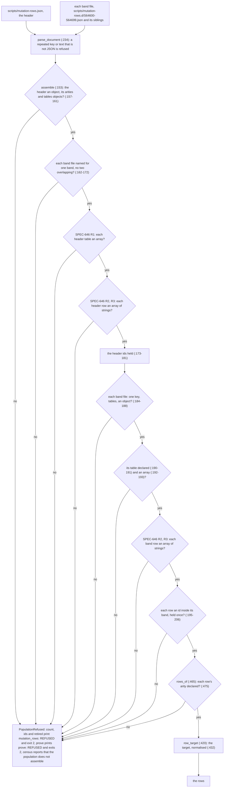

# Schematic: the population reader's shape checks, from the files to the rows (SPEC-646, ADR-669)

Every `path:line` below is `scripts/mutation_rows.py`'s at the base, `bd953ba7`, unless it names
another file, and the cure's names are SPEC-646's.
Kinds: a data flow (section 1) and a decision table (section 2).
The schematic that owns the runner's whole job, `docs/schematics/mutation-testing.md`, is left as
it stands.

## 1. The data flow, with the checks marked

The header and every band file are parsed by one function and joined by one, `assemble`; the three
nodes labelled SPEC-646 are the cure's. Every refusal is one `PopulationRefused`, which each verb
reports as it reports every other refusal of the population.

At the base the three SPEC-646 nodes do not exist: a header table goes from `BNAME` straight to
`HELD` through `list(rows)` (`:174`), and a band row from `BTAB` straight to `BIDS`, so a table or
a row of the wrong shape reaches `HELD`, `BIDS`, `ROWSOF` or `TARGET`, and ends there in a
traceback, a refusal that names no file, or a row read as if it were well formed.

## 2. Each shape's path

Each shape is planted after one well-formed row, in a fixture whose header declares
`SCRIPT_MUTATIONS` with the arity `[6]`.

| planted shape | where | at the base | with SPEC-646 | decided by |
|---|---|---|---|---|
| a header table `1` or `null` | the header | `list(rows)` at `:174` raises `TypeError`: a traceback, exit 1 | R1's sentence, exit 2 | A1 |
| a header table `{}` | the header | read as an empty table: exit 0 | R1's sentence, exit 2 | A1 |
| a header table `"rows"` | the header | its characters read as rows: `None: 1 cells, where SCRIPT_MUTATIONS declares [6]`, exit 2, naming no file | R1's sentence, exit 2 | A1 |
| a row `1` after a good row | the header | `len(row)` at `:475` raises `TypeError`: a traceback, exit 1 | R2's sentence for `[1]` | A2 |
| a row `"S00081-ROW"` or `{}` after a good row | the header | `None: 10 cells, ...` or `None: 0 cells, ...`, exit 2, naming no file | R2's sentence for `[1]` | A2 |
| a row `1`, a string or `{}` after a good row | a band file | `<file>: a SCRIPT_MUTATIONS row has no id`, exit 2, naming no shape | R2's sentence for `[1]` | A2 |
| a row whose id is `7` | the header; a band file | read as a row with a number id, exit 0; `... row has no id`, exit 2 | R3's sentence for `[1]` | A3 |
| a row whose target is `null` | either | `posixpath.normpath(None)` at `:432` raises `TypeError`: a traceback, exit 1 | R3's sentence for `[1]` | A3 |
| a row whose find is `5` | either | read as a row, exit 0 (a later census or proof reads a number as text) | R3's sentence for `[1]` | A3 |
| a band file's table `{}` | a band file | `<file>: SCRIPT_MUTATIONS is not an array of rows`, exit 2 | unchanged | A4 |
| an empty row `[]` after a good row | a band file | `<file>: a SCRIPT_MUTATIONS row has no id`, exit 2 | unchanged | A4 |

## 3. Where each step lives

| step | function | line at the base |
|---|---|---|
| parse one document | `parse_document` | `:234-244` |
| read the tree's header and band files | `load_tree`, `tree_fragments` | `:264-267`, `:251-261` |
| read a revision's header and band files | `load_revision` | `:375-387` |
| join them into one population | `assemble` | `:153-209` |
| the header an object, its arities and tables objects | `assemble` | `:157-161` |
| band names, and no two bands overlapping | `assemble` | `:162-172` |
| SPEC-646's header table check (R1) and header row check (R2, R3) | `assemble`, `_refuse_misshapen_rows` | inserted after `:172`; the helper after `:150` |
| the header's ids held | `assemble` | `:173-181` |
| a band file's one key, its `tables` object, its table declared and an array | `assemble` | `:184-193` |
| SPEC-646's band row check (R2, R3) | `_refuse_misshapen_rows` | inserted after `:193` |
| ids, bands and holds | `assemble` | `:194-206` |
| each row's arity | `rows_of` | `:465`, `:475-478` |
| each row's target | `row_target` | `:420-432` |
| the verbs' refusal lines | `dispatch`, `census`, `prove` | `:1551-1556`, `:1590-1594`, `:925-931`, `:1222-1226` |
| the tests | `scripts/tests/test_mutation_rows.py`, `ThePopulationReaderRefusesAMisshapenTableOrRow`; `scripts/tests/test_band_repeated_key.py` (A5) | inserted after `scripts/tests/test_mutation_rows.py:433` |
