# Schematic: generated mutants for the repository's Python, on a pull request and weekly

Kind: data flow (the pull request's mutation jobs with the Python job added, and the weekly
battery's Python shards) and a state machine (one file's run inside a shard). Read at DeckStreak
`dev` 26263de (`.github/workflows/ci.yml`, `.github/workflows/mutation-weekly.yml`,
`scripts/mutation-verdict.py`, `scripts/mutation_rows.py`). Decided by ADR-073; built by SPEC-087.

This ADDS to `docs/schematics/mutation-testing.md` and redraws none of it: the Rust shards, the
rows, the web job and the verdict's Rust class are drawn there, and the equivalence record's path
from a fragment to a verdict in `docs/schematics/mutation-equivalence-record.md`. Here each of
those appears as one node, and only the Python run is drawn whole.

## 1. A pull request's diff: where the Python job sits

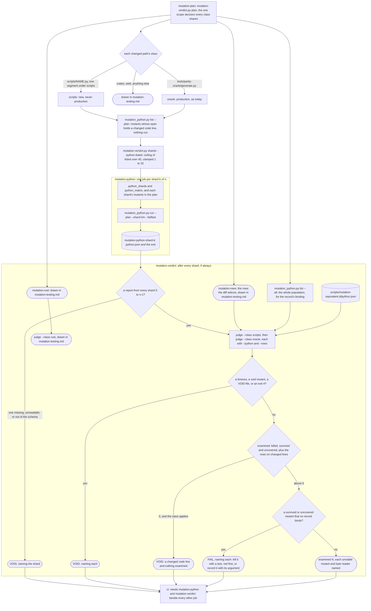

A class whose changed lines are all blank or comments reads `not-applicable` before any of this,
as SPEC-039 R4 reads every class; the `mutation-python` job still runs one shard, prints its case
and writes a report, because `ci` reads a skipped need as failed.

## 2. One file's run inside a shard

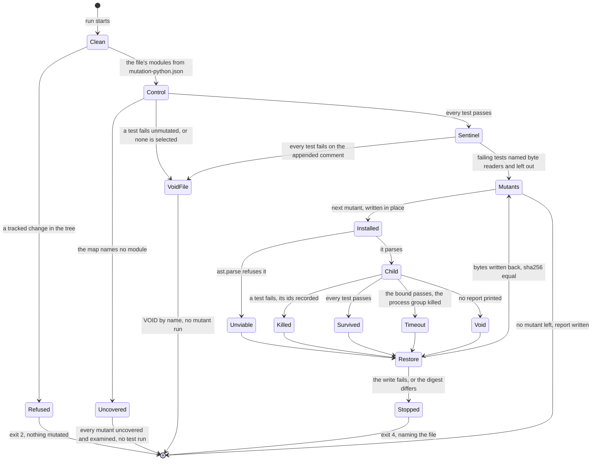

The sentinel's run restores the file the same way before the first mutant. Every child runs with
`PYTHONDONTWRITEBYTECODE=1` and `PYTHONPYCACHEPREFIX` in a temporary directory, and loads each test
module as `unittest discover` does, so an import that fails is a failed test named for its module.
The child runs from a copy of the runner and of the `scripts/` modules it imports, taken outside the
tree before the first mutant, so no mutant of the runner runs as its own child, and drops the
copy's modules from `sys.modules` before it loads a test module, so a test that imports
`mutation_rows` by name reads the tree's file, the mutant installed.

## 3. The weekly battery: the Python shards added

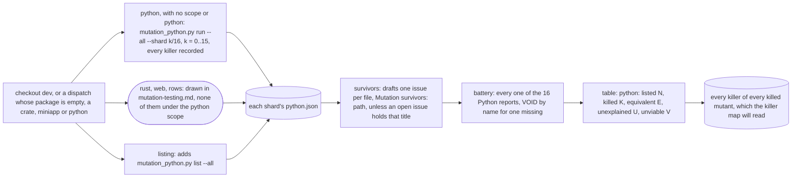

## 4. What crosses each step

| from | to | what | shape |
|---|---|---|---|
| `mutation-plan` | `mutation-python` | the plan, the matrix, each shard's mutants | `plan.json`, `python_shards`, `python_matrix` |
| `mutation-plan` | `mutation-verdict` | the whole population's listing | the `list --all` output |
| `mutation-python` | `mutation-verdict` | one report per shard | `python.json`, schema `deckstreak.mutation-python.v1` |
| `mutation-rows` | `mutation-verdict` | the rows' outcomes, counted into each class's examined | `rows.json` |
| the tree | `mutation-verdict` | the Python records | `scripts/mutation-equivalent.d/python.json` |
| the weekly `python` job | `survivors`, `battery`, `table` | sixteen reports with every killer | `python.json` each |

## 5. Amendment (SPEC-415): a release's Python plan, before and after the refusal

Insert-only; every earlier byte of this schematic is kept. Kind: data flow (the plan, the Python
legs and the verdict) with one decision node, where the plan sizes or refuses. Read at DeckStreak
`dev` c74b6b9 (`scripts/mutation-verdict.py:120-121`, `:987-995`, `:1017-1023`, `:1072-1075` and
`:1603-1611`; `.github/workflows/ci.yml:376-446`, `:531-571`, `:646-702` and `:875-905`). Decided
by ADR-429; built by SPEC-415.

Section 1's node `pyshards` still reads "ceiling of listed over 40, clamped 1 to 32". SPEC-362 R14
made the rule 20 listed mutants a leg, and SPEC-415 makes the clamp a refusal: the node is kept as
it was drawn, and this section is the plan as it now runs.

### 5.1 Before: the cap

The cap cuts at `python_shards`' `min`: 272 legs of work go into 32 jobs. The bound cuts at the
job's `timeout-minutes: 60`, and because the runner writes its report only when its run ends, a cut
leg leaves nothing for the verdict to read: no outcome, no examined count and no cost.

### 5.2 After: the refusal

### 5.3 What crosses each step, before and after

| step | before | after |
|---|---|---|
| the listing | 5423 listed, the runner's own listing | unchanged: nothing sampled, filtered or dropped |
| the legs | 272 needed, 32 run | 272 needed, refused whole at the plan |
| a leg's mutants | 169 or 170 | at most 20, or none run |
| a leg's bound | `timeout-minutes: 60` | unchanged |
| a mutant's bound | the larger of 60 seconds and five times its file's control run | unchanged |
| `--failfast` | on, for each mutant's run | unchanged |
| the plan's exit | 0, with no refusal | 1, with the refusal by name |
| the verdict | VOID, each of 32 legs named | VOID, the plan names no python shards |
| what stays examined | every listed mutant promised, none reported | in a sized plan, every listed mutant in exactly one leg, the examined sum equal to the listing |

### 5.4 How the Python and Rust legs share the run

The run holds 256 jobs. The Python legs keep a fixed share of at most 32, the Rust legs at most
209 (`LEG_CEILING["ci"]`, derived with the Python legs counted at 32), and 15 other jobs hold the
rest. Each plan refuses whole above its own share, by name, and neither borrows the other's.

## 6. The Python legs dealt by each file's cost (SPEC-418, ADR-432)

Added after section 5; every earlier byte is kept. Kind: data flow. Read at DeckStreak `dev`
c74b6b9, whose line numbers these are, with SPEC-415's change on top (`scripts/mutation-verdict.py`
`python_shards` at 987-995 and `shards` at 1008-1093, `scripts/mutation_python.py` `select` at
768-796 and its report at 901-902, `.github/workflows/ci.yml` `mutation-python` at 531-570).
Decided by ADR-432; built by SPEC-418.

Before: the legs are sized by a count, and a leg runs its own `k::n`. Nothing is written until a
run ends, so a leg cut at its 60 minutes leaves no cost behind.

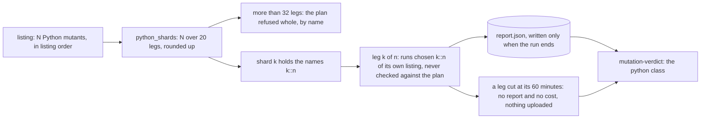

After: a priced file's mutants are dealt by what they cost, within half the job, and every leg
records each cost as it is paid, so a cut leg still measures the next plan.

```mermaid
flowchart LR
  listing["listing: N Python mutants, in listing order"] --> bycost["python_by_cost"]
  table[("PYTHON_CONTROL_SECONDS: a price per file, shipped empty")] --> bycost
  bycost -->|no listed file priced| count["the count rule of section 5, byte for byte"]
  bycost -->|a priced file| runs["each priced file cut into runs of at most k, k = floor of 1800 over its price, less 2"]
  runs --> dealt["runs dealt heaviest first onto the lightest leg, in the fewest legs whose slowest is within 1800 s"]
  dealt --> unpriced["unpriced mutants: 20 a leg, round robin, after the priced legs"]
  unpriced --> refused["more than 32 legs, or one mutant's leg past 1800 s: refused whole by name, exit 1, the plan unwritten"]
  unpriced --> plan[("plan.json python: count, shards, projected_seconds")]
  count --> plan
  plan --> leg["leg k of n: planned_leg holds the plan's count and partition to its own listing"]
  leg -->|a name missing or extra| usage["refused before any mutant: exit 2, no report"]
  leg -->|the partition holds| ran["runs exactly the names shard k lists"]
  ran --> costs[("costs.jsonl beside report.json: a control line, then one line per mutant, each flushed")]
  ran --> report[("report.json, when the run ends")]
  costs --> prices["mutation-verdict.py prices --costs DIR: each file's price, with its run, attempt and shard"]
  prices -.->|a later delivery commits the table| table
  report --> verdict["mutation-verdict: the python class, every planned leg counted"]
  usage --> verdict
```

A priced file's leg projects (2 + m) x price for its m mutants there: its control, its sentinel
and each mutant at the control's cost. The bound is 1800 seconds, half the `mutation-python` job's
60 minutes. The run's 225 legs (256 jobs less the 31 others) stay in fixed shares, 32 Python and
193 Rust, so the plan's joint line reads its legs and projected runner-minutes against
32 x 30 + 193 x 180 = 35700, and the leg ceiling is unchanged.

| from | to | what | shape |
|---|---|---|---|
| `mutation-plan` | `mutation-python` | each leg's names and its projection | `plan.json` `python`: `count`, `shards[].mutants`, `shards[].projected_seconds` |
| `mutation-python` | its uploaded artifact | each file's control seconds and each mutant's seconds, as paid | `costs.jsonl`, one JSON line each: `control`, `uncovered`, `mutant` |
| a run's downloaded artifacts | `mutation-verdict.py prices` | every leg's `costs.jsonl` | one table line per file, with its run, attempt and shard |
| `prices`' output | `PYTHON_CONTROL_SECONDS` | a file's price, committed by a later delivery | a whole number of seconds per path |

## 7. The share, the measured prices and the scoped test set (SPEC-420, ADR-434)

Every `path:line` in this section was read at dev `e64a778e`. Section 6 stays as written. This
section shows what changes around it: the share, one value with a cap; the price table, filled by
the `prices` verb from one recorded run; and each mutant, run against the tests its line's trace
names.

### 7.1 Before: a Python leg at dev `e64a778e`

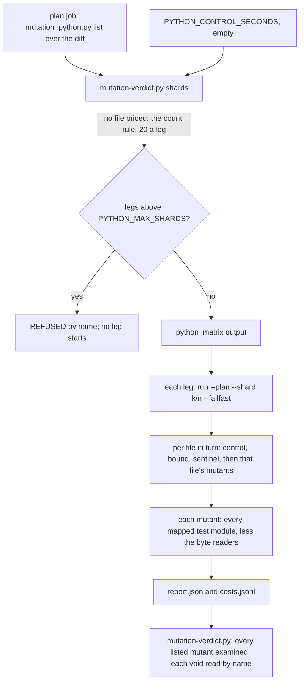

The share is `PYTHON_MAX_SHARDS`, on line 122, beside the count rule's 20, and nothing caps it. No
leg runs a control mutant.

### 7.2 After: a Python leg under SPEC-420

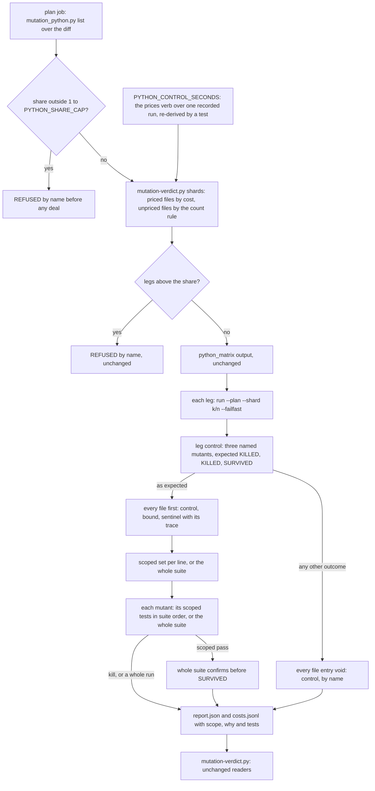

In `run --all`, the scheduled battery's mode, the leg control runs and every file is prepared
first, but no trace is taken and every mutant runs the whole suite.

### 7.3 One mutant's tests

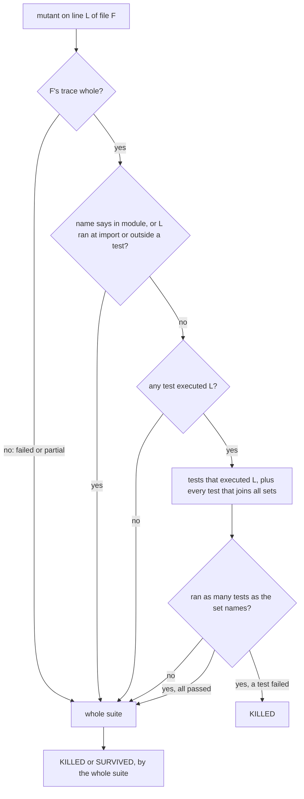

A test joins every scoped set of F when a process it started left no record, when its process image
was replaced by `os.exec`, or when it left a thread running past its end. Byte readers, the tests the
sentinel turns red, stay out of the scoped and the whole runs alike.

### 7.4 The trace records

The trace is taken in the sentinel run: the unmutated lines, with one comment appended. It is taken
inside the leg, on every run.
- **The runner's process** records each test's lines of F through `sys.monitoring` `LINE` events,
  restarted at each test's start. It counts each test's spawns from the process-creation audit
  events.
- **Each child process** gets the same tracer and audit hook from a scratch `sitecustomize`, and
  writes one record when it exits: its pid, its parent's pid, its test, its lines of F, and how
  many processes it started.
- **The judge** reads the directory once, after the runner exits. For each process, it counts the
  records that name it as their parent. A process with fewer records naming it than processes it
  started makes its test join every set.

`formal/tla/TracedSetCovers` checks that a dropped test never executed L, in every order of spawn,
exit, write and read.

### 7.5 What crosses each step

| step | before (dev `e64a778e`) | after (SPEC-420) |
|---|---|---|
| listing | `mutation_python.py list` over the diff | unchanged |
| trace | none | the sentinel run's, per file, per leg, in `run --plan` only |
| scoped set | every mapped module, less the byte readers | the tests that executed the line, or the whole suite on each fallback |
| price | `PYTHON_CONTROL_SECONDS`, empty | the `prices` verb's seven lines over one recorded run's 1017 records, re-derived by a test |
| deal | SPEC-418's cost deal; the count rule for unpriced files | unchanged |
| share | `PYTHON_MAX_SHARDS` on line 122, uncapped | `PYTHON_MAX_SHARDS` alone on its line; `PYTHON_SHARE_CAP = 128` |
| refusal | by name above the share | by name outside 1 to the cap, before any deal; by name above the share, unchanged |
| control | none | three named mutants first in every leg, read through each file entry's `void` |
| verdict | every listed mutant examined; each `void` read by name | unchanged readers; a mutant record names `scope`, `why` and `tests` |

## 8. Scoped prices from a dispatched run (SPEC-421, ADR-435)

Every `path:line` in this section was read at dev `c726af67`. Sections 6 and 7 stay as written.
This section shows what changes around them: a dispatched price run measures each population file
scoped, a verb turns its records into a second table of triples, and the plan reads that table
when its legs run scoped.

### 8.1 Before: a Python leg's price at dev `c726af67`

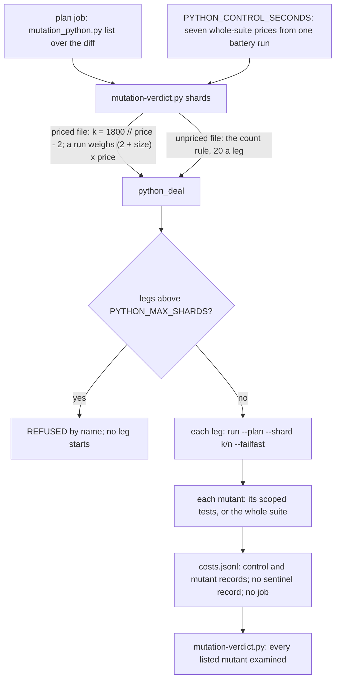

The leg runs each mutant scoped, but the plan charged it the whole-suite control:
`scripts/mutation-verdict.py` at 224 s a mutant, six a leg (`scripts/mutation-verdict.py:135-143`,
:1071-1135). Nine listed files had no price, and no run measured a scoped one.

### 8.2 After: the price run and the fill

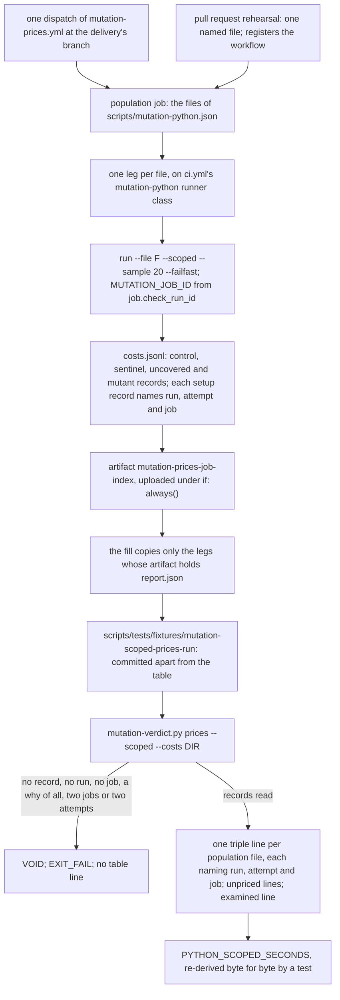

The workflow files nothing and judges nothing. A leg cut at its 120-minute limit leaves no
`report.json`, so its file reads `unpriced` by name and keeps its fallback.

### 8.3 After: the plan's choice of price

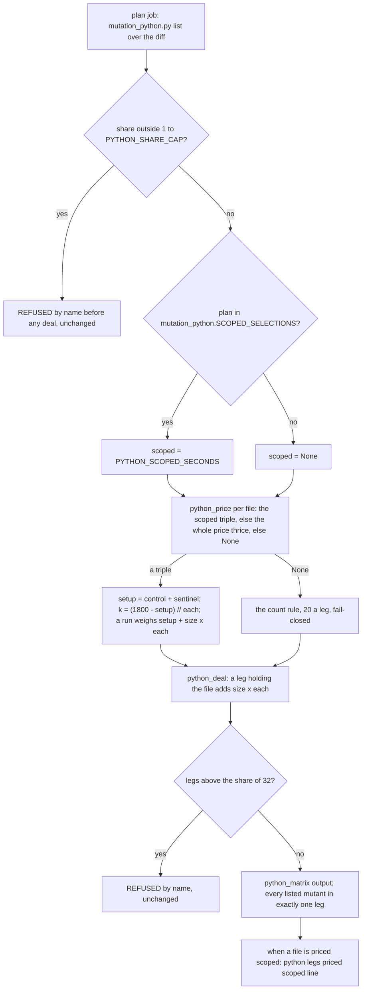

`prepare` traces on the same value the plan reads, `selection(args) in SCOPED_SELECTIONS`, or on
`--scoped`, so the plan prices a leg scoped exactly when the leg runs scoped. For a whole price the
triple is (p, p, p), so every deal and every printed line is byte-identical to section 6's.

### 8.4 What crosses each step

| step | before (dev `c726af67`) | after (SPEC-421) |
|---|---|---|
| listing | `mutation_python.py list` over the diff | unchanged |
| scoped set | the tests that executed the line, in `run --plan` only | unchanged in `run --plan`; also in a `--file --scoped` price run |
| kept costs | control, uncovered and mutant records naming run and attempt | the setup records also name their job; a traced sentinel writes one sentinel record; a whole run writes none |
| price record | `PYTHON_CONTROL_SECONDS`, seven whole-suite prices | unchanged, as the fallback; `PYTHON_SCOPED_SECONDS`, triples from one dispatched run's committed records, re-derived by a test |
| scoped or whole | always whole | the scoped triple when `plan` is in `SCOPED_SELECTIONS` and the file has one; else the whole price thrice; else the count rule |
| deal | a run weighs (2 + size) x price | a run weighs setup + size x each; byte-identical for a whole price |
| share | `PYTHON_MAX_SHARDS` 32 under `PYTHON_SHARE_CAP` 128 | unchanged |
| refusal | by name above the share; by name at k < 1 | unchanged in text; k read as (1800 - setup) // each |
| verdict | every listed mutant examined; each `void` read by name | unchanged; no mutant leaves the plan, and every shard is counted |
