# Schematic: generated mutants for the repository's Python, on a pull request and weekly

Kind: data flow (the pull request's mutation jobs with the Python job added, and the weekly
battery's Python shards) and a state machine (one file's run inside a shard). Read at DeckStreak
`dev` 26263de (`.github/workflows/ci.yml`, `.github/workflows/mutation-weekly.yml`,
`scripts/mutation-verdict.py`, `scripts/mutation_rows.py`). Decided by ADR-073; built by SPEC-087.

This ADDS to `docs/schematics/mutation-testing.md` and redraws none of it: the Rust shards, the
rows, the web job and the verdict's Rust class are drawn there, and the equivalence record's path
from a fragment to a verdict in `docs/schematics/mutation-equivalence-record.md`. Here each of
those appears as one node, and only the Python run is drawn whole.

## 1. A pull request's diff: where the Python job sits


A class whose changed lines are all blank or comments reads `not-applicable` before any of this,
as SPEC-039 R4 reads every class; the `mutation-python` job still runs one shard, prints its case
and writes a report, because `ci` reads a skipped need as failed.

## 2. One file's run inside a shard

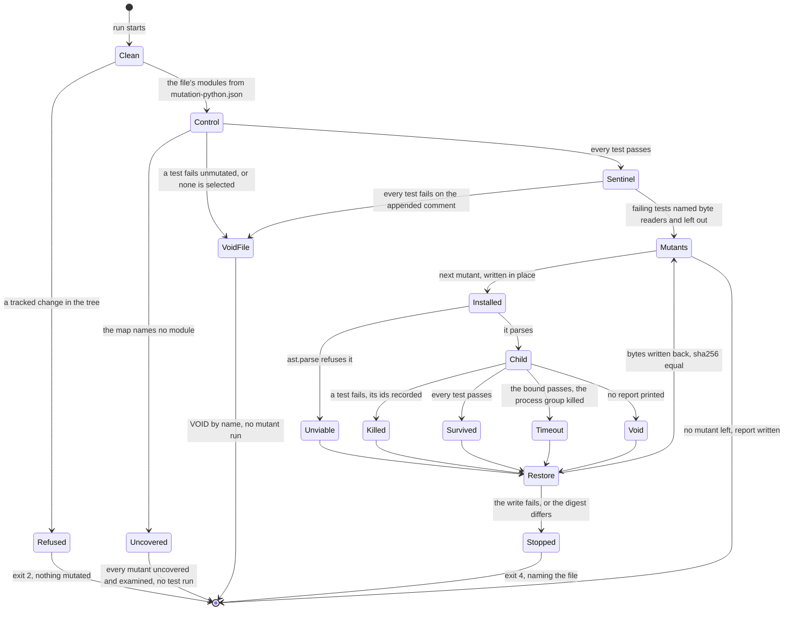

The sentinel's run restores the file the same way before the first mutant. Every child runs with
`PYTHONDONTWRITEBYTECODE=1` and `PYTHONPYCACHEPREFIX` in a temporary directory, and loads each test
module as `unittest discover` does, so an import that fails is a failed test named for its module.
The child runs from a copy of the runner and of the `scripts/` modules it imports, taken outside the
tree before the first mutant, so no mutant of the runner runs as its own child, and drops the
copy's modules from `sys.modules` before it loads a test module, so a test that imports
`mutation_rows` by name reads the tree's file, the mutant installed.

## 3. The weekly battery: the Python shards added


## 4. What crosses each step

| from | to | what | shape |
|---|---|---|---|
| `mutation-plan` | `mutation-python` | the plan, the matrix, each shard's mutants | `plan.json`, `python_shards`, `python_matrix` |
| `mutation-plan` | `mutation-verdict` | the whole population's listing | the `list --all` output |
| `mutation-python` | `mutation-verdict` | one report per shard | `python.json`, schema `deckstreak.mutation-python.v1` |
| `mutation-rows` | `mutation-verdict` | the rows' outcomes, counted into each class's examined | `rows.json` |
| the tree | `mutation-verdict` | the Python records | `scripts/mutation-equivalent.d/python.json` |
| the weekly `python` job | `survivors`, `battery`, `table` | sixteen reports with every killer | `python.json` each |

## 5. Amendment (SPEC-415): a release's Python plan, before and after the refusal

Insert-only; every earlier byte of this schematic is kept. Kind: data flow (the plan, the Python
legs and the verdict) with one decision node, where the plan sizes or refuses. Read at DeckStreak
`dev` c74b6b9 (`scripts/mutation-verdict.py:120-121`, `:987-995`, `:1017-1023`, `:1072-1075` and
`:1603-1611`; `.github/workflows/ci.yml:376-446`, `:531-571`, `:646-702` and `:875-905`). Decided
by ADR-429; built by SPEC-415.

Section 1's node `pyshards` still reads "ceiling of listed over 40, clamped 1 to 32". SPEC-362 R14
made the rule 20 listed mutants a leg, and SPEC-415 makes the clamp a refusal: the node is kept as
it was drawn, and this section is the plan as it now runs.

### 5.1 Before: the cap

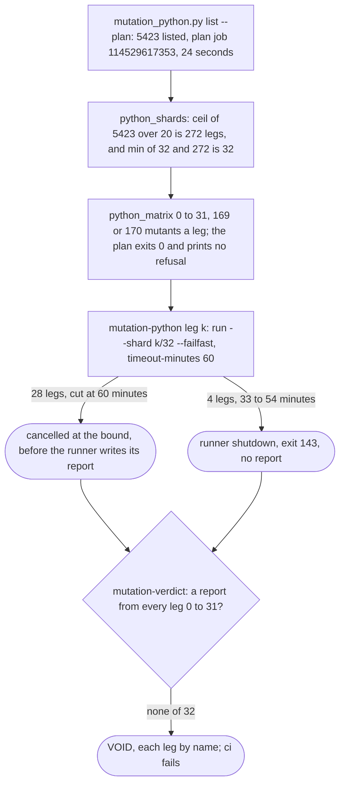

The cap cuts at `python_shards`' `min`: 272 legs of work go into 32 jobs. The bound cuts at the
job's `timeout-minutes: 60`, and because the runner writes its report only when its run ends, a cut
leg leaves nothing for the verdict to read: no outcome, no examined count and no cost.

### 5.2 After: the refusal

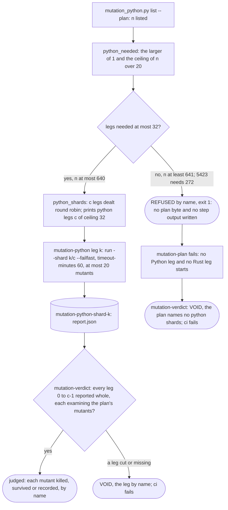

### 5.3 What crosses each step, before and after

| step | before | after |
|---|---|---|
| the listing | 5423 listed, the runner's own listing | unchanged: nothing sampled, filtered or dropped |
| the legs | 272 needed, 32 run | 272 needed, refused whole at the plan |
| a leg's mutants | 169 or 170 | at most 20, or none run |
| a leg's bound | `timeout-minutes: 60` | unchanged |
| a mutant's bound | the larger of 60 seconds and five times its file's control run | unchanged |
| `--failfast` | on, for each mutant's run | unchanged |
| the plan's exit | 0, with no refusal | 1, with the refusal by name |
| the verdict | VOID, each of 32 legs named | VOID, the plan names no python shards |
| what stays examined | every listed mutant promised, none reported | in a sized plan, every listed mutant in exactly one leg, the examined sum equal to the listing |

### 5.4 How the Python and Rust legs share the run

The run holds 256 jobs. The Python legs keep a fixed share of at most 32, the Rust legs at most
209 (`LEG_CEILING["ci"]`, derived with the Python legs counted at 32), and 15 other jobs hold the
rest. Each plan refuses whole above its own share, by name, and neither borrows the other's.

## 6. The Python legs dealt by each file's cost (SPEC-418, ADR-432)

Added after section 5; every earlier byte is kept. Kind: data flow. Read at DeckStreak `dev`
c74b6b9, whose line numbers these are, with SPEC-415's change on top (`scripts/mutation-verdict.py`
`python_shards` at 987-995 and `shards` at 1008-1093, `scripts/mutation_python.py` `select` at
768-796 and its report at 901-902, `.github/workflows/ci.yml` `mutation-python` at 531-570).
Decided by ADR-432; built by SPEC-418.

Before: the legs are sized by a count, and a leg runs its own `k::n`. Nothing is written until a
run ends, so a leg cut at its 60 minutes leaves no cost behind.

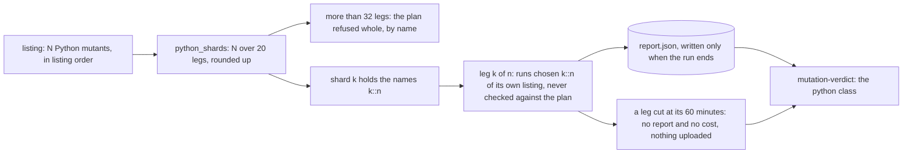

After: a priced file's mutants are dealt by what they cost, within half the job, and every leg
records each cost as it is paid, so a cut leg still measures the next plan.

```mermaid
flowchart LR
  listing["listing: N Python mutants, in listing order"] --> bycost["python_by_cost"]
  table[("PYTHON_CONTROL_SECONDS: a price per file, shipped empty")] --> bycost
  bycost -->|no listed file priced| count["the count rule of section 5, byte for byte"]
  bycost -->|a priced file| runs["each priced file cut into runs of at most k, k = floor of 1800 over its price, less 2"]
  runs --> dealt["runs dealt heaviest first onto the lightest leg, in the fewest legs whose slowest is within 1800 s"]
  dealt --> unpriced["unpriced mutants: 20 a leg, round robin, after the priced legs"]
  unpriced --> refused["more than 32 legs, or one mutant's leg past 1800 s: refused whole by name, exit 1, the plan unwritten"]
  unpriced --> plan[("plan.json python: count, shards, projected_seconds")]
  count --> plan
  plan --> leg["leg k of n: planned_leg holds the plan's count and partition to its own listing"]
  leg -->|a name missing or extra| usage["refused before any mutant: exit 2, no report"]
  leg -->|the partition holds| ran["runs exactly the names shard k lists"]
  ran --> costs[("costs.jsonl beside report.json: a control line, then one line per mutant, each flushed")]
  ran --> report[("report.json, when the run ends")]
  costs --> prices["mutation-verdict.py prices --costs DIR: each file's price, with its run, attempt and shard"]
  prices -.->|a later delivery commits the table| table
  report --> verdict["mutation-verdict: the python class, every planned leg counted"]
  usage --> verdict
```

A priced file's leg projects (2 + m) x price for its m mutants there: its control, its sentinel
and each mutant at the control's cost. The bound is 1800 seconds, half the `mutation-python` job's
60 minutes. The run's 225 legs (256 jobs less the 31 others) stay in fixed shares, 32 Python and
193 Rust, so the plan's joint line reads its legs and projected runner-minutes against
32 x 30 + 193 x 180 = 35700, and the leg ceiling is unchanged.

| from | to | what | shape |
|---|---|---|---|
| `mutation-plan` | `mutation-python` | each leg's names and its projection | `plan.json` `python`: `count`, `shards[].mutants`, `shards[].projected_seconds` |
| `mutation-python` | its uploaded artifact | each file's control seconds and each mutant's seconds, as paid | `costs.jsonl`, one JSON line each: `control`, `uncovered`, `mutant` |
| a run's downloaded artifacts | `mutation-verdict.py prices` | every leg's `costs.jsonl` | one table line per file, with its run, attempt and shard |
| `prices`' output | `PYTHON_CONTROL_SECONDS` | a file's price, committed by a later delivery | a whole number of seconds per path |

## 7. The share, the measured prices and the scoped test set (SPEC-420, ADR-434)

Every `path:line` in this section was read at dev `e64a778e`. Section 6 stays as written. This
section shows what changes around it: the share, one value with a cap; the price table, filled by
the `prices` verb from one recorded run; and each mutant, run against the tests its line's trace
names.

### 7.1 Before: a Python leg at dev `e64a778e`

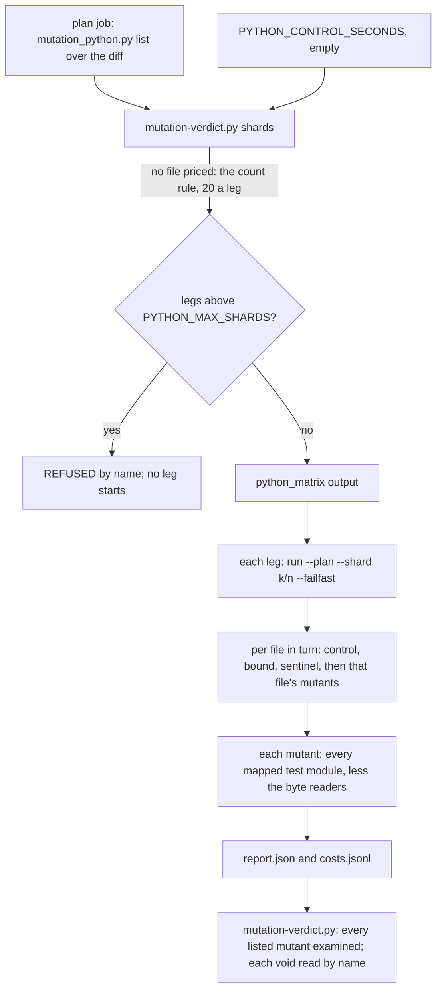

The share is `PYTHON_MAX_SHARDS`, on line 122, beside the count rule's 20, and nothing caps it. No
leg runs a control mutant.

### 7.2 After: a Python leg under SPEC-420

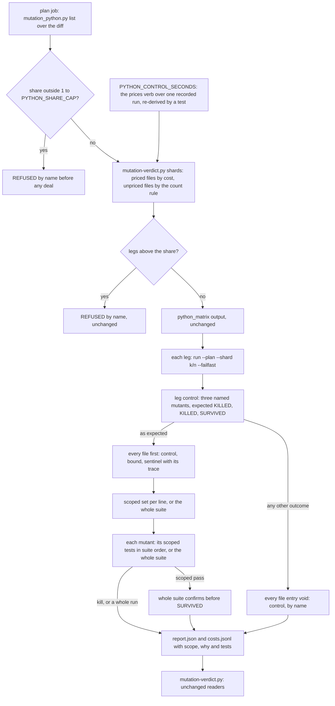

In `run --all`, the scheduled battery's mode, the leg control runs and every file is prepared
first, but no trace is taken and every mutant runs the whole suite.

### 7.3 One mutant's tests

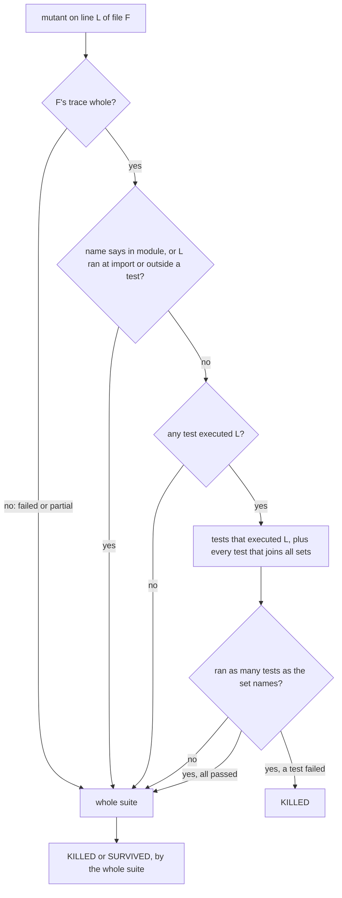

A test joins every scoped set of F when a process it started left no record, when its process image
was replaced by `os.exec`, or when it left a thread running past its end. Byte readers, the tests the
sentinel turns red, stay out of the scoped and the whole runs alike.

### 7.4 The trace records

The trace is taken in the sentinel run: the unmutated lines, with one comment appended. It is taken
inside the leg, on every run.
- **The runner's process** records each test's lines of F through `sys.monitoring` `LINE` events,
  restarted at each test's start. It counts each test's spawns from the process-creation audit
  events.
- **Each child process** gets the same tracer and audit hook from a scratch `sitecustomize`, and
  writes one record when it exits: its pid, its parent's pid, its test, its lines of F, and how
  many processes it started.
- **The judge** reads the directory once, after the runner exits. For each process, it counts the
  records that name it as their parent. A process with fewer records naming it than processes it
  started makes its test join every set.

`formal/tla/TracedSetCovers` checks that a dropped test never executed L, in every order of spawn,
exit, write and read.

### 7.5 What crosses each step

| step | before (dev `e64a778e`) | after (SPEC-420) |
|---|---|---|
| listing | `mutation_python.py list` over the diff | unchanged |
| trace | none | the sentinel run's, per file, per leg, in `run --plan` only |
| scoped set | every mapped module, less the byte readers | the tests that executed the line, or the whole suite on each fallback |
| price | `PYTHON_CONTROL_SECONDS`, empty | the `prices` verb's seven lines over one recorded run's 1017 records, re-derived by a test |
| deal | SPEC-418's cost deal; the count rule for unpriced files | unchanged |
| share | `PYTHON_MAX_SHARDS` on line 122, uncapped | `PYTHON_MAX_SHARDS` alone on its line; `PYTHON_SHARE_CAP = 128` |
| refusal | by name above the share | by name outside 1 to the cap, before any deal; by name above the share, unchanged |
| control | none | three named mutants first in every leg, read through each file entry's `void` |
| verdict | every listed mutant examined; each `void` read by name | unchanged readers; a mutant record names `scope`, `why` and `tests` |

## 8. Scoped prices from a dispatched run (SPEC-421, ADR-435)

Every `path:line` in this section was read at dev `c726af67`. Sections 6 and 7 stay as written.
This section shows what changes around them: a dispatched price run measures each population file
scoped, a verb turns its records into a second table of triples, and the plan reads that table
when its legs run scoped.

### 8.1 Before: a Python leg's price at dev `c726af67`

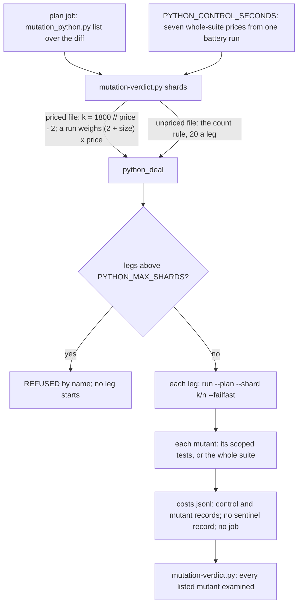

The leg runs each mutant scoped, but the plan charged it the whole-suite control:
`scripts/mutation-verdict.py` at 224 s a mutant, six a leg (`scripts/mutation-verdict.py:135-143`,
:1071-1135). Nine listed files had no price, and no run measured a scoped one.

### 8.2 After: the price run and the fill

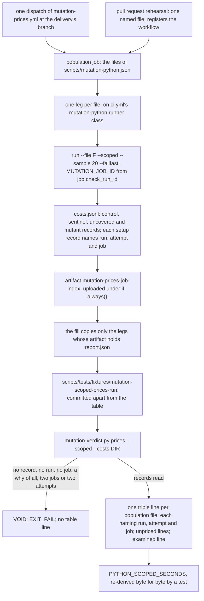

The workflow files nothing and judges nothing. A leg cut at its 120-minute limit leaves no
`report.json`, so its file reads `unpriced` by name and keeps its fallback.

### 8.3 After: the plan's choice of price

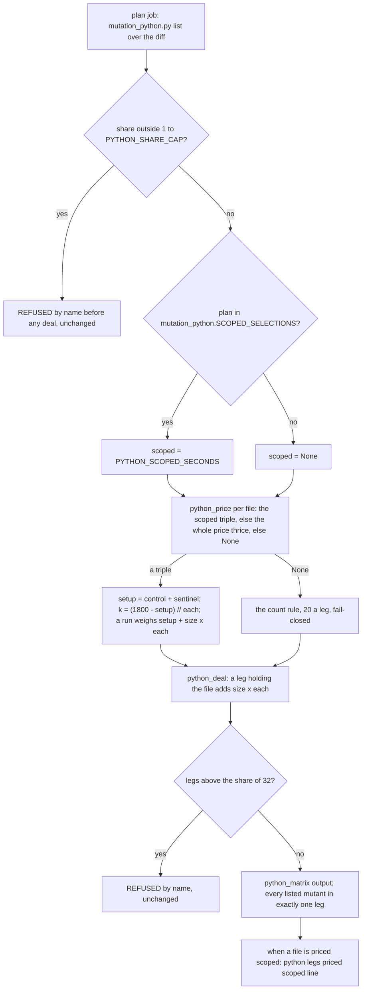

`prepare` traces on the same value the plan reads, `selection(args) in SCOPED_SELECTIONS`, or on
`--scoped`, so the plan prices a leg scoped exactly when the leg runs scoped. For a whole price the
triple is (p, p, p), so every deal and every printed line is byte-identical to section 6's.

### 8.4 What crosses each step

| step | before (dev `c726af67`) | after (SPEC-421) |
|---|---|---|
| listing | `mutation_python.py list` over the diff | unchanged |
| scoped set | the tests that executed the line, in `run --plan` only | unchanged in `run --plan`; also in a `--file --scoped` price run |
| kept costs | control, uncovered and mutant records naming run and attempt | the setup records also name their job; a traced sentinel writes one sentinel record; a whole run writes none |
| price record | `PYTHON_CONTROL_SECONDS`, seven whole-suite prices | unchanged, as the fallback; `PYTHON_SCOPED_SECONDS`, triples from one dispatched run's committed records, re-derived by a test |
| scoped or whole | always whole | the scoped triple when `plan` is in `SCOPED_SELECTIONS` and the file has one; else the whole price thrice; else the count rule |
| deal | a run weighs (2 + size) x price | a run weighs setup + size x each; byte-identical for a whole price |
| share | `PYTHON_MAX_SHARDS` 32 under `PYTHON_SHARE_CAP` 128 | unchanged |
| refusal | by name above the share; by name at k < 1 | unchanged in text; k read as (1800 - setup) // each |
| verdict | every listed mutant examined; each `void` read by name | unchanged; no mutant leaves the plan, and every shard is counted |

## 9. The release run's Python legs past the share (SPEC-422, ADR-436)

Every `path:line` in this section was read at dev `26ecc2ad`. Sections 6 to 8 stay as written.
This section shows what changes for one run alone, the release pull request's: the plan names it
by a predicate, deals its Python legs up to one ceiling constant in place of the share, and splits
them over two matrix jobs of at most 256 legs each, and the verdict counts every leg of both. At the
constant's placeholder value, the release run is the pull request run.

### 9.1 Before: the release run's Python plan at dev `26ecc2ad`

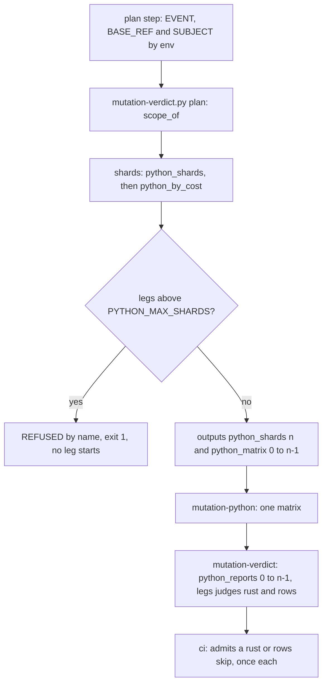

The plan step passes the event, the base ref and the subject (`.github/workflows/ci.yml:399-403`),
and `scope_of` reads the event and the base alone (`scripts/mutation-verdict.py:195`). Every run,
the release's included, holds its Python legs to the share of 32 (`:125`): past it the cost deal
refuses (`:1161`) or the count rule does (`:1220-1227`), and the run reads VOID. One matrix job
reads the plan's axis (`.github/workflows/ci.yml:543-582`); the verdict counts the shards 0 to
n - 1 (`scripts/mutation-verdict.py:1839`), `legs` judges two legs (`:2196-2203`), and `ci` admits
two skips (`.github/workflows/ci.yml:982`).

### 9.2 After: the plan names the release run and holds it to its ceiling

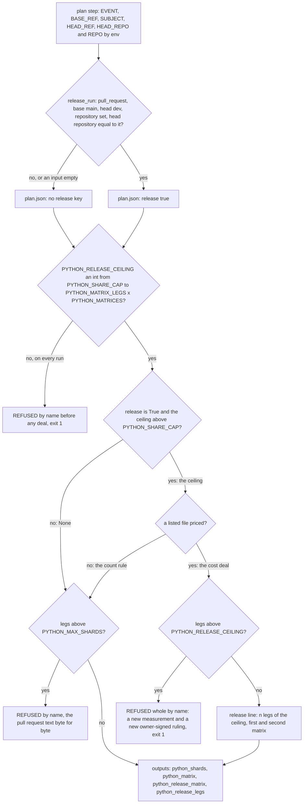

The predicate is `base-is-dev`'s own condition (`.github/workflows/ci.yml:944-962`), read in the
plan and failing closed: any input that is empty or unread is not the release run. The ceiling is
one constant after `PYTHON_SHARE_CAP` (`scripts/mutation-verdict.py:127`), and its `#:` line cites
the owner-signed ruling file by path once a measurement sets it. The share's check and both of its
refusal texts are reached unchanged whenever the helper returns None.

### 9.3 After: two matrices and one verdict

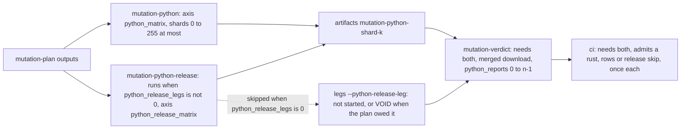

For n legs the first matrix holds the shards 0 to min(n, 256) - 1 and the second the shards 256 to
n - 1. Each leg runs `--shard k/n` over the total and keeps its report under the one name family,
so the verdict's merged download and its count of shards 0 to n - 1 read both matrices with no
change. On every run but the release run the second job's axis is empty and its condition false:
it generates no leg, the job-budget derivation counts it at 0, and `LEG_CEILING` is unchanged.

### 9.4 The measurement that reads the limit per matrix

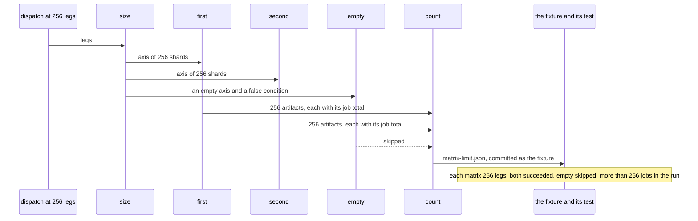

`.github/workflows/matrix-limit.yml` is dispatched once, at 256 legs a matrix. Its `count` job runs
whatever the other jobs read, and records each matrix's legs, each leg's `strategy.job-total`,
every job's result and the run's job count. The record is committed as
`scripts/tests/fixtures/matrix-limit-<run>/`, and SPEC-422 A19 reads it. A record that shows the
limit counted per run fails A19, and the delivery does not land: the second matrix is admitted by
this measurement or not at all.

### 9.5 What crosses each step

| step | before (dev `26ecc2ad`) | after (SPEC-422) |
|---|---|---|
| predicate | none: `scope_of` reads the event and the base | `release_run` over the event, the base, the head, the head repository and the repository; `"release": true` only when it holds |
| ceiling | none | `PYTHON_RELEASE_CEILING`, at `PYTHON_SHARE_CAP` until a signed measurement sets it; range-checked on every run |
| deal | the share 32 on every run | the share on every run but the release run under a set ceiling, whose cost deal is held to the ceiling; the count rule keeps the share |
| refusal | by name above the share | unchanged for every other run; the release run's past its ceiling, whole, by name, naming the constant and a new signature |
| matrices | one, `mutation-python` | two: `mutation-python` for the shards 0 to 255 and `mutation-python-release` from 256, at most `PYTHON_MATRIX_LEGS` each |
| verdict | every listed mutant examined; reports 0 to n - 1 | unchanged; both matrices' reports, under one name family |
| legs | rust and rows | rust, rows and the release leg, owed only past `PYTHON_MATRIX_LEGS` |
| ci | admits two skips | admits three, once each |

## 10. The Python kill round (SPEC-437, ADR-451)

Added after section 9; every earlier byte is kept. Kind: data flow. Every `path:line` in this
section was read at dev `b25ed04a`. Decided by ADR-451; built by SPEC-437, the first of six parts,
with SPEC-438 to SPEC-442 after it. This section shows where each survivor of the release run goes
until a test kills it or a record explains it, how a priced file's runs move from contiguous to
interleaved, and how a record is judged in its own class alone.

### 10.1 From a survivor to its killer or its record

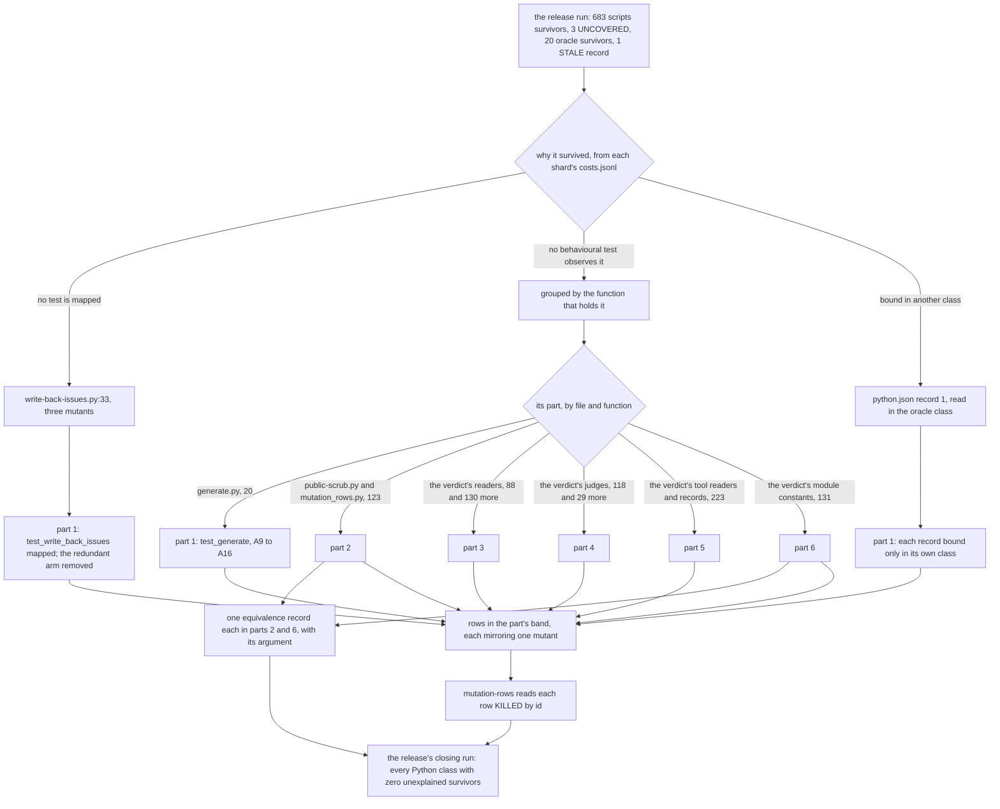

A killer never reads its target file's bytes: such a test fails under the runner's sentinel, is
dropped from the file's mutant runs as a byte reader (`scripts/mutation_python.py:516-518`,
`:901`), and kills nothing. So the two `CommittedGoldensAreCurrent` tests stay readers, and
`generate.py`'s survivors die by behaviour. A part's new killer module sits first in its file's map
list, because a `<module>` mutant runs every mapped module whole, in order, until one fails.

### 10.2 Before: a priced file's runs at dev `b25ed04a`

```mermaid
flowchart LR
  bList["listing: a priced file's m mutants, in listing order"] --> bK["k = (1800 - setup) // each"]
  bK --> bCut["ceil(m / k) contiguous runs: indices[start:end]"]
  bCut --> bDeal["runs dealt heaviest first onto the lightest leg"]
  bDeal --> bLeg["a run holds one region of the file, whose mutants share one traced test set"]
  bLeg --> bCost["a costly region lands whole on one leg, priced at the file's mean"]
  bCost --> bCut60["the leg passes the job's 60 minutes and is cut before its upload"]
  bCut60 --> bVoid["the verdict reads the leg VOID: no report"]
```

`python_by_cost` cuts each priced file's listing at `scripts/mutation-verdict.py:1235-1241`. The
run measured 24 legs cut at the bound: 23 left no report, and one, leg 241, finished in time for
its report to be read. Simulated over the run's measured costs, this deal puts 19 legs past 3600 s.

### 10.3 After: the runs interleaved (SPEC-437 R1, R2)

```mermaid
flowchart LR
  aList["listing: a priced file's m mutants, in listing order"] --> aK["k = (1800 - setup) // each, unchanged"]
  aK --> aCut["n = ceil(m / k) runs: run j holds positions j, j + n, j + 2n"]
  aCut --> aSame["each run's size, order, weight and projection: the contiguous cut's"]
  aSame --> aDeal["runs dealt heaviest first onto the lightest leg, unchanged"]
  aDeal --> aLeg["each leg holds every n-th mutant of every region of the file"]
  aLeg --> aFit["every leg within its job: the slowest simulated 3187 s, 2654 s with the kill parts"]
  aFit --> aReport["each leg uploads its report, and the verdict counts it"]
```

Only membership moves: the count of legs, every `projected_seconds`, every refusal and every
printed line are the contiguous deal's. `formal/tla/EveryLegCounted`'s `Plan` already admits any
deal of the listed mutants over the legs, so the model is re-read and not changed.

### 10.4 One record, judged in its own class (SPEC-437 R3)

```mermaid
flowchart TD
  rRecords[("scripts/mutation-equivalent.d/python.json: the Python records")] --> rClass{"classify of the record's file equals the judged class?"}
  rJudge["judge_python: the scripts class or the oracle class"] --> rClass
  rClass -->|"no"| rSkip["neither bound nor judged: no STALE and no AMBIGUOUS"]
  rClass -->|"yes"| rBind["bound against the class's population"]
  rBind -->|"one mutant"| rValid["valid: it excuses that mutant"]
  rBind -->|"none"| rStale["STALE: binds no python mutant"]
  rBind -->|"two or more"| rAmb["AMBIGUOUS: binds them all, excuses none"]
```

At the base, `judge_python` binds every record against the class's population
(`scripts/mutation-verdict.py:2155`) and keeps the bound ones of its class only afterwards
(`:2167-2169`), so the scripts record at `scripts/mutation_python.py:745:73` read STALE in the
oracle class. After SPEC-437, the class is chosen before binding, and that filter is gone with the
need for it. `formal/lean/Formal/RecordClassBinding.lean` proves the choice for every class, record
list and binding count, and its vectors hold the code to the proof.

### 10.5 What crosses each step

| step | before (dev `b25ed04a`) | after (SPEC-437 and its five sibling parts) |
|---|---|---|
| deal | each priced file cut into contiguous runs | each priced file's run j holds every n-th mutant from j; every figure kept |
| record binding | every Python record bound in every class, filtered by class after | each record bound only in its own class |
| write-back | no mapped test; a fallback arm no test can reach | `test_write_back_issues` mapped; unknown keys refused before any substitution |
| oracle survivors | 20, no behavioural test observes them | 20 killers in `test_generate.py`; both digest tests stay readers |
| scripts survivors | 683 | parts 2 to 6, each its own SPEC, ADR and band; 681 killed, 2 recorded equivalent |
| rows | none on these survivors | S43700-S43727 in part 1; each later part rows its own groups |
| proof | the rows and the changed-line legs of each part's pull request | the release's closing run, every class read whole |

## 11. Amendment (SPEC-480): a mutant that never advances its loop

Added after section 10; every earlier byte is kept. Kind: state machine. Every `path:line` in this
section was read at dev `36c4783a`. Decided by ADR-497; built by SPEC-480. This section shows one
dealt mutant's leg before and after the progress guard in `rust_tokens`, and the pass bound of the
ingest crate's lenient reader that ends the Rust mutant the memory scope stopped.

### 11.1 Before: one runaway mutant in a Python leg

```mermaid
stateDiagram-v2
  [*] --> bDealt
  bDealt: the leg runs its third dealt mutant, in rust_tokens
  bDealt --> bRead: a test tokenizes a Rust text
  bRead: the reading at a token start
  bRead --> bStay: the mutant leaves the stop at the start
  bStay: the token ends where it starts
  bStay --> bStay: one more token appended, the position unchanged
  bStay --> bStopped: the child's memory runs out before its wall-clock bound
  bStopped: the runner stops the leg, exit 143
  bStopped --> bVoid: no report and no artifact
  bVoid: the verdict reads the leg VOID, under the scripts FAIL
  bVoid --> [*]
```

`rust_tokens` (`scripts/mutation-verdict.py:513-539`) appends `(at, stop)` and moves `at` to
`stop` on every pass (`:537-538`). Under each of the six mutants of lines 532 and 534 a token
start leaves `stop == at`, so the loop appends without end. The harness bounds a mutant's wall
clock only (`scripts/mutation_python.py:1138`), never its memory, so the runner stops first and the
leg leaves no report.

### 11.2 After: the progress guard (SPEC-480 R1, ADR-497 D2)

```mermaid
stateDiagram-v2
  [*] --> aDealt
  aDealt: the leg runs the same mutant
  aDealt --> aRead: a test tokenizes a Rust text
  aRead: the reading at a token start
  aRead --> aGuard: the stop is set, a literal's end, a word's end or one past the start
  aGuard: the progress guard, after stop = at + 1 if stop is None else stop
  aGuard --> aNext: the stop lies past the start, as on every admitted text
  aNext: the token is appended and the position moves to its stop
  aNext --> aRead: more text
  aNext --> aDone: the end of the text
  aDone: the tokens, the same the base reads
  aGuard --> aRaise: the stop lies at or before the start, as under each of the six mutants
  aRaise: RuntimeError naming the position
  aRaise --> aKilled: the test that read the text fails
  aKilled: the harness reads the mutant killed, and the leg reports
  aDone --> [*]
  aKilled --> [*]
```

Under each of the six mutants (rows S48001 to S48006) the guard raises at the first stalled
token; under the guard's own listed mutant, `<=` to `>`, it raises at the first advancing one.
Both read killed by the tests of SPEC-480. The differential census that proves the guard the
identity holds a verbatim copy of the base function, since a test that reads its target file's
bytes is dropped from that file's mutant runs, and it sits outside the verdict file's map in
`scripts/mutation-python.json`, so no mutant run pays for it. `formal/lean/Formal/TokenProgress.lean`
proves that the guarded loop ends within the text's length plus one passes, with at most the
text's length of tokens.

### 11.3 The lenient reader's pass bound (SPEC-480 R5, ADR-497 D4)

```mermaid
stateDiagram-v2
  [*] --> rPass
  rPass: one pass of leniently, at most the text's length of them
  rPass --> rEnd: the position reached the text's end
  rPass --> rAdvance: a correct pass moves at least one byte
  rAdvance: the next byte
  rAdvance --> rPass
  rPass --> rStall: under the shard's mutant, the position stays at 0 on an opening brace
  rStall: one more brace pushed, the position unchanged
  rStall --> rBound: the passes reach the text's length
  rBound: the reading ends with a wrong text
  rBound --> rNone: parse answers none
  rNone: the existing test fails at its expect, and the mutant reads caught
  rEnd --> [*]
  rNone --> [*]
```

`leniently` (`crates/ingest/src/memory_state.rs:41-89`) looped `while at < bytes.len()`. Under
`at *= width` (`:85`) the stalled state had no way out but the memory scope's stop, which the rust
class reads as a memory finding, neither caught nor timed out. With at most `bytes.len()` passes,
the same mutant ends, and `a_bare_word_outside_a_string_drops_only_its_field` catches it.

### 11.4 What crosses each step

| step | before (dev `36c4783a`) | after (SPEC-480) |
|---|---|---|
| a reading that stays, in `rust_tokens` | one token appended per pass, without end | `RuntimeError` naming the position |
| the six legs of the release run | stopped by the runner, no report, VOID | each runaway mutant read killed, each leg reporting |
| the verdict file's dealt mutants | 2843 | 2844, the guard's own `<=` to `>` added |
| a pass of `leniently` | a `while` over the position | at most the text's length of passes |
| the Rust mutant at `memory_state.rs:85:16` | stopped by the memory scope | caught by `a_bare_word_outside_a_string_drops_only_its_field` |
| rows | none on these mutants | S48001 to S48007 |
| proof | none | the differential census, the seeded differential, `lean/TokenProgress` and the release run's next reading |
