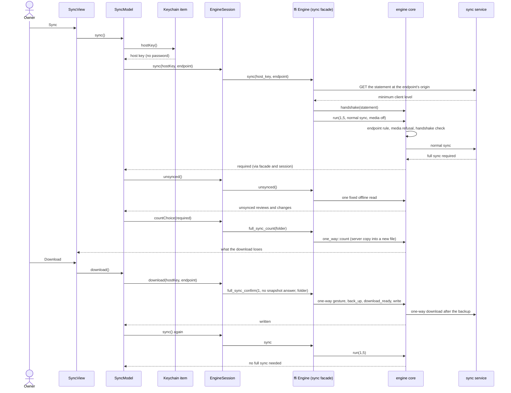

# The native client's first sync through the full-sync choice (SPEC-503)

The sequence of a fresh install's first sync on iPhone and iPad, from the owner's tap to the
normal sync after the download. Each arrow is one call; the core decides every rule.

## Where each rule lives

| Rule | Where |
| --- | --- |
| Endpoint rule, media refusal, handshake check | `crates/engine-core/src/dispatch.rs::run` |
| The normal sync's request and the statement's URL | `crates/engine-core/src/native_sync.rs` |
| Counts, backup, re-check, write | `crates/engine-core/src/one_way.rs`, `full_sync.rs` |
| The one-way gesture | `crates/ffi/src/engine.rs` (the adapter's entry file) |
| The host key | the app's one Keychain item, `SyncCredentialStore` |
