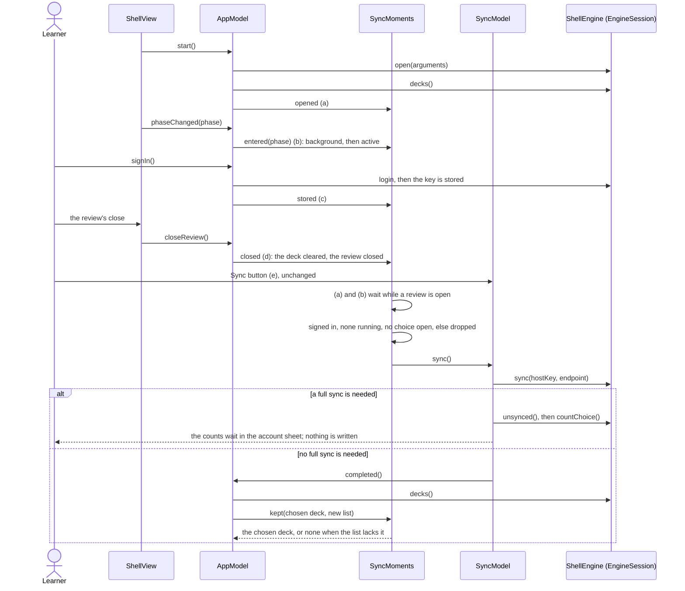

# The native client's sync moments (SPEC-600)

The sequence of the five moments at which the iPhone and iPad app runs its normal sync, the guards
each passes, and the deck list read again after a sync completes. Each arrow is one call; the sync
itself is SPEC-503's, unchanged (`docs/schematics/native-first-sync.md`).

## Where each rule lives

| Rule | Where |
| --- | --- |
| The moments, the review-open wait, the drop and the chosen deck kept | `ios/App/Sources/SyncMoments.swift` |
| The moments' call sites, the seam and the deck list read again | `ios/App/Sources/AppModel.swift` |
| The completed sync reported | `ios/App/Sources/SyncModel.swift` |
| The scene phase and the review's close handed to the model | `ios/App/Sources/DeckListView.swift` |
| The normal sync, the counts and the download | SPEC-503, unchanged |
