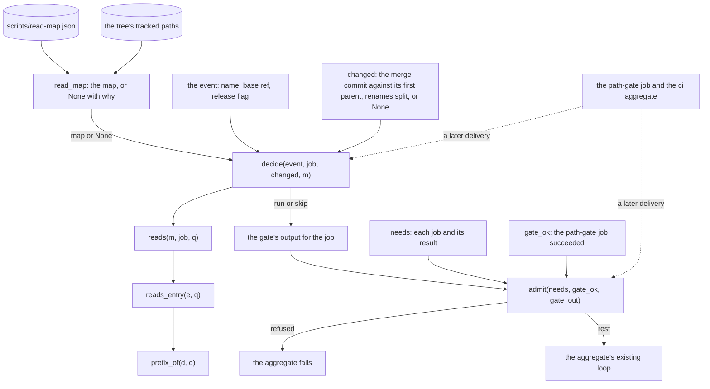
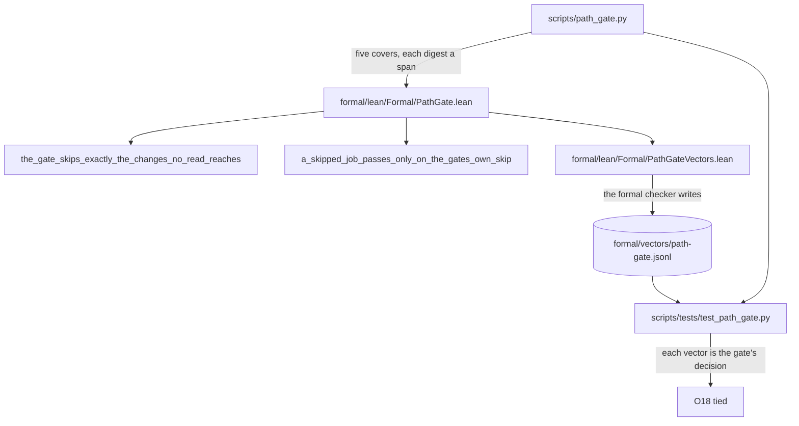

# Schematic: a gated Rust job is skipped only when the change touches nothing it reads

Kind: data flow (the map, the change list and the event into the decision and the admission, and
the Lean port tied to the script by vectors). Read at dev at the cut (the land of #1196). Decided
by ADR-658; built by SPEC-634.

## 1. The decision and the admission

`read_map` admits the map or refuses it; a refused map is None. `decide` answers for one job from
the event, the change list and the map, through `reads`, `reads_entry` and `prefix_of`. `admit`
judges each gated job's result by the path-gate job's success and its output. The caller, the
path-gate job and the `ci` aggregate, is a later delivery's, drawn dashed.

## 2. The proof and its tie

`lean/PathGate` ports the five functions and proves two theorems over them. The vectors writer
prints the port's answers; the formal checker writes them to the vectors file, and the test reads
each one against the script.

