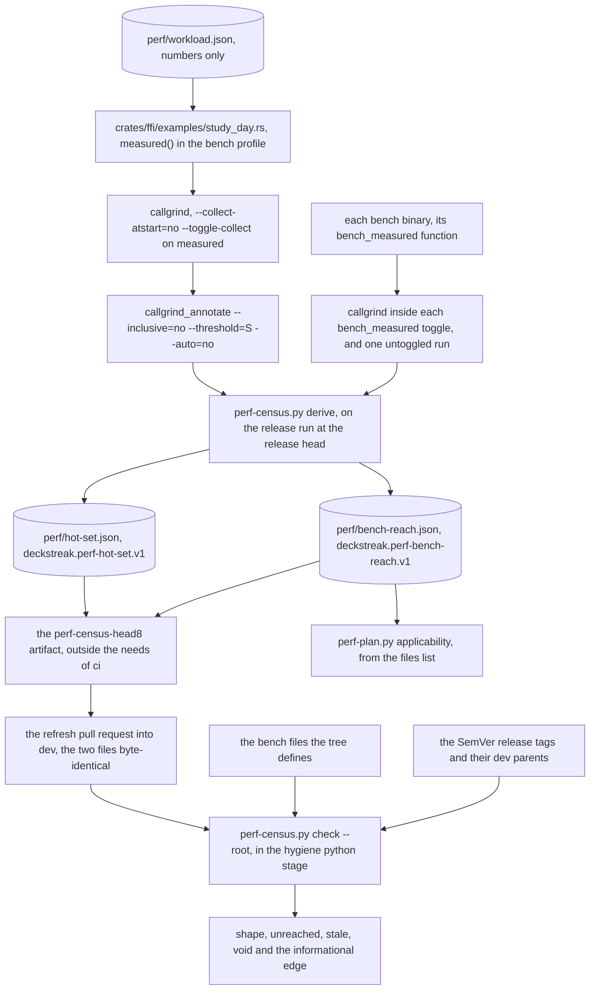

# Schematic: the bench census, from the study day to the hygiene check (SPEC-630, ADR-652)

Kind: data flow. Citations read at dev `6c3af8f`.

The release run derives the membership at the release pull request's head; a refresh pull request
commits the two files; every pull request's hygiene stage checks them against the tree and the
release tags. The release run is named by `base-is-dev`'s `release` output
(`.github/workflows/ci.yml:1342-1380`), and hygiene's checkout holds the full history
(`.github/workflows/ci.yml:316`, `fetch-depth: 0`); its python stage is `scripts/check.sh:179-195`.

## The two files, as `derive` writes them

| file | keys | read by |
|---|---|---|
| `perf/hot-set.json` | `schema`, `share`, `workload` (`path`, `sha256`), `derived_at`, `release`, `toolchain`, `valgrind`, `total_ir`, `members` (`fn`, `file`, `self_ir`, `share`) | `check`: every arm |
| `perf/bench-reach.json` | `schema`, `derived_at`, `benches` (bench id to `total_ir` and `functions`), `files` | `check`: `shape`, `unreached`, `void`; the bench plan: `files` |

## Where each input comes from

- The membership: the listing callgrind_annotate prints at the share, its creator, events and
  threshold read from its own header.
- The reach: one listing per bench, printed whole (threshold 100), inside its toggle.
- The files: the untoggled listings, the files under the checkout's root, relative to it.
- The benches the tree defines: `#[divan::bench]` functions in `crates/*/benches/*.rs` and
  `bench(` calls in `web/app/bench/**/*.bench.ts`, each `<file stem>::<bench>`.
- The release tags: `v<major>.<minor>.<patch>` tags of the history at `--root`, each judged by its
  second parent.
