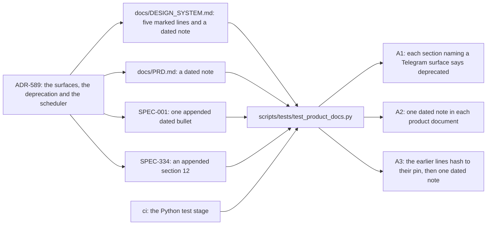

# Schematic: the product documents, their ADR-589 notes, and the census that reads them

Read at `dev` `0756b82`, the base of SPEC-651 (ADR-673). Kind:
component and data flow. Every `path:line` below was read at that commit.

The four documents keep every line they held at that commit. The design system gains one marked
line under each heading whose section names a Telegram surface, and a dated note at the end of its
Amendments; the PRD gains a dated note at the end of its Amendments; SPEC-001 and SPEC-334 each gain
one appended dated note. `scripts/tests/test_product_docs.py` reads all four, and the Python test
stage of the `ci` workflow runs it with the rest of `scripts/tests`.

## Where each note and mark goes

| document | at the base | what is added |
|---|---|---|
| `docs/DESIGN_SYSTEM.md` | the headings at `docs/DESIGN_SYSTEM.md:1`, `:6`, `:13`, `:59` and `:64`, each followed by a blank line | one marked line opening `Amended below (ADR-589):` after that blank line, then one blank line |
| `docs/DESIGN_SYSTEM.md` | the Amendments section, `docs/DESIGN_SYSTEM.md:72` to the last line, `:129` | one blank line and the dated note |
| `docs/PRD.md` | the Amendments section, `docs/PRD.md:61` to the last line, `:78` | one blank line and the dated note |
| `docs/specs/SPEC-001-campaign-prd-parity-and-waves.md` | section 14, `docs/specs/SPEC-001-campaign-prd-parity-and-waves.md:391` to the last line, `:433` | one dated bullet, with no blank line before it |
| `docs/specs/SPEC-334-app-campaign-prd-web-and-ios-clients-over-the-engine.md` | section 11, `docs/specs/SPEC-334-app-campaign-prd-web-and-ios-clients-over-the-engine.md:248` to the last line, `:256` | one blank line and section 12 |

## What the census reads

- **A1, the section census.** Each product document is split at its `#` and `##` headings; a
  section is the unit, because a wrapped sentence names a surface on one line and the word
  deprecated on the next. A section that names a Telegram surface and not the word is a finding,
  named by the document's path and the heading.
- **A2, the one dated note.** Each product document's paragraphs, whitespace normalised; exactly one
  opens the dated ADR-589 note and names the web app, the iPhone and iPad app and the deprecation.
- **A3, the kept text.** Each campaign spec's first lines, as many as it held at the base, hash to
  their pin; the text after them holds the dated mark once and names the two apps, the deprecation
  and Rex.

Each test refuses a planted inline text before it reads a document, and refuses an examined count
of zero.
