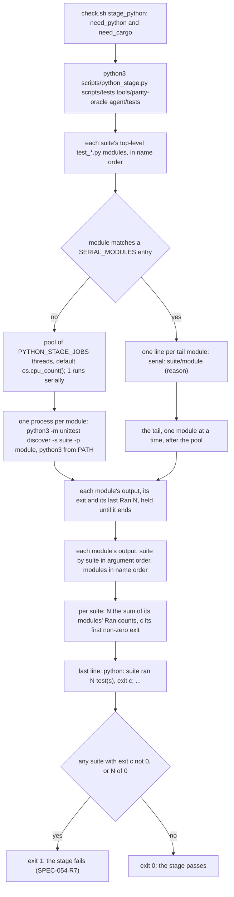

# Schematic: the python stage's module pool (SPEC-633, ADR-656)

Kind: data flow. It draws how `stage_python` in `scripts/check.sh` runs the three python suites
through `scripts/python_stage.py` once SPEC-633 lands, from the call to the verdict line.

A suite with no module has N of 0 and fails. `check.sh` writes the stage's output to `python.log`
and its time to `timings.tsv`, as before.
