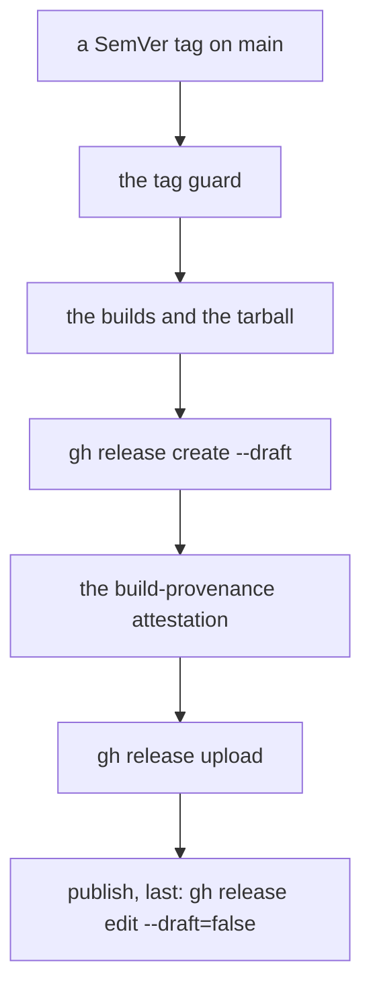
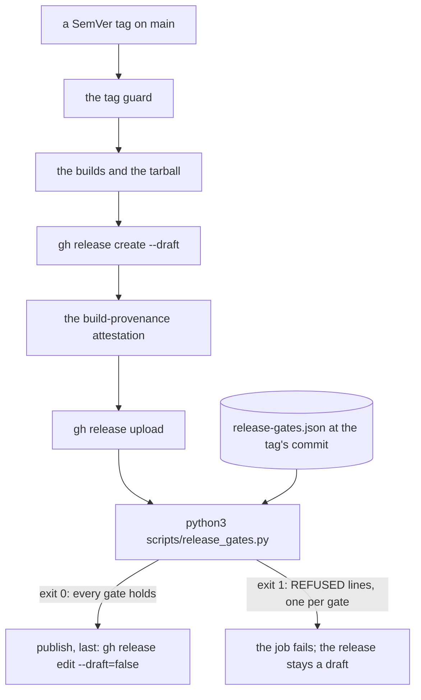
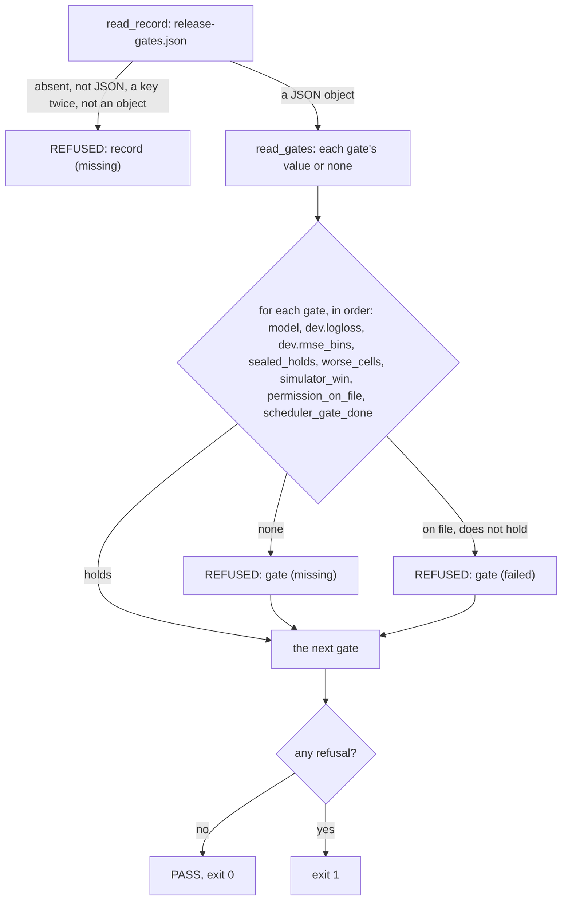

# Schematic: a release tag is published only when the scheduler's release gates are on file

Kind: data flow (the release job from the tag to the publish step, before and after the gate), with
the decision drawn as a flowchart. Read at DeckStreak `d3b09d5e` (`.github/workflows/release.yml`).
Decided by ADR-520; built by SPEC-502.

## 1. Before: every tag is published

At `d3b09d5e` the `release` job proves the tag (`release.yml:47-67`), builds, assembles the tarball
(`:127-149`), creates a draft (`:150-153`), attests (`:154-156`), uploads (`:157-160`) and publishes
in its last step (`:161-164`). Nothing between the upload and the publish reads any record.

## 2. After: the record at the tag decides the publish

One step joins directly before the publish. It reads `release-gates.json` from the tag's own
checkout and exits 0 only when the record is on file and every gate holds; a non-zero exit fails
the job, so GitHub runs no later step and the draft stays a draft.

## 3. The decision

`read_gates` turns the record into each gate's value, or none when the record lacks it or holds it
in another type. `verdict` then names every refusing gate in the record's order.

The Lean entry `lean/ReleaseGates` ports `verdict` and the per-gate helpers; its vectors,
`formal/vectors/release-gates.jsonl`, are read by `scripts/tests/test_release_gates.py`.
