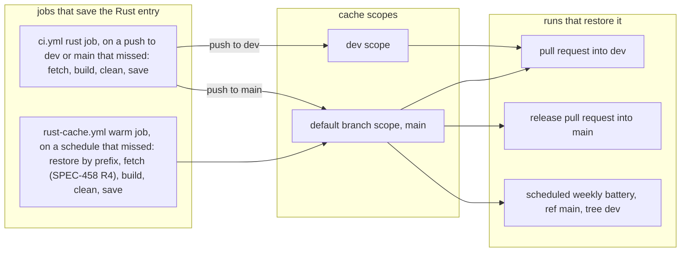
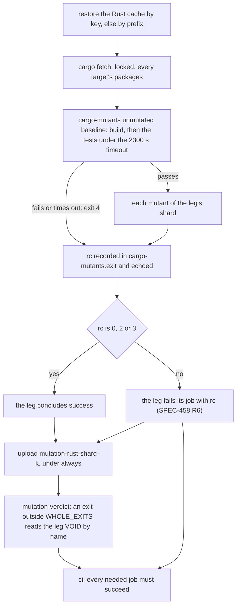
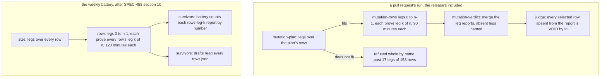
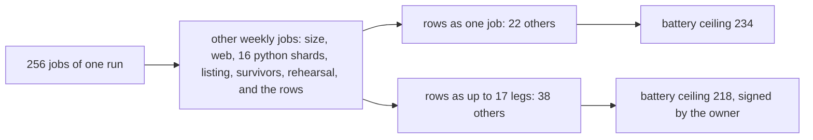

# The release run's mutant legs: their baseline, their cache and their bound (SPEC-458)

Kind: data flow. Every `path:line` below was read at `dev` 83846ea3. Decided by ADR-475; specified
by SPEC-458. Each output is named as its workflow writes it.

## 1. Where each Rust leg's cache comes from

A run restores a cache only from its own ref, its pull request's base branch and the default
branch (`.github/workflows/rust-cache.yml:3-6`). A release pull request's base is `main`, which is
also the default branch, and a scheduled run's ref is the default branch, so both read only what
the default branch's scope holds. Two jobs save the Rust entry: `ci.yml`'s `rust` on a push to
`dev` or `main` that missed (`ci.yml:74-83`), and `rust-cache.yml`'s `warm` on a schedule that
missed (`rust-cache.yml:90-99`). SPEC-458 R4 gives the second the fetch the first already runs.

Before SPEC-458 the warm job saved an entry its build had filled, so the default branch's scope
could hold a registry short of the packages a host build never compiles. After it, every entry in
either scope holds every package `Cargo.lock` pins for every target. No key and no entry is added.

## 2. One Rust leg, from restore to verdict

Each job that runs a cargo-mutants baseline, in every workflow, fetches between its last restore
and its baseline (SPEC-458 R1): `ci.yml`'s `mutation-rust` (`ci.yml:499-535`), and, after this
delivery, `mutation-weekly.yml`'s `rust` (`:135-178`) and `rehearsal` (`:419-447`). The pull
request's leg then ends on the colour line (R6).

In the release pull request's run at `dev` 83846ea3, 76 of the 143 completed legs took the
`exit 4` edge and still concluded `success` (run 38976943303: 2300 s of baseline test each). After
SPEC-458 the same legs take the red edge; the verdict reads them exactly as it did.

## 3. The rows legs and their bound

The pull request's plan deals the selected rows into the fewest legs whose largest is projected
within `ROWS_BOUND_SECONDS` (2700, half of the rows job's 90 minutes) at `ROW_SECONDS` (17) a row,
at most `ROWS_MAX_LEGS` (17) legs, and refuses whole past them (`scripts/mutation_rows.py:108-116`,
`:1286-1313`). The verdict's job merges the legs' reports and the judge reads one (`ci.yml:738-766`).
SPEC-458 keeps every figure (ADR-475 D6). Section 10 of SPEC-458 gives the weekly battery the same
deal, its legs counted by the battery.

Measured on the release pull request's run at `dev` 83846ea3: the plan job 117228556587 dealt 2653 rows into 17 legs, projected at 2669 s.
The 17 legs of run 38976943303 took 1641 s (job 117228729317) to 2968 s (job 117228729301), 1994 s on the mean, each inside its 5400 s bound.

## 4. The weekly battery's ceiling (SPEC-458 section 10)

`LEG_CEILING["battery"]` is the 256 jobs of one run less the most every other job of
`mutation-weekly.yml` can generate (`scripts/mutation-verdict.py:959-961`). Today that is 22, the
rows job among them as one; with the rows dealt into at most 17 legs it is 38, and the ceiling
falls from 234 to 218. That change lands only with the owner's signed ruling.

