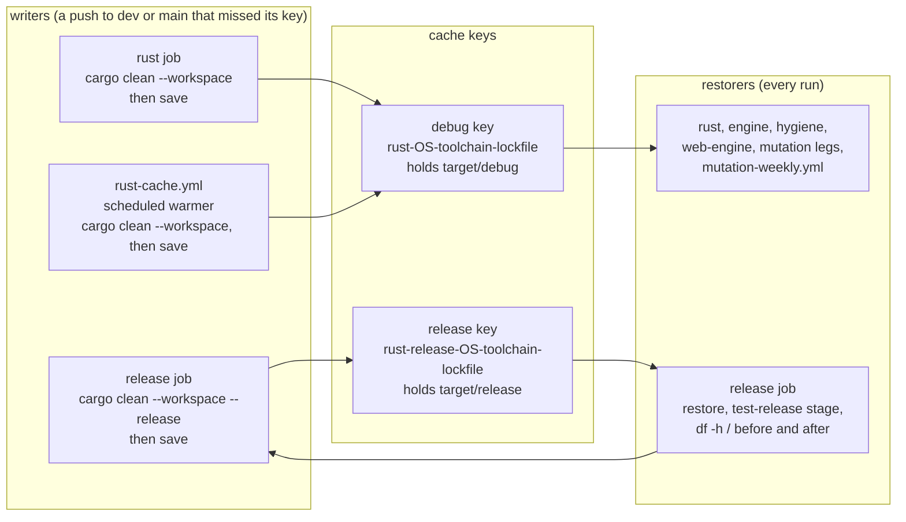

# The release job's cache, and the two keys with one writer each

Kind: component and data flow. Read at the base of this pull request (`dev` when it was cut;
`.github/workflows/ci.yml:81-92` the `rust` job's clean and save, `:156-209` the `release` job).
The cache of SPEC-631 (ADR-654): which job writes which key, which jobs restore it, and the clean
before each save.

## Component and data flow

## What each part holds

- The debug key has two writers, the `rust` job and the scheduled warmer; its fallback prefix is
  `rust-<os>-<toolchain hash>-`, which is no prefix of the release key.
- The release key has one writer, the `release` job. Its fallback prefix is
  `rust-release-<os>-<toolchain hash>-`, which matches no debug key.
- Each writer cleans before it saves: `cargo clean --workspace` leaves the dependencies' debug
  artifacts, `cargo clean --workspace --release` leaves the dependencies' release artifacts, so the
  workspace's own crates, rebuilt from any fresh checkout, are not cached.
- The save runs only on a push to `dev` or `main` whose restore missed its exact key. A pull request
  restores and never saves, so it misses the release key until a saving push has written it.
- The `release` job prints `df -h /` before its restore and after its stage.
