# Review fixture day: the writer pins the hour, the reader meets it half a day later

A data-flow schematic of SPEC-615 (ADR-637). Every `path:line` citation was read at this pull
request's base on dev, and the engine's at the rev `Cargo.lock` pins; the new paths are SPEC-615's.

## 1. Where the fixture's day comes from

```mermaid
flowchart LR
  WRITER["review-fixture example, run by the xcframework job (xcframework.yml:133)"] --> BUILD["review::build: CollectionBuilder writes schedVer 2 and a creation offset, no rollover"]
  BUILD --> PIN["day_cutoff::pin: each hour measured in its own open, the one nearest half a day ahead kept, set and read back"]
  PIN -->|rollover key alone| COLL["collection.anki2 with its rollover hour"]
  WRITER --> OTHERS["parity, sound video and card health collections, unchanged"]
  COLL --> ART["engine artifact: review-fixture/"]
  ART --> JOB["release-and-app job copies it for xcodebuild test (xcframework.yml:1020-1030)"]
  JOB --> APP["ReviewModelTests, ReviewSessionTests, ReviewFlowTests open it through the adapter"]
  APP --> TIMING["engine timing, version 2: the next cutoff is the pinned hour on the reading host's clock (timing.rs:39-45)"]
  TIMING --> DESCRIBE["describe_next_states: maybe_as_days on each choice (interval_kind.rs:12)"]
  DESCRIBE --> LABEL["the interval label: minutes while the step ends before the cutoff"]
```

Before this delivery the `PIN` step was absent: the engine wrote its default hour on the first
reading (`rslib/src/scheduler/mod.rs:63-71`), so the cutoff was that hour on every reading host,
whenever the fixture was written.

## 2. Each step, its proof, its red and its row

| step | what holds it | red planted | row |
|---|---|---|---|
| the fixture is a version-2 collection | A1's premise, the stored `schedVer` | none: a red here stops the delivery, since the design reads it | none |
| the pin keeps the hour nearest half a day ahead and reads it back | A1, `fixture_day_cutoff.rs` | an inert pin that reads the day and writes nothing, after A1 sets the hour whose day ends within the hour | S61500 (the target of half a day made a quarter) |
| the pin writes the `rollover` key alone | A1, the stored `schedVer` after the pin | none | none |
| the text card keeps its four intervals | A2, `fixture_day_cutoff.rs` | not red: a guard, unchanged by the pin | none |
| the writer pins once, between the review and parity builds | A3, a census over the example | the example before its three insertions | none |
| the app's labels stay the engine's | A4, SPEC-348's A15, A17 and A19 on both destinations | not red: kept Swift tests | none |

## 3. Why half a day

The cutoff is read on the reading host's clock, and the fixture is written in one job and read in
another. A reader that keeps the writer's offset meets the cutoff about twelve hours after the
write; a reader whose offset differs by some hours meets it that many hours earlier or later, so
any difference under eleven hours still leaves more than half an hour after the write. The hour
farthest from now, which `review_pairs.rs` keeps for its own collection (lines 125 to 143), is
read by one process; a reader one hour behind this writer would meet that cutoff within the hour.

## 4. What stays as it is

The interval label and `crates/ffi/src`, every Swift file and expected interval, the workflows,
`crates/ffi/tests/support/review.rs`, `parity.rs`, `sound_video.rs` and `health.rs`, and every
existing Rust test, `review_pairs.rs` included.
