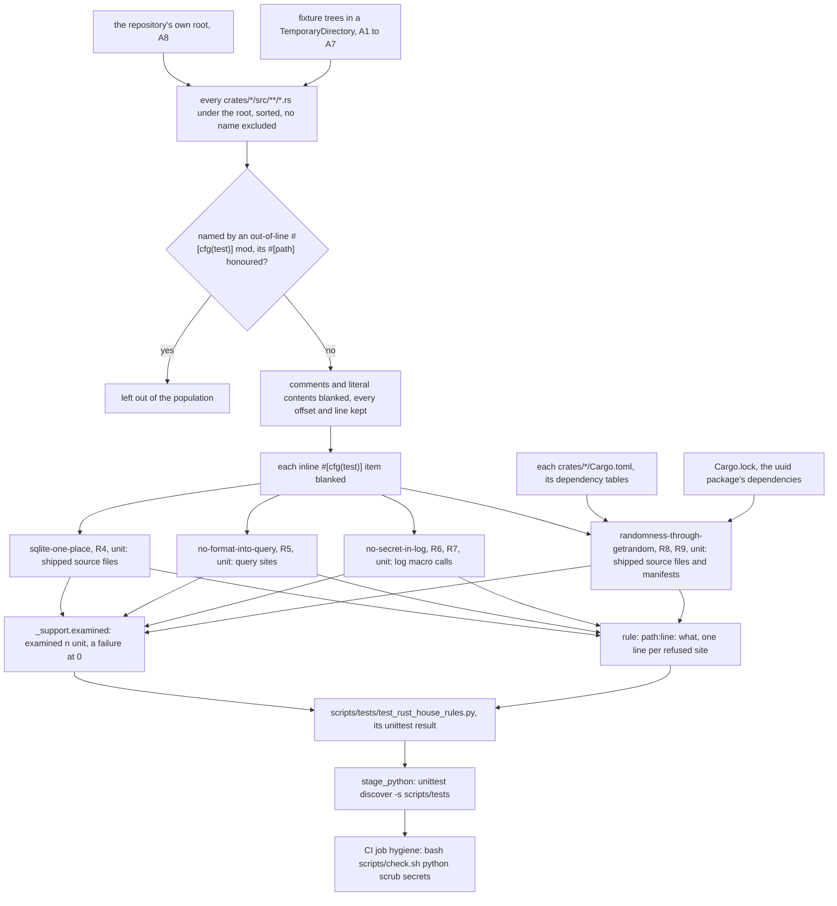

# Schematic: the Rust house rules guard, from the shipped sources to the hygiene job

Kind: data flow. Read at DeckStreak dev `ac7ebd752`. Decided by ADR-441; built by SPEC-427.

## Where it runs

The guard runs only in CI, in the `hygiene` job, and its walk has no name exclusion, so every
shipped `crates/*/src/**/*.rs` file is judged there and the verdict is CI's (ADR-441 D5). The job
(`.github/workflows/ci.yml:298`) runs `bash scripts/check.sh python scrub secrets` (`:351`);
`stage_python` (`scripts/check.sh:179-197`) runs `python3 -m unittest discover -s scripts/tests
-p 'test_*.py'` (`:186`), and a suite that ran no test fails (`:191`). The counts each rule
examined are the ones A8 prints in that job's log.

## The population

- The walk takes a root: the repository's own for A8, a fixture tree written into a temporary
  directory for A1 to A7. Under it, every `crates/*/src/**/*.rs` file, sorted (SPEC-427 R2).
  `crates/*/tests`, `crates/*/examples` and each crate's `build.rs` are outside the glob.
- A file an out-of-line `#[cfg(test)] mod <name>;` declares leaves the population whole, resolved
  from its declaring file as the compiler resolves it, its `#[path]` honoured. At the base,
  `crates/ingest/src/skip_write.rs:1087-1088` declares `crates/ingest/src/skip_write/tests.rs`,
  and `crates/vault/src/unicode_other.rs:753-755` declares `crates/vault/src/unicode_other_tests.rs`
  by its `#[path]`. `crates/daemon/src/wiring.rs:812-814` declares a test module whose `#[path]`
  names a file outside `crates/`, so it removes no file of the population.
- The lexer (R3) and the inline `#[cfg(test)]` span (R2) blank text and never remove it, so every
  `path:line` a rule prints is the source's own line. A format string's text is read from its
  literal, so an inline `{name}` capture reaches `no-secret-in-log`.

## The four rules

SPEC-427's requirements are the authority; this table names each rule's inputs and refusals.

| rule | requirement | examines | refuses |
|---|---|---|---|
| `sqlite-one-place` | R4 | each population file but `crates/kernel/src/db.rs` | `SqliteConnectOptions`, `SqlitePoolOptions`, `PoolOptions`, `rusqlite`, `libsqlite3_sys`; `connect`, `connect_with`, `connect_lazy` or `connect_lazy_with` on a path ending in `SqlitePool`, `Pool`, `SqliteConnection` or `Connection`, qualified forms included; a `.connect_with(`, `.connect_lazy(` or `.connect_lazy_with(` call |
| `no-format-into-query` | R5 | each call of `sqlx::query`, `query_as`, `query_scalar`, `query_with`, `query_as_with`, `query_scalar_with` and `raw_sql`, by its `sqlx::` path or a bare name the file imports from sqlx, and each `AssertSqlSafe(...)` site | an argument holding a `format!`, a `.leak()`, or a name a `let` binds, or an assignment sets, to a `format!` earlier in the same function |
| `no-secret-in-log` | R6, R7 | each macro called by a `tracing::` or `log::` path, each bare macro the file imports from either, and each `#[instrument]` | a passed name holding a pair of ADR-441 D3; otherwise, unless its last segment ends in an about-name, a name holding a part |
| `randomness-through-getrandom` | R8, R9 | each population file, each `crates/*/Cargo.toml`, and `Cargo.lock`'s `uuid` package | a path through `rand`, `rand_core`, `rand_chacha` or `fastrand`; `ring::rand`; `OsRng`, `ThreadRng`, `thread_rng`, `StdRng`, `SmallRng`, `SeedableRng`; a `use` or `extern crate` of a refused crate; `PyRandom::new`; a manifest dependency on a refused crate by its key or its `package`; a `uuid` random constructor while the lock's `uuid` depends on a `rand`-family package |

A call's passed names (R6) are its field keys, each path chain in a value, the shorthand, `%` and
`?` forms, its positional format arguments and each inline `{name}` capture; a `target:`,
`parent:` or `name:` argument and a `Level::` argument pass none.

## The side inputs

- Each `crates/*/Cargo.toml`: its `dependencies`, `build-dependencies` and
  `target.*.dependencies` entries, each read by its key and by its `package` (R8).
- `Cargo.lock`'s `uuid` package: at the base its dependencies are `getrandom`, `js-sys`,
  `serde_core` and `wasm-bindgen`, and no `rand`-family package, so the `Uuid::new_v4` at
  `crates/identity/src/passkeys.rs:413` is admitted (R9).

## What the rules do not match

These are declared classes of ADR-441, not exclusions of the walk: each file that holds one is
still examined by every rule.

- `RandomState` at `crates/ingest/src/sync.rs:393`, the retry jitter, which needs spread and not
  secrecy (ADR-441 D4).
- The engine's own SQLite, opened through the engine's API at `crates/ingest/src/engine.rs:533`
  and `crates/web-engine/src/wasm.rs:136` (ADR-441 D1).
- The literal-only query macros (`sqlx::query!` and its kin), which take a literal the compiler
  checks: counted apart and not judged (ADR-441 D2).
