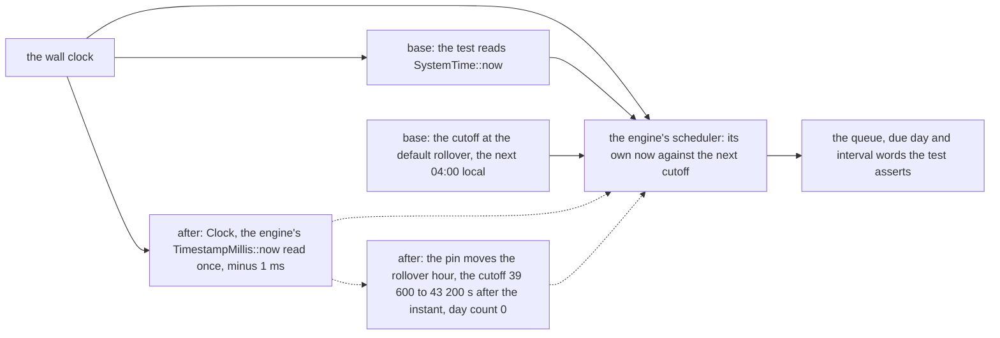
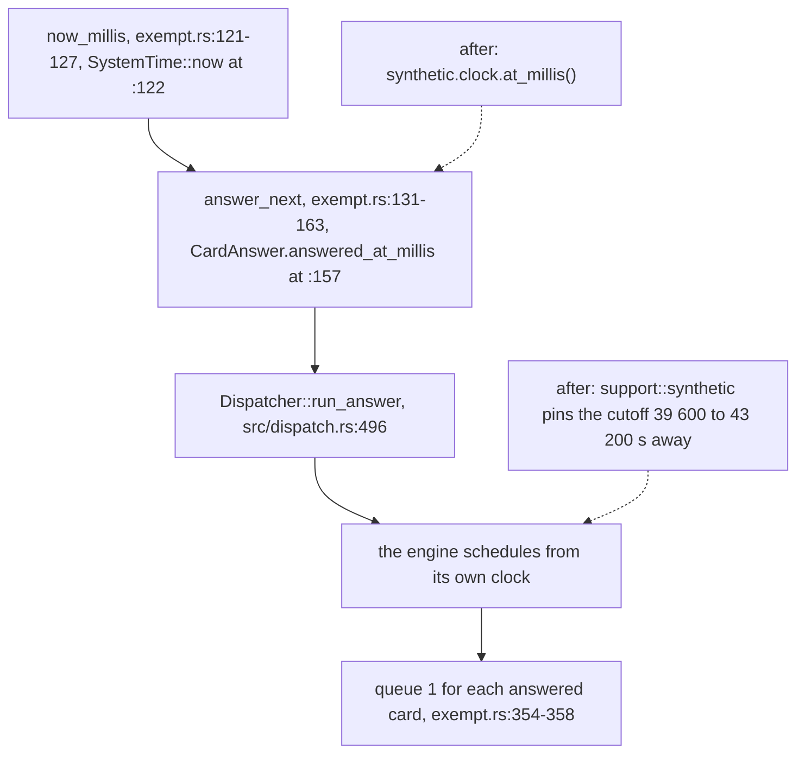
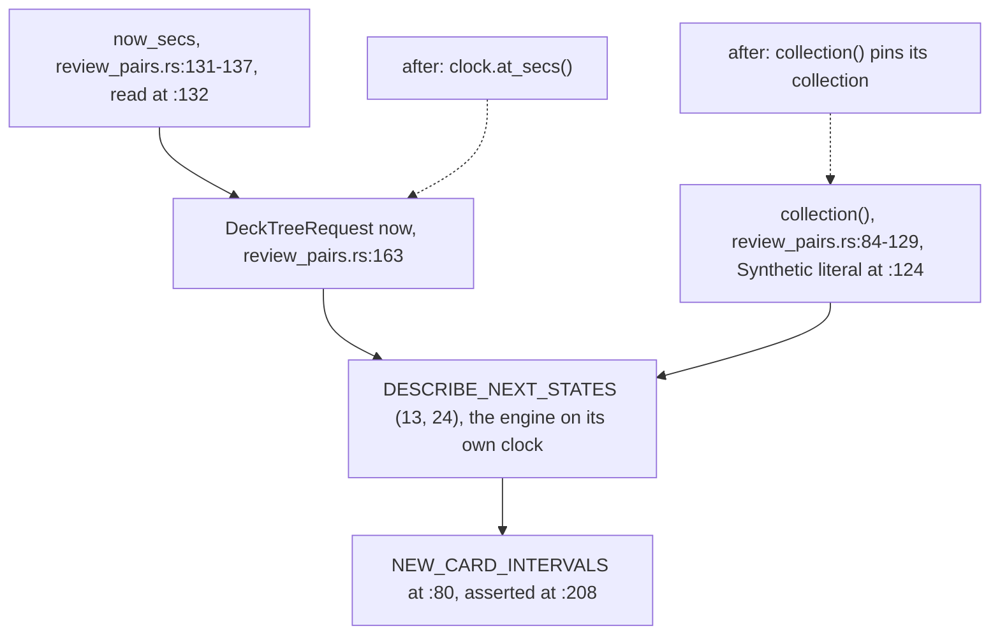
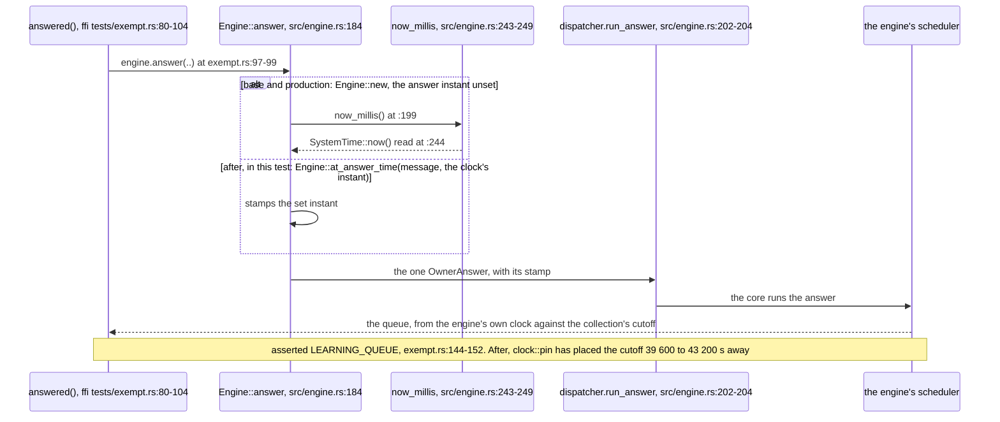
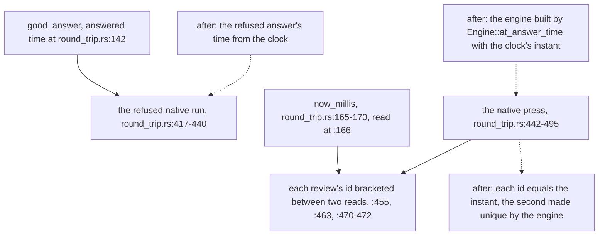
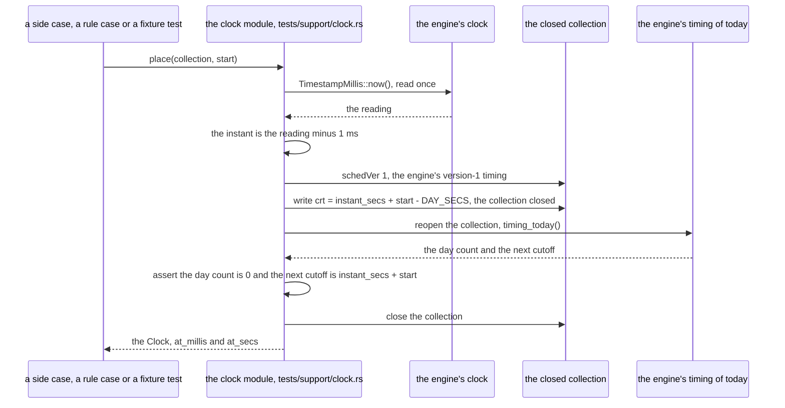
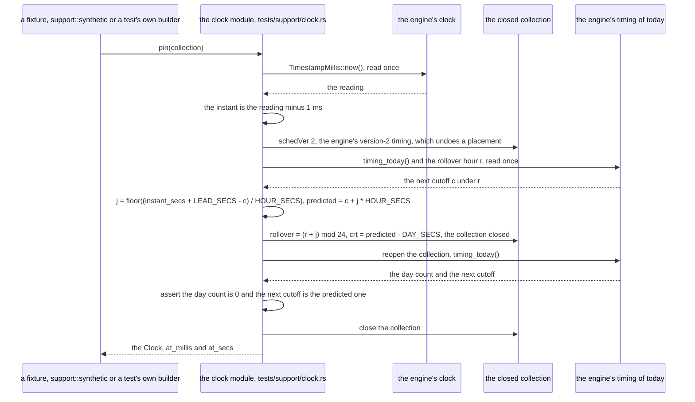
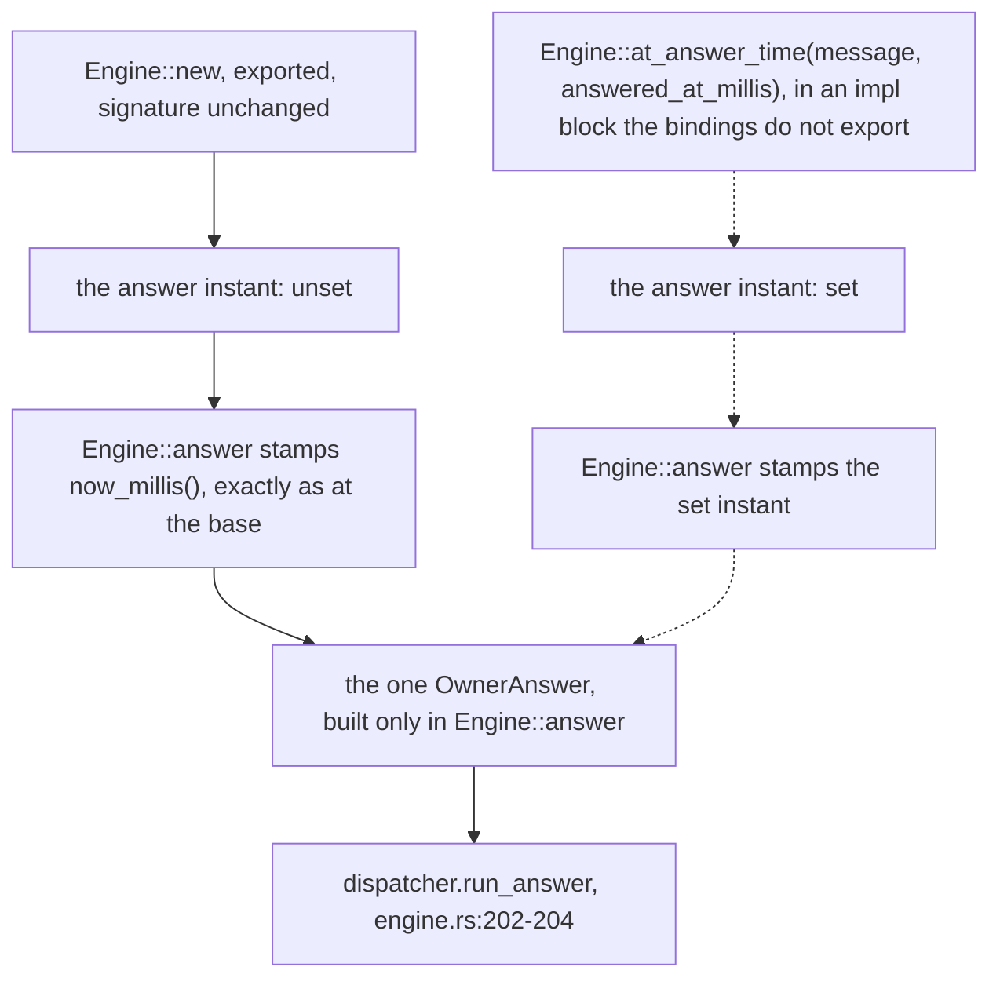
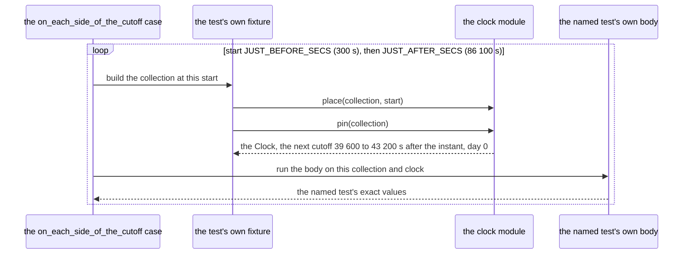
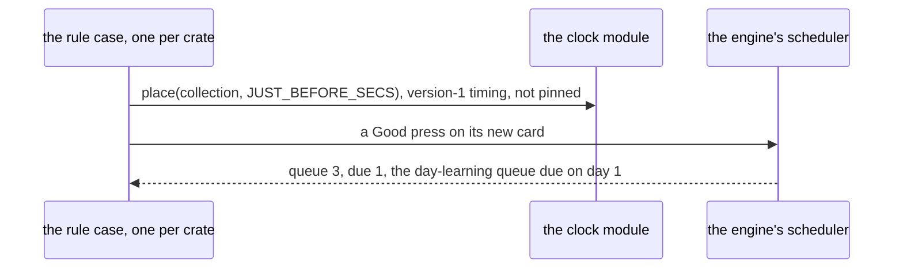

# Scheduler tests take their time from one injected clock

- **Kinds:** data flow and sequence, drawn in mermaid.
- **Read at:** commit `83846ea3`; every `path:line` below is a line at that commit. The engine's
  timing on the fixtures' collections was measured by a probe over those collections, in both
  crates, under `TZ=UTC` and `TZ=Pacific/Auckland`.
- **Decided by:** ADR-457. **Specified by:** SPEC-443, the first part of #747.

## 1. Two clocks reach every scheduler test

A scheduler test reaches two clocks. The test's own clock supplies the times it hands the engine:
an answer's time, a deck tree's `now`, a collection's modified time. The engine's own clock decides
the schedule: the engine compares its own reading of now with the collection's next cutoff, and a
learning interval that reaches the cutoff reads in days (`crates/ffi/tests/review_pairs.rs:114-120`).
At the base both are the wall clock and the cutoff sits at the engine's default rollover, the next
04:00 in the zone the engine reads, so the four tests #747 names pass or fail by the time of day
they run. After this delivery every time a test hands the engine comes from one `Clock`, and the
collection's next cutoff is pinned on the last local hour boundary at or before 43 200 s after the
clock's instant, so more than 39 600 s away, whatever the wall clock reads.

In every flowchart below, solid edges are the base's path and dotted edges are what replaces it.

## 2. Each named test, from its clock read to the injected clock

### 2.1 engine-core `exempt.rs` `a_forget_gesture_resets_its_one_card_and_no_other`

| step | at `83846ea3` | after |
|---|---|---|
| time read | `now_millis` (`crates/engine-core/tests/exempt.rs:121-127`), `SystemTime::now()` at `:122` | `synthetic.clock.at_millis()` |
| handed to the engine | `answer_next` (`:131-163`) builds `CardAnswer.answered_at_millis: now_millis()` (`:157`) | the same field, from the clock |
| scheduled by | `Dispatcher::run_answer` (`crates/engine-core/src/dispatch.rs:496`), the engine on its own clock | the same, on the collection `support::synthetic` pinned |
| near the cutoff | the Good step reaches the cutoff: queue 3 | the cutoff is 39 600 to 43 200 s away: queue 1 |
| asserted | queue 1 for each answered card (`exempt.rs:354-358`) | unchanged |

### 2.2 engine-core `review_pairs.rs` `the_review_pairs_run_natively_and_no_other_pair_joins`

| step | at `83846ea3` | after |
|---|---|---|
| time read | `now_secs` (`crates/engine-core/tests/review_pairs.rs:131-137`), read at `:132` | `clock.at_secs()` |
| handed to the engine | `DeckTreeRequest { now: now_secs() }` (`:163`) | `DeckTreeRequest { now: clock.at_secs() }` |
| the collection | its own builder `collection()` (`:84-129`, the `Synthetic` literal at `:124`), cutoff unpinned | pinned in `collection()` |
| scheduled by | `DESCRIBE_NEXT_STATES` (13, 24), the engine on its own clock | the same, on the pinned collection |
| asserted | the words `NEW_CARD_INTERVALS` (`:80`), `["<1m", "<6m", "<10m", "4d"]`, at `:208` | unchanged |

### 2.3 ffi `exempt.rs` `a_native_forget_tap_resets_its_one_card`

The test holds no clock read. It reaches two clocks through `Engine::answer`, and each gets its own
cure (ADR-457 D3): the engine's clock decides the queue the assertion reads, so the test's fixture
pins the synthetic collection's cutoff before the adapter opens it; the adapter's clock
(`crates/ffi/src/engine.rs:199`, `:243-249`) stamps only the review's id, so the test builds its
engine with `Engine::at_answer_time` and the clock's instant.

| step | at `83846ea3` | after |
|---|---|---|
| entered by | `answered()` (`crates/ffi/tests/exempt.rs:80-104`), `engine.answer(..)` at `:97-99` | unchanged |
| the review's stamp | `Engine::answer` (`crates/ffi/src/engine.rs:184`) stamps `now_millis()` (`:199`; the fn at `:243-249` reads `SystemTime::now()` at `:244`) | the engine is built by `Engine::at_answer_time`, and `answer` stamps the clock's instant |
| scheduled by | `dispatcher.run_answer` (`engine.rs:202-204`), the engine on its own clock | the same, on the synthetic collection `clock::pin` pinned before the adapter opens it |
| asserted | `LEARNING_QUEUE` (`exempt.rs:144-152`) | unchanged |

### 2.4 ffi `round_trip.rs` `a_native_press_answers_only_its_card_with_its_grade`

| step | at `83846ea3` | after |
|---|---|---|
| the refused answer | `good_answer`'s answered time (`crates/ffi/tests/round_trip.rs:142`), used by the refused native run (`:417-440`) | from the clock |
| the press | `Engine::answer` on the adapter's own clock | the engine built by `Engine::at_answer_time` with the clock's instant |
| asserted | each review's id between two reads of `now_millis` (`:165-170`, read at `:166`): `:455`, `:463`, `:470-472`, an assertion on the wall clock | each review's id equals the injected instant, the second made unique by the engine; the ids' offsets are measured at green and written as literals |

### 2.5 The other reads this delivery moves onto the clock

The same cure reaches every engine-core and ffi scheduler test (SPEC-443 R3). The `SystemTime::now`
reads handed to the engine: engine-core `answer.rs:111`, `dispatch.rs:74`, `exempt.rs:122`,
`one_way.rs:243`, `replay.rs:135`, `review_pairs.rs:132`, `undo_answer.rs:79`, `undo_change.rs:131`;
ffi `review_actions.rs:60`, `review_pairs.rs:144`, `round_trip.rs:142`, `:166`. The engine's own
clock read in engine-core test code: `full_sync.rs:56` and `one_way.rs:70`. Afterwards, under
`crates/engine-core/tests` and `crates/ffi/tests`, those spellings remain only in the 12 stamps that
name scratch directories, which reach no engine, and in the two clock modules.

## 3. The seam

### 3.1 The clock module

One per test crate, `crates/engine-core/tests/support/clock.rs` and
`crates/ffi/tests/support/clock.rs`, each the one reader of time in its crate's scheduler tests. Each
holds `Clock` (`at_millis`, `at_secs`), `place` and `pin`, and these constants (SPEC-443 R1):

| constant | value | what it places |
|---|---|---|
| `DAY_SECS` | `86_400` | one day: the placement's creation stamp a day before its cutoff, and the pin's creation stamp at the cutoff before its predicted one |
| `HOUR_SECS` | `3_600` | one step of the rollover hour, the grain of the engine's version-2 cutoff |
| `LEAD_SECS` | `43_200` | the pin: the next cutoff the last local hour boundary at or before 12 hours after the instant, so 39 600 to 43 200 s after it, and the previous one 43 200 to 46 800 s before it |
| `JUST_BEFORE_SECS` | `300` | a side start, placed to the second: the next cutoff five minutes after the instant |
| `JUST_AFTER_SECS` | `86_100` | a side start, placed to the second: the previous cutoff five minutes before the instant |

`place` sets a start to the second on the engine's version-1 timing:

`pin` keeps the engine's version-2 timing, the one production runs, and moves its rollover hour:

Why two timings. The collections these tests build run the engine's version-2 timing: the engine's
default configuration for a new collection sets `schedVer` 2, `sched2021` and its creation offset,
and its first timing read writes `rollover` 4. Their next cutoff is the next rollover hour in the
zone the engine reads, and the creation stamp `crt` moves only the day count (measured: the old
placement read day 1 and the next 04:00 where it asserted day 0 and 300 s). The rollover hour puts
the cutoff only on a local hour boundary (measured: rollover 0, 12 and 23 read 00:00, 12:00 and
23:00 UTC under `TZ=UTC`, and 11:00, 23:00 and 10:00 UTC under `TZ=Pacific/Auckland`), so the pin
holds its lead to within one hour and cannot place a start five minutes from a cutoff. The
engine's version-1 timing, selected by `schedVer` 1, puts the next cutoff at `crt` plus whole days,
to the second in every zone (measured), so `place` uses it for the starts; the engine answers under
it (measured: a Good press 300 s before the cutoff left the card at queue 3, due 1) and refuses the
review's bury (measured), so a placed collection is a start only, and every body runs on a pinned
one. `crt` at the cutoff before the predicted one keeps the day count 0 on both branches of the
engine's day count (measured in both zones). Each module reads its own result back through the
engine's `timing_today()` at every run, so its arithmetic is checked by the engine itself and is
never a transcription of it. The instant sits one millisecond before the engine's reading, so no
later read of any clock in the run equals it; on the pin the engine's own now lay 0 to 1 s after
it (measured).

Where the pin is applied: engine-core's `support::synthetic` (`crates/engine-core/tests/support/mod.rs`,
`pub struct Synthetic` at `:54`) pins the collection it builds and carries its clock as
`Synthetic::clock`; engine-core `review_pairs.rs` pins in its own `collection()`; the ffi tests pin
the synthetic collection (`crates/ffi/tests/support/synthetic.rs`) with `clock::pin` before the
adapter opens it, and `crates/ffi/tests/review_pairs.rs` takes the shared pin in place of its own
rollover pin (`:123-141`). The time a core test supplies already had a seam: `CardAnswer`'s
`answered_at_millis`, which `crates/engine-core/src/answer.rs:149-163` `answer_request` takes as a
parameter.

### 3.2 The adapter's answer instant

`Engine` gains a private field holding an optional answer instant, the one production seam
(SPEC-443 R4). `Engine::run` (`crates/ffi/src/engine.rs:104`) is byte-identical, and no exported
signature changes.

## 4. The cutoff cases

| start | next cutoff after the instant | previous cutoff before the instant | a Good step on a new card |
|---|---|---|---|
| placed `JUST_BEFORE_SECS` (300 s), version-1 timing | 300 s | 86 100 s | reaches the cutoff: the day-learning queue, due on day 1 |
| placed `JUST_AFTER_SECS` (86 100 s), version-1 timing | 86 100 s | 300 s | stays within the day |
| pinned, `LEAD_SECS` (43 200 s) to the hour, version-2 timing | 39 600 to 43 200 s | 43 200 to 46 800 s | stays within the day, with 11 hours of margin or more on each side |

Each named test gains `<name>_on_each_side_of_the_cutoff`, which runs the named test's own body
twice: on a collection first placed `JUST_BEFORE_SECS` before its cutoff and on one first placed
`JUST_AFTER_SECS`, each placed by version-1 timing and then pinned by the test's own fixture. It
asserts the named test's exact values on both sides. Red at the base: the base's fixture pins
nothing, so the start placed 300 s before the cutoff stays, the Good step reaches it, and the test
fails whatever the time of day or the zone.

A rule case per crate pins what the engine does at the placed start, as a literal, so the side
cases cannot pass over a placement that did nothing. Each crate's fixture test places its
collection at `JUST_BEFORE_SECS` and then pins it, and asserts day 0 and a next cutoff more than
39 600 s and at most 43 200 s after the instant, against literals: at the base the placement stays,
so the cutoff lies 300 s after the instant at every hour.

| criterion | case |
|---|---|
| A1 | `a_forget_gesture_resets_its_one_card_and_no_other_on_each_side_of_the_cutoff` |
| A2 | `the_review_pairs_run_natively_and_no_other_pair_joins_on_each_side_of_the_cutoff` |
| A3 | `a_native_forget_tap_resets_its_one_card_on_each_side_of_the_cutoff` |
| A4 | `a_native_press_stamps_each_review_at_the_injected_instant_on_each_side_of_the_cutoff` |
| A5 | `the_core_fixture_holds_the_engines_cutoff_twelve_hours_after_the_clock`, `the_adapter_fixture_holds_the_engines_cutoff_twelve_hours_after_the_clock` |
| A6 | `a_core_good_press_just_before_the_cutoff_moves_the_card_to_tomorrow`, `an_adapter_good_press_just_before_the_cutoff_moves_the_card_to_tomorrow` |

## 5. What this does NOT cover

- The production clock reads, which the production clock census lists file by file (#897).
- The skip write's two production reads in `crates/ingest/src/skip_write.rs`, read through the kernel's clock by their own delivery (#877).
- The guard that holds every engine member's test files to listed wall-clock reads, beside the production census: ADR-457 D4, the second part of this issue, landing after #897 (#747).
- The other engine members' test reads, ingest's among them (#747).
- A clock census for the web client's TypeScript and the native harness's Swift (#879).
