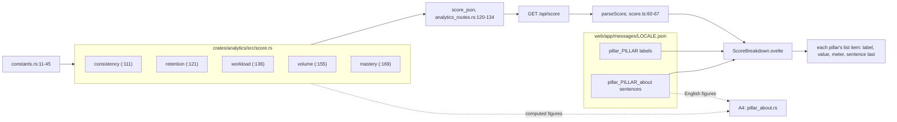

# Score pillar descriptions: each pillar from its function to its sentence

SPEC-606, ADR-627. A data-flow schematic. Every `path:line` citation was read at commit `b065fce`.

Each pillar's figure is computed by its own function in the analytics context, answered by `GET /api/score`, and shown by the score breakdown. The breakdown shows each figure with its label, its bar and, last in its row, its sentence, read from the locale's message file. A4 reads the English sentences back and checks each stated figure against the same functions.

| pillar | function and line | sentence key | locales | test |
|---|---|---|---|---|
| consistency | `consistency`, `crates/analytics/src/score.rs:111` | `pillar_consistency_about` | all seven | A1, A3, A4 |
| retention | `retention`, `crates/analytics/src/score.rs:121` | `pillar_retention_about` | all seven | A1, A2, A3, A4 |
| workload | `workload`, `crates/analytics/src/score.rs:136` | `pillar_workload_about` | all seven | A1, A3, A4 |
| volume | `volume`, `crates/analytics/src/score.rs:155` | `pillar_volume_about` | all seven | A1, A3, A4 |
| mastery | `mastery`, `crates/analytics/src/score.rs:169` | `pillar_mastery_about` | all seven | A1, A3, A4 |

The seven locales are the app's locale list (`web/app/project.inlang/settings.json:8`): en, zh-Hans, zh-Hant, ja, ko, fr and es.

The figures each English sentence states, in order, and the inputs A4 computes them from:

| pillar | figures | computed as |
|---|---|---|
| consistency | 70, 30, 25 | `consistency(1, 0)`; `consistency(1, S) - consistency(1, 0)`; `S`, the smallest streak at which `consistency(1, S)` is 100 |
| retention | 50, 0, 95, 100, 5, 70 | `F`, the largest percent at which `retention(F, 1000)` is 0; that 0; `C`, the smallest at which it is 100; that 100; the smallest answer count at which `retention(F, M)` is 0; twice `retention(F, 1)` |
| workload | 1, 5, 40 | the step `workload(1, 0, 0, true) - workload(1, 0, P, true)` at `P`, the smallest backlog at which it reaches 1; `P`; the step at a backlog of 1,000,000 |
| volume | 80, 100 | `volume(20, 10.0, 20.0, 10.0)`; `volume(25, 12.5, 20.0, 10.0)` |
| mastery | 3, 21, 100, 3, 30 | `G`, the smallest graduation count at which `mastery(G, 0)` is 100; `MATURE_IVL_DAYS`; `mastery(G, 0)`; `mastery(G, 0) - mastery(G, 1)`; `mastery(G, 0) - mastery(G, 1_000_000)` |
