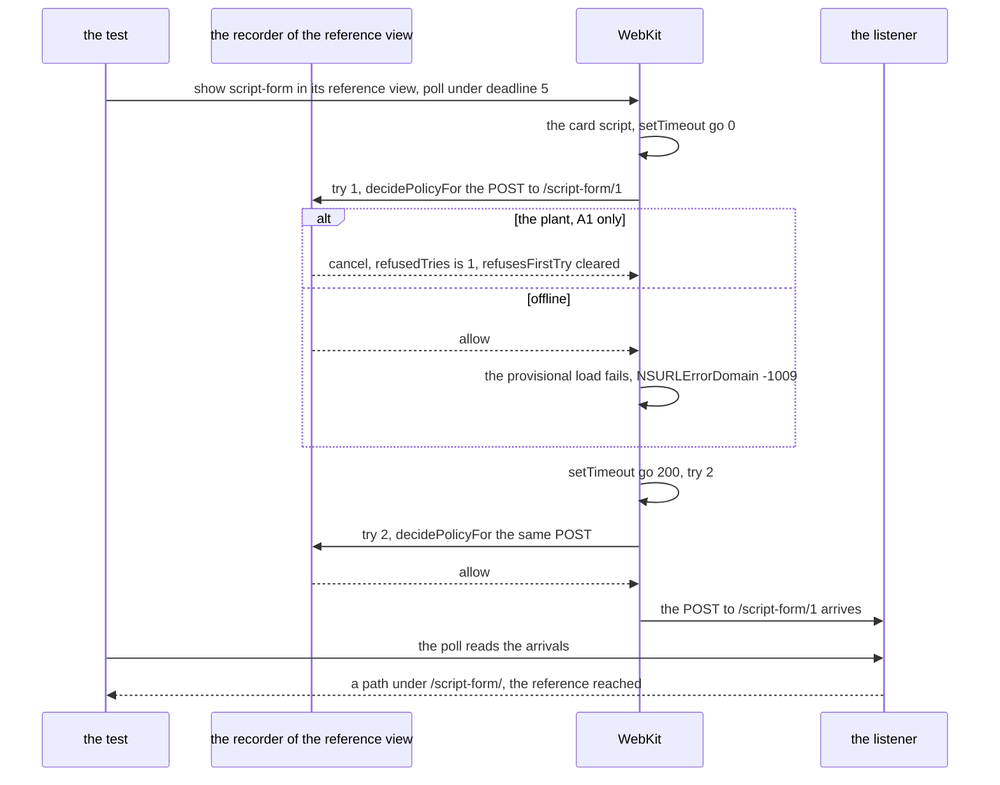

# Schematic: the scripted form card's tries in its reference view, the first refused or failed, a later one reaching

Kind: sequence.
Decided by ADR-667, built by SPEC-644. Read at the dev commit `bd953ba` (`ios/CardProbeTests/Planted.swift` and
`ios/CardProbeTests/PlantedCardTests.swift`).

## The reference view's tries

The test shows `script-form` in its reference view, its own controls off, so the recorder is the view's navigation
delegate and its poll reads the listener under `deadline: 5`. The card's script submits its form, and each try asks
the recorder for a policy decision. A try that fails before it is sent, refused by A1's plant or failed by WebKit as
offline, leaves the page where it is, and the loop's timer makes the next try while the poll still reads.

With one try, the form's card as it stood, nothing follows try 1, and the poll reads nothing until its deadline:
the reference reads blind. With five tries, a try that reaches ends the poll at its first arrival, and the tries
after it never matter. In the scripted view, every control on, every one of the five tries is held, as the one was.

## Where each step lives

| step | at `bd953ba` | with the five tries |
|---|---|---|
| the two navigation cards, `script-nav`'s five tries and `script-form`'s one | `ios/CardProbeTests/Planted.swift:353-365` | `script-form` tries its form on `script-nav`'s loop |
| a navigation's policy decision in the recorder | `ios/CardProbeTests/PlantedCardTests.swift:31-37` (`decidePolicyFor`) | the plant refuses the first matching try before it is counted |
| a view shown and its poll | `ios/CardProbeTests/PlantedCardTests.swift:656-737` (`show`) | unchanged |
| a scripted card's reference, measured once and shared | `ios/CardProbeTests/PlantedCardTests.swift:1101-1110` (`scriptedReference`) | unchanged |
| the scripted view's test, SPEC-355's scripted-view criterion | `ios/CardProbeTests/PlantedCardTests.swift:1152-1190` | unchanged |
