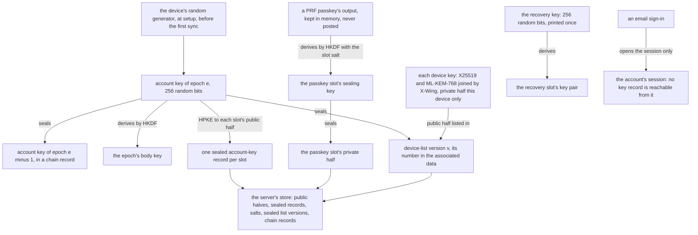
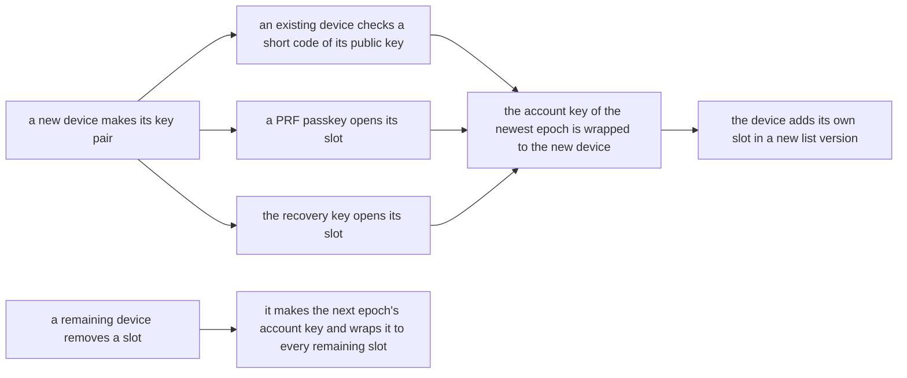
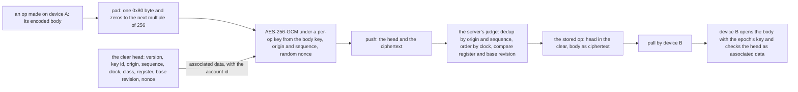
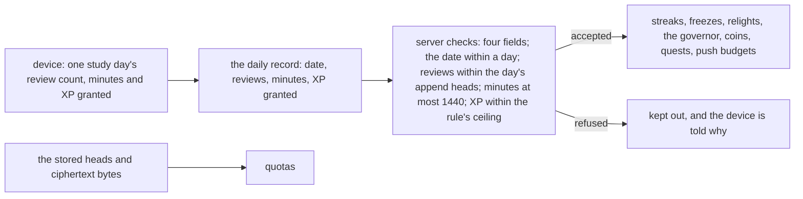

# Sealed sync keys: the account key and its slots, an op's clear head and sealed body, and the daily record's path

A data-flow schematic of SPEC-583 (ADR-602). Every `path:line` citation was read at the dev this change is cut from;
the new paths are SPEC-583's. The design goes live at the sync cut-over and never before it.

## 1. The key hierarchy: from the account key to each slot

A new device joins by one of three doors, and a removal starts the next epoch:

## 2. One op, from one device through the server to another

## 3. The daily record's path to the features it feeds

## 4. Each step, its proof, its red and its row

| step | proved by | red | rows |
|---|---|---|---|
| the four keys, and the server holds none in a usable form (section 1) | A1, A2 | A1 red at the red commit; A2 planted | S58301, S58302, S58303 |
| the clear head holds exactly the judge's fields (section 2) | A3, A4 | A3 red at the red commit; A4 planted | S58304, S58305 |
| the daily record holds exactly four fields, in order (section 3) | A5, A6 | A5 red at the red commit; A6 planted | S58306, S58307 |
| every context and table that sealing touches has a verdict | A8, A9 | A8 red at the red commit; A9 planted | S58308, S58309, S58310 |
| the privacy text the cut-over installs names what is sealed and what is kept | A10 | A10 red at the red commit, its refusals planted | S58311, S58312 |
| the privacy page claims no sealed sync before the cut-over | A11 | not red: the page claims none at dev; its rows are the reds | S58313, S58314 |

Every proof is in `scripts/tests/test_sealed_sync_records.py`. The sealing core, the clients and
the relay that build these steps carry their own tests and models (SPEC-583 section 5).

## 5. What stays as it is

Until the cut-over, the stock-app sync path is unchanged: the sync server's store and its
snapshots (`deploy/scripts/sync-server.sh:78-80`; `deploy/scripts/backup.py:50-52`), the private
copy `ingest` reads (`crates/ingest/src/lib.rs:3-6`), today's sealed web sync key (ADR-374) and
the app's Keychain item (`ios/App/Sources/SyncCredentialStore.swift:38`). The context map, the
privacy page and every table keep their text and schema; the census records what each becomes.
