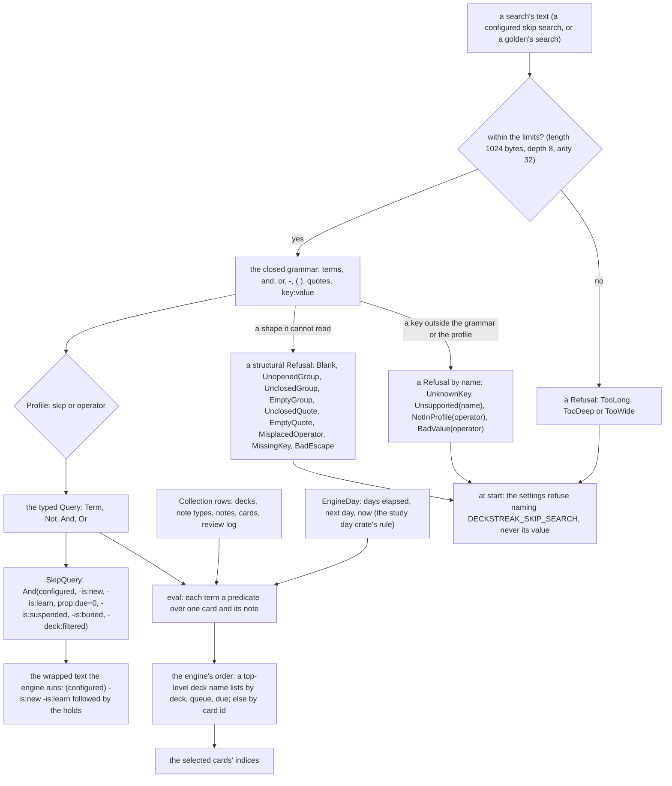
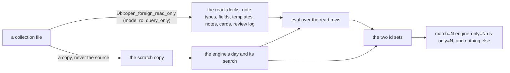

# Schematic: a search, from its text to the cards it selects

Kind: data flow. Read at the delivery's base `bae990a2`, and at the pinned engine `65e053b8` for the syntax and the
predicates it ports (`rslib/src/search/parser.rs`, `rslib/src/search/sqlwriter.rs`,
`rslib/src/scheduler/timing.rs`). Decided by ADR-532; built by SPEC-514.

## The parity tool

## What each edge carries

- **Text to the limits.** The byte length is read before any character: a search past 1024 bytes is refused whole.
  The depth is counted at each `(` and the arity at each group's end, so the parser's recursion is bounded by the
  depth limit.
- **The grammar to the profile.** Each `key:value` is matched against the grammar's own keys first (`deck`, `tag`,
  `is`, `prop`, `card`, `note`, `added`, `rated`); an engine key the grammar does not implement is refused by its own
  name from a fixed list; any other key is a field search only under a profile that admits field searches, and an
  unknown key everywhere else. No refusal carries the search's text.
- **The query to the skip wrap.** The configured query is one operand of a top-level `and` whose other operands are
  the holds; the wrapped text parses back to the same query (`crates/search/tests/holds.rs`), and the Lean entry
  `formal/lean/Formal/SearchHolds.lean` proves no configured query selects a card past the holds.
- **Rows and the day to the evaluator.** The evaluator reads the rows it is given and the day it is given; it opens
  nothing and reads no clock. Names are matched in Rust: the engine's `LIKE` for text and field values, its globs
  with Unicode case folding for deck, note type, template, field and tag names.
- **The source to the parity tool.** DeckStreak's side reads the source only through the kernel's read-only open;
  the engine runs only on a scratch copy, so the source is never opened writable and never written.
