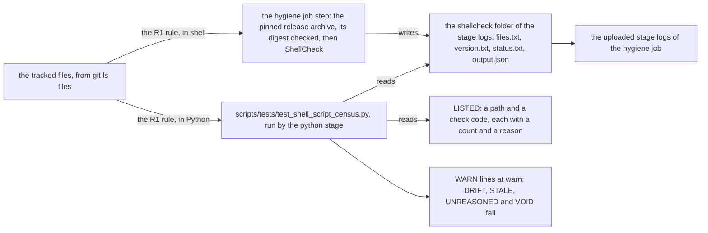

# Schematic: how the hygiene job's ShellCheck step and the shell script census read the tree

Kind: data flow. Decided by ADR-677; built by SPEC-655.

One step of the hygiene job runs ShellCheck over every tracked shell script and saves what it saw;
the python stage that follows runs the census, which lists the same scripts from the tree and
judges the saved output. The tool never decides the job: the census does, starting at warn.

## What each part decides

- The step fails only on the download or the digest. It records the tool's exit status and never
  fails on a finding (SPEC-655 R3).
- The census refuses an empty population, and a saved output that is missing, off the pin or
  contradicted by its exit status, as VOID; a saved list other than its own population fails as
  DRIFT (R2, R4).
- Each finding is compared with LISTED by path and check code. At warn an unlisted finding prints a
  WARN line and passes; a listed entry found fewer times than listed fails as STALE, and an entry
  with an empty reason fails as UNREASONED, at both levels (R5, R6).
- Outside the hygiene job no output is saved, so the repository test reads VOID there (R7).
