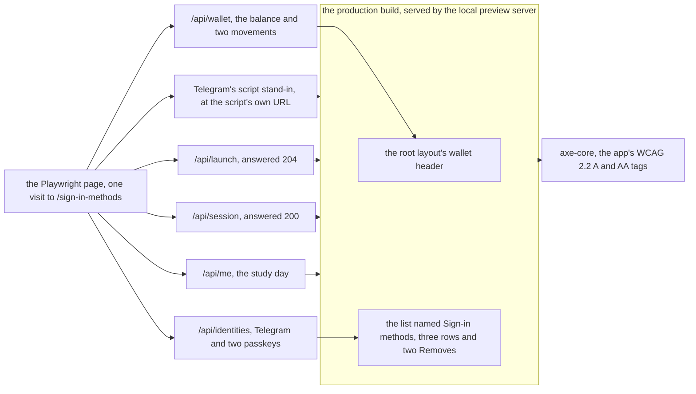
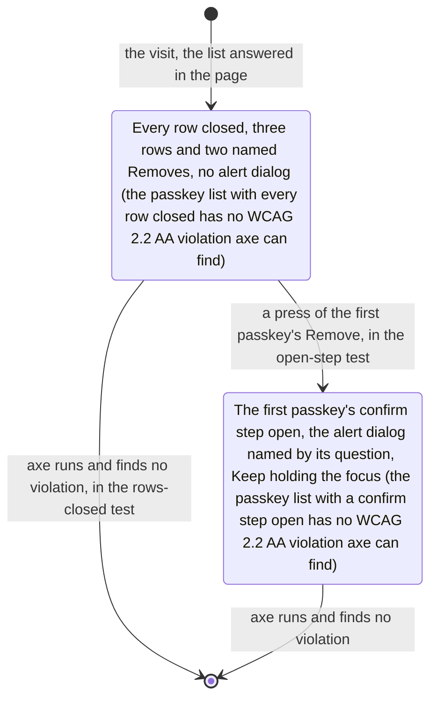

# The sign-in methods list in the browser audit: what is answered in the page and the two states axe reads (SPEC-643, ADR-666)

Kinds: data flow and state machine. Every `path:line` below was read at
`36efa139f5d9dccdb5a4716267fec0ec2ca536fc`. The audit is `web/app/tests/sign-in-methods-a11y.spec.ts`;
the screen is `web/app/src/routes/sign-in-methods/+page.svelte`, which renders
`web/app/src/lib/settings/SignInMethods.svelte` under the root layout
(`web/app/src/routes/+layout.svelte`). The screen and the app's audit are unchanged.

## 1. What the page is answered with, and what axe reads

The palette loop paints each of Telegram's light and dark palettes through the stand-in and
emulates the matching colour scheme, so every answer above is given once per palette.

## 2. The two states axe reads

Each test makes its own visit, so each starts from the list as it first shows.

The list's Removes are matched by their place and an `added ` prefix
(`SignInMethods.svelte:150`, `web/app/messages/en.json:351`), never by the formatted day. The open
step is the `div role="alertdialog"` labelled by its question (`SignInMethods.svelte:152-153`,
`en.json:349`), and Keep takes the focus as it mounts (`SignInMethods.svelte:35`, `:165`).

## 3. What is answered in the page

| answered in the page | stands in for | why |
|---|---|---|
| Telegram's script stand-in, at the script's URL | Telegram's own script, which a chat loads | it sets the palette's `--tg-theme-*` colours the design tokens read, and the Mini App object the wrapper reads |
| `/api/launch`, answered 204 | the server's launch validation | the screen opens as a launch, as every audited screen does |
| `/api/session`, answered 200 | the server's session | the page holds a session, answered as the app's audit and the voice picker's audit answer it |
| `/api/me`, the study day | the owner's study day | the page's study day, answered as both existing audits answer it |
| `/api/wallet`, a balance and two movements | the owner's wallet | the root layout's wallet header reads it on every owner screen (`+layout.svelte:45`) |
| `/api/identities`, Telegram and two passkeys added at two instants | the owner's sign-in methods | the list shows three rows and two Removes with distinct names, so the audit reads the rows and the open step |

The root layout's feed read (`/api/notifications/feed`, `+layout.svelte:42`) is answered by no
route: it is left to the local preview server, as the app's audit and the voice picker's audit
leave it, and no route is added for it.
