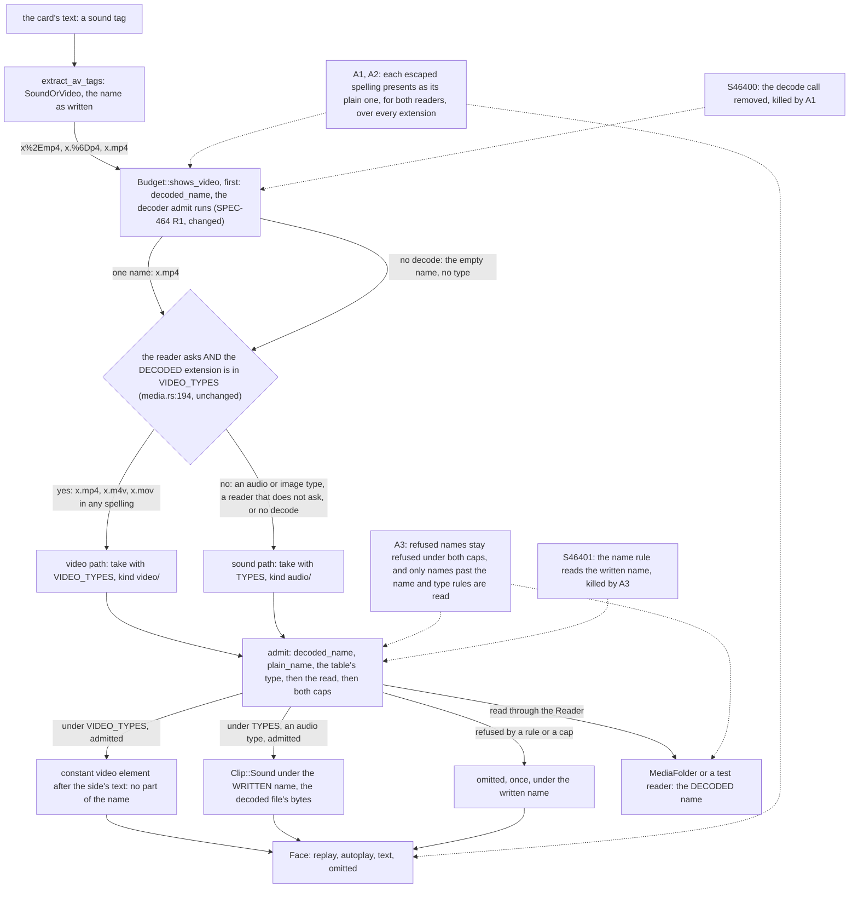

# Schematic: a sound tag's name, from the card to its video decision and to the decoded load

- **For:** SPEC-464, ADR-481. **Kind:** data flow. **Read at:** DEV `36c4783a`.
- **Stands on:** `docs/schematics/ios-review-screen.md` section 7 (SPEC-410's route of a sound tag's video),
  which this schematic leaves as it is.

A sound tag's name reaches the route as the card writes it. SPEC-464 has the budget's video decision decode
it first, with `decoded_name`, the one decoder `admit` runs, so the decision and the load read one form of the
name: an escaped spelling and its plain spelling join at that decode, before the route, and take one path. A
name that does not decode becomes the empty name, which has no type, and stays a sound tag. The clip's name
and the omitted names keep the spelling as written.

| step | reads the name | what an escaped spelling takes | file:line at DEV | changed by SPEC-464 |
|---|---|---|---|---|
| tags | as written | `SoundOrVideo("x%2Emp4")` | `crates/engine-core/src/face.rs:197`, `:199` | no |
| decision | decoded, by `decoded_name` | `x.mp4`: shown as a video for a reader that asks, as `x.mp4` is | `crates/engine-core/src/media.rs:193-195`, `:107-123` | yes: two lines above `:194`, which stays byte-identical (R1; rows S46400, S41012, S41013) |
| route | the decision's answer | the video path | `crates/engine-core/src/face.rs:167-174` | no |
| admit | decoded | `x.mp4` under `VIDEO_TYPES`; a refused name at the rule that refuses it | `crates/engine-core/src/media.rs:281-302` (`:287`, `:288`, `:291`, `:292`) | no (pinned by A3; row S46401) |
| read | decoded | the file `x.mp4`, which the plain spelling reads too | `crates/engine-core/src/media.rs:292`; `crates/ffi/src/face.rs:66-72` | no |
| element | no part of the name | the plain spelling's element | `crates/engine-core/src/media.rs:58-67` | no |
| clip | as written | `Clip::Sound { name: "x%2Emp3", bytes }` for an audio type | `crates/engine-core/src/face.rs:171-174` | no |
| omitted | as written | `"x%2Epng"`, once | `crates/engine-core/src/media.rs:266-277` | no |

The cure is the decision on the decoded name (ADR-481 D2). The names it newly routes to a read, an escaped
`m4v` or `mov`, read only the file their plain spelling reads, under the same rules and caps.

Unchanged and outside the change: `crates/engine-core/src/face.rs`, `crates/ffi/src/face.rs`, `admit`,
`TYPES`, `VIDEO_TYPES`, both caps, every Swift and web file, and the web's reader, which keeps `shows_video` at
its default, so every sound tag stays a sound there.
