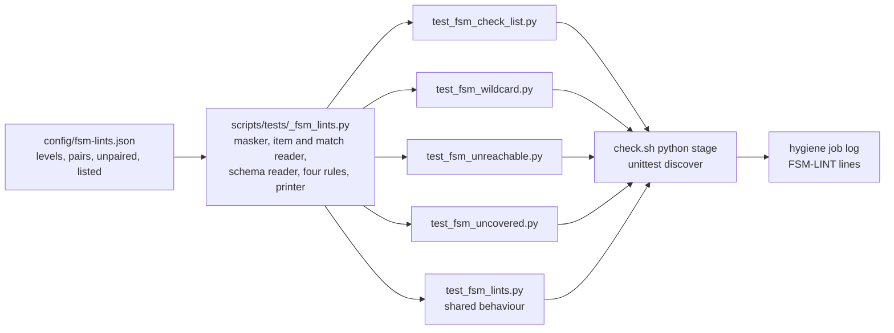
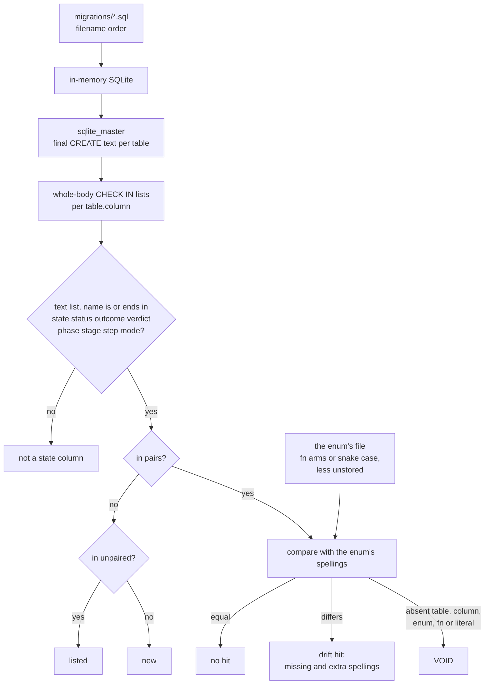
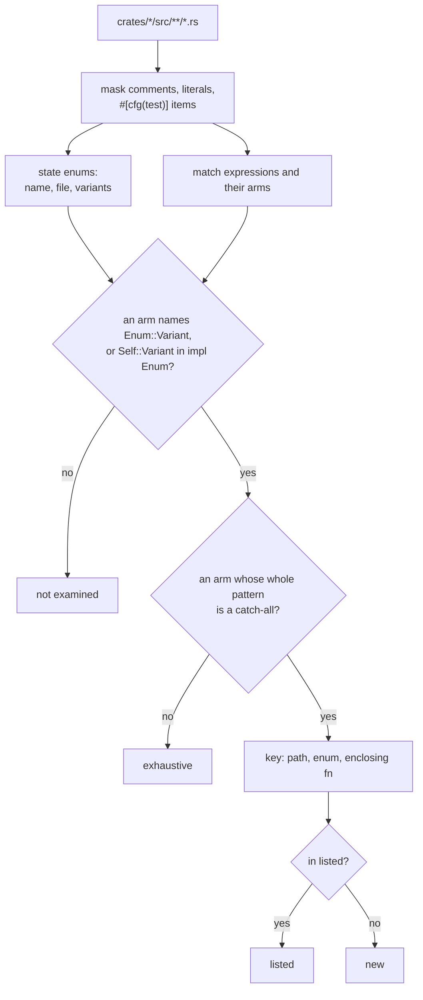
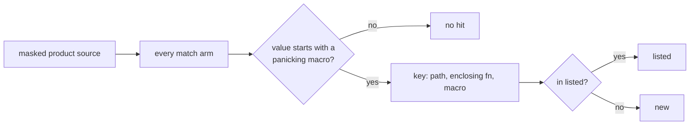
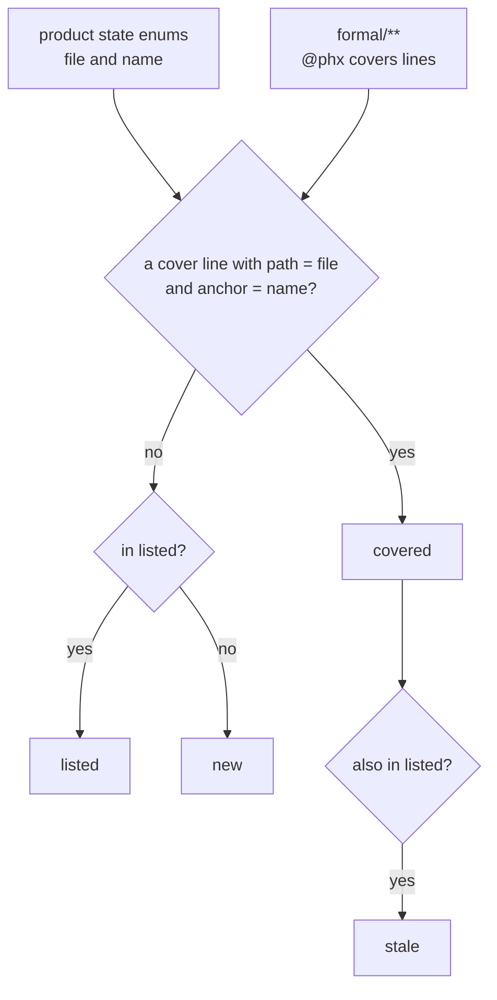
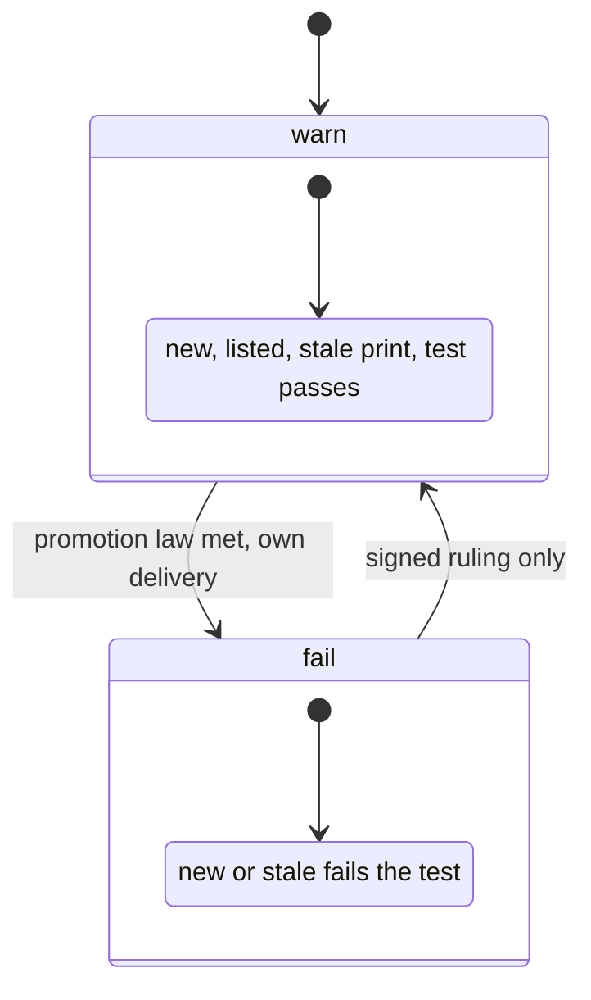

# State-machine lints: the four rules' data flow

Path: `docs/schematics/state-machine-lints.md`. Kind: data flow. Every `path:line` below was read
at dev `b25ed04a`. Decided by ADR-447 for SPEC-433.

## 1. Where the rules run

Each rule is a test module under `scripts/tests`. `scripts/check.sh`'s python stage runs
`python3 -m unittest discover -s scripts/tests -p 'test_*.py'` and prints every suite's output
(`scripts/check.sh:185-188`), and the `hygiene` job runs that stage
(`.github/workflows/ci.yml:351`). So every `FSM-LINT` line lands in the `hygiene` job's log, where
the promotion reader counts it.

## 2. FSM-CHECK-LIST

Population: every `migrations/*.sql` (33 files), executed in filename order into one in-memory
SQLite database. The schema is read from `sqlite_master` once all have run. Matcher: the
whole-body form `CHECK (<column> IN (<literal>, ...))`, read with comments and literals masked.
Examined: the domain lists of the final schema, at least 54 at `b25ed04a` (42 text, 12 integer);
59 written lists fold to them, and `migrations/004102_notifications_queue_claim.sql` rewrites 5.

Sites at `b25ed04a`: 9 state columns; 7 pairs, each equal (`sync_runs.status` with `RunStatus`,
`chests.state` with `ChestState`, `skip_days.state` with `SkipState`, `reading_topic_days.state`
with `TopicState`, `cron_fires.last_outcome` with `Outcome`, `reading_runs.outcome` with
`RunOutcome`, `agent_runs.verdict` with `Verdict`); 2 listed unpaired (`notification_queue.state`,
`inbox_captures.state`); 0 drift.

## 3. FSM-WILDCARD

Population: every `.rs` file under `crates/*/src` (340), masked of comments, literals and items
under `#[cfg(test)]` (27 product files hold one). State enums: those declared there whose names end
in the seven suffixes, 12 at `b25ed04a`. Matcher: an arm whose whole pattern is `_`, `_ if`, a lone
binding or `<binding> @ _`, in a match whose arms name the enum's variant. Examined: 13 matches at
`b25ed04a`.

Sites at `b25ed04a`: 2 listed, `crates/readings/src/state.rs:302` (`TopicState::class`) and `:312`
(`TopicState::reason`).

## 4. FSM-UNREACHABLE

Population: FSM-WILDCARD's masked product source. Matcher: a match arm whose value is
`unreachable!`, `panic!`, `todo!` or `unimplemented!`, bare or first in its block. Examined: the
product files (340) and every match arm in them.

Sites at `b25ed04a`: none. The two such macros under `crates/*/src` are masked:
`crates/kernel/src/verdict.rs:29` sits in a doc comment, and `crates/daemon/src/wiring.rs:1515`
sits under `#[cfg(test)]`.

## 5. FSM-UNCOVERED

Population: the product state enums (12) and every `@phx covers` line in the 55 modules under
`formal/` (251 at `b25ed04a`). Matcher: a cover whose path is the enum's file and whose anchor is
the enum's name.

Sites at `b25ed04a`: 1 covered, `Phase`, by
`formal/tla/MintReadsTheFinalBase/MintReadsTheFinalBase.tla:2`; 11 listed (`BandStep`,
`NotifyState`, `AnchorState`, `SkipState`, `RunStatus`, `ChestState`, `TopicState`, the insights
`State`, the passkeys `State`, the poll `Step` and the wiring `Step`).

## 6. Levels, the ratchet and VOID

At either level, a reading that examined nothing, a walk whose count differs from an independent
listing, or a register entry outside its seed with no ruling file is VOID and fails. A listed entry
is deleted freely, and an entry outside the seed is added only with a `ruling` that names a file
under `docs/rulings/`.
