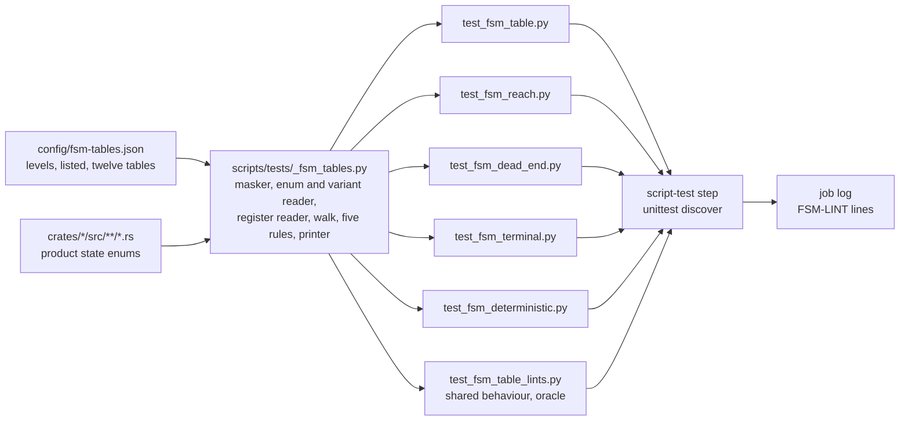
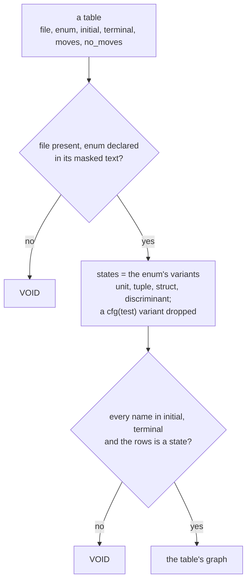
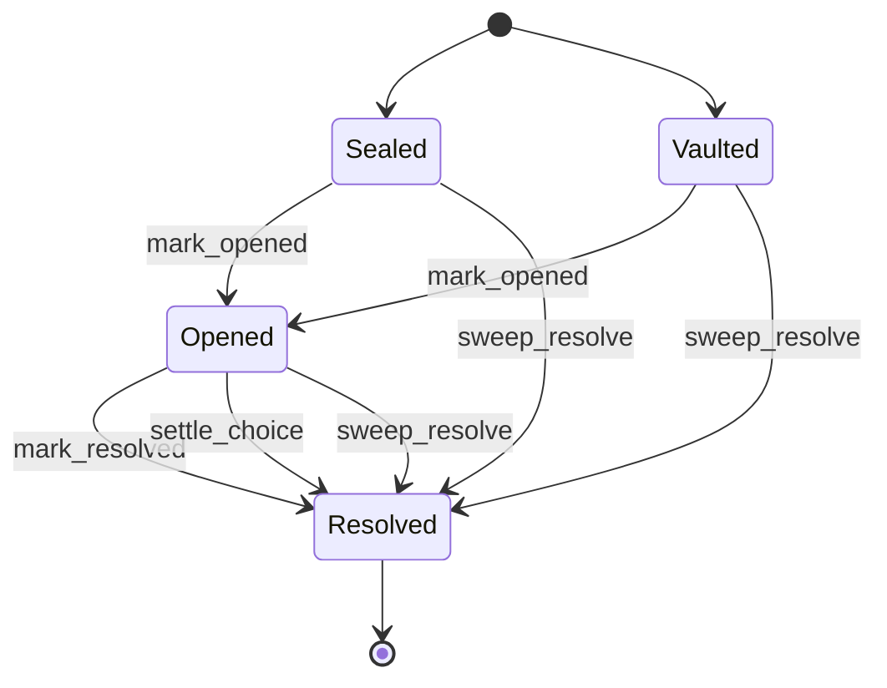
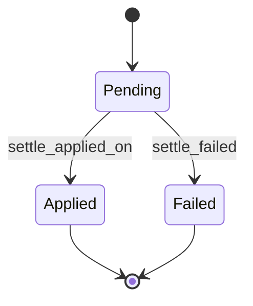
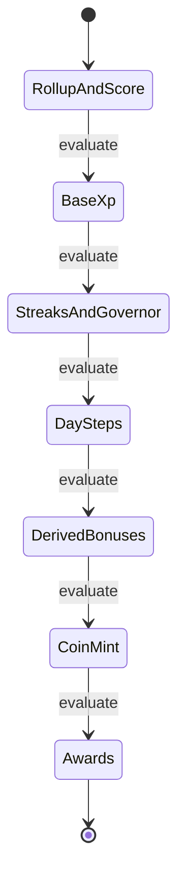
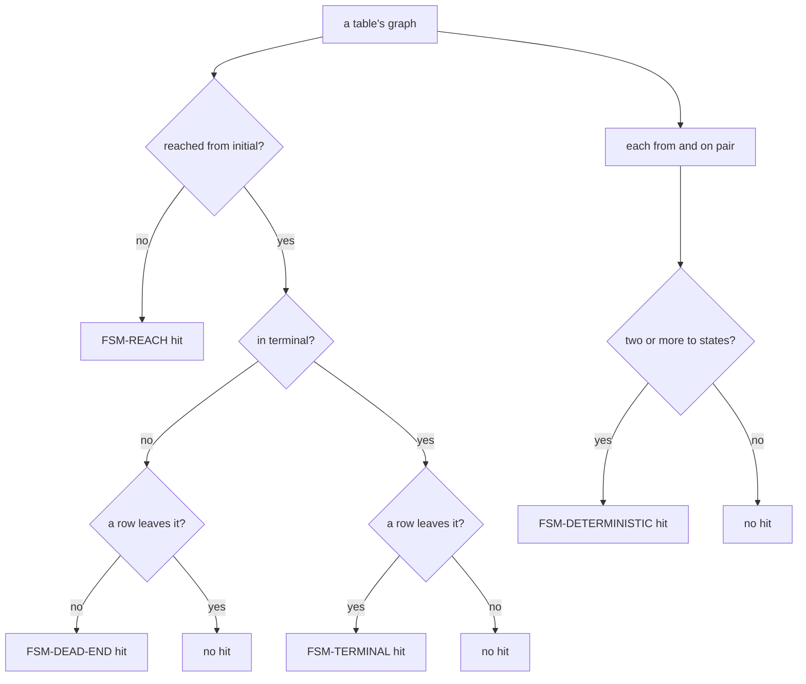
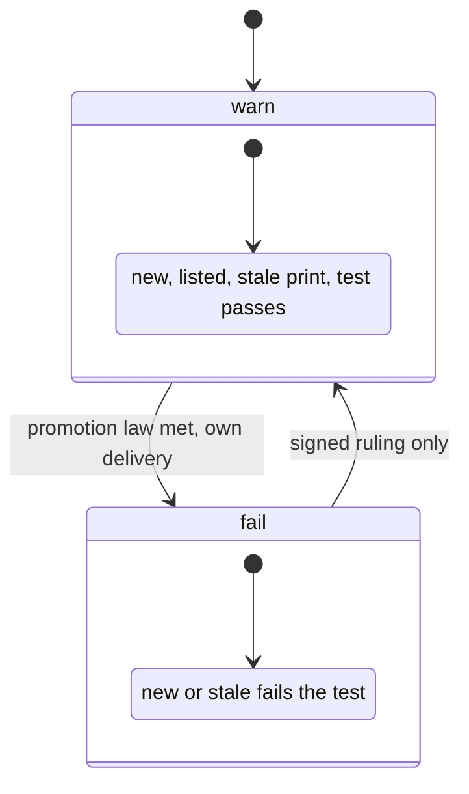

# State-machine transition tables: each table's shape and the five rules' data flow

Path: `docs/schematics/state-machine-transition-tables.md`. Kind: state machine (the three tables
with moves) and data flow (the five rules). Every `path:line` below was read at dev `b25ed04a`.
Decided by ADR-448 for SPEC-434.

## 1. Where the rules run

Each rule is a test module under `scripts/tests`, beside SPEC-433's four. The script-test step that
runs `python3 -m unittest discover -s scripts/tests -p 'test_*.py'` runs them, so every `FSM-LINT`
line lands in the same job log as SPEC-433's lines, where the promotion reader counts them.

## 2. A table's shape

A table is keyed by `file` and `enum`. It holds `initial`, `terminal`, `moves` (rows
`{"from", "to", "on"}`) and, only when `moves` is empty, `no_moves`. Its states are not listed: they
are the enum's variants, read from the enum's declaration in `file`.

## 3. The three tables with moves

`ChestState` (`crates/quests/src/chest_store.rs:50`, stored in `chests.state`). Each move is a
guarded update naming the states it leaves (`:300`, `:316`, `:337`, `:355`).

`SkipState` (`crates/ingest/src/skip.rs:232`, stored in `skip_days.state`). `begin` inserts
`pending` (`:363`); `mark_undone_on` writes another column and is no row.

`Phase` (`crates/coordination/src/recompute/mod.rs:56`), the order `PHASES` (`:74`) the fold keeps
(`:487-493`) and runs (`:631`).

## 4. The nine tables with no moves

Each declares every state initial and terminal, and says why no write moves it.

| enum | file | states | why no move |
|---|---|---|---|
| `BandStep` | `crates/curriculum/src/progress.rs:240` | 3 | one comparison's outcome |
| `NotifyState` | `crates/daemon/src/lifecycle.rs:46` | 3 | a datagram, never a held value |
| `Step` | `crates/daemon/src/wiring.rs:605` | 12 | the label of a failed sync step |
| `State` | `crates/identity/src/passkeys.rs:135` | 2 | a ceremony's kind, fixed at its insert |
| `AnchorState` | `crates/ingest/src/gate.rs:102` | 3 | one read's finding |
| `RunStatus` | `crates/ingest/src/sync_runs.rs:159` | 3 | inserted with its run, never updated |
| `State` | `crates/insights/src/registry.rs:8` | 2 | a row's setting in the source |
| `TopicState` | `crates/readings/src/state.rs:257` | 6 | overwritten whatever it held |
| `Step` | `crates/bot/src/poll.rs:228` | 3 | one start request's outcome |

## 5. The five rules

| rule | population | walk | examined at `b25ed04a` | hits at `b25ed04a` |
|---|---|---|---|---|
| FSM-TABLE | product state enums in `crates/*/src` (340 files) | each enum against the register's keys | 12 state-enums | 0 |
| FSM-REACH | every state of every table | breadth first from `initial` over `moves` | 51 states | 0 |
| FSM-DEAD-END | reached states outside `terminal` | a row leaving each | 10 states | 0 |
| FSM-TERMINAL | reached states in `terminal` | a row leaving each | 41 terminals | 0 |
| FSM-DETERMINISTIC | distinct `(from, on)` pairs of every row | the `to` states of each pair | 15 pairs | 0 |

Each state takes one path through the first branch, so it is a hit of at most one of FSM-REACH,
FSM-DEAD-END and FSM-TERMINAL. A hit is keyed by its enum and state (or state and event), printed
at the enum's file and the variant's line, and compared with the rule's `listed` entries: listed,
`new`, or, for a listed entry no hit matches, `stale`.

## 6. Levels, the ratchet and VOID

At either level, a reading that examined nothing, a tree with no `crates/` or no register, a table
naming a file, enum or state that is absent, FSM-TABLE's walk count differing from an independent
listing, or a register that is malformed or holds a listed entry with no ruling file is VOID or
refused, and fails. A listed entry is deleted freely, and added only with a `ruling` that names a
file under `docs/rulings/`.
