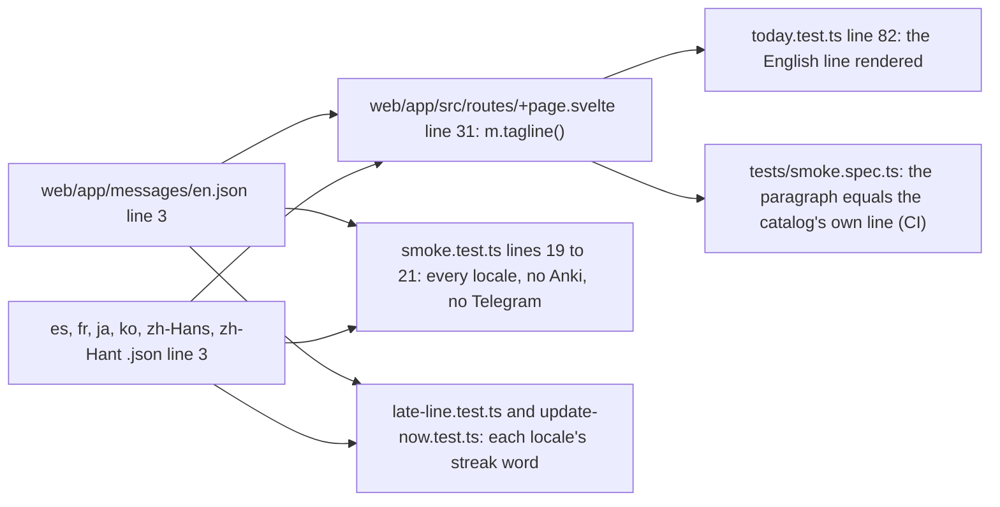

# Tagline: line 3 of the seven catalogs, the tests that pin it, and the order of the red

Read at dev before this delivery. Decided by ADR-600; built by SPEC-581, cut after SPEC-580 merges.

| step | criteria | red, and where it is read | control |
|---|---|---|---|
| the red commit: `smoke.test.ts` lines 19 and 21, `today.test.ts` line 82 | A1, A2 | both FAIL on dev's catalogs, locally under Vitest, every locale and every run | A3 and A4 green |
| the green commit: line 3 of the seven catalogs | A1, A2 | both pass | A3 and A4 still green: every streak word kept |

No rows (ADR-600 D3). Nothing else in the web app changes.
