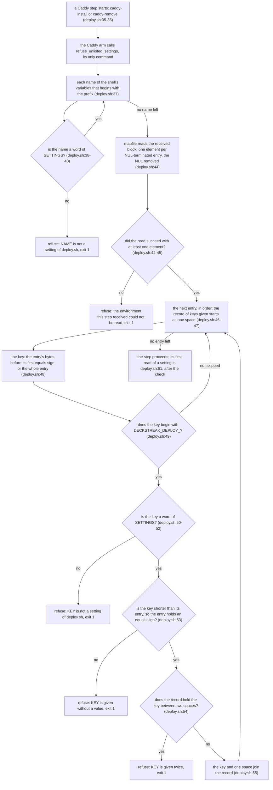
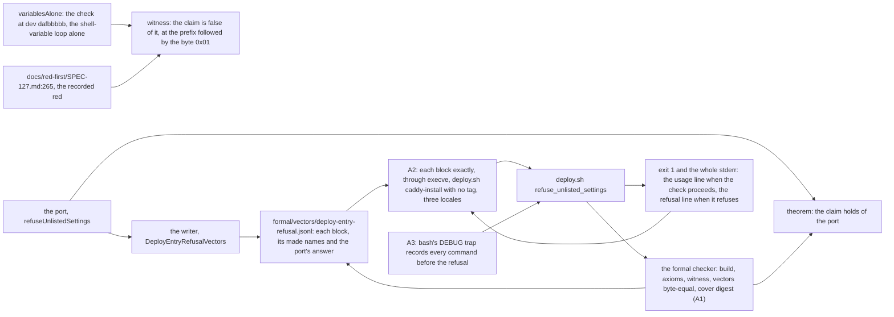

# Schematic: the Caddy steps' settings check and its Lean proof

Every `deploy/deploy.sh:<n>` citation below was read at dev `36c4783a`. After SPEC-473 the same
lines are the body of `refuse_unlisted_settings`, unchanged, and the Caddy arm calls it; the
citations name the lines as dev holds them.

## The check, from the received block to the verdict (data flow)

Nothing on this path reads a setting's value or writes a file: the names loop reads names, the
entry loop reads each entry only to cut its key and to compare the key with the whole entry, and
each refusal writes one line to stderr. A name outside the prefix that the shell reads as code
when it starts runs before `step` and is outside this drawing and the proof (#423).

## The port beside each step

| step of the check | `deploy/deploy.sh` at dev | the port in `formal/lean/Formal/DeployEntryRefusal.lean` |
|---|---|---|
| the function the Caddy arm calls | `:35-58` (after SPEC-473, the function's span) | `refuseUnlistedSettings`, the `covers` anchor `refuse_unlisted_settings` |
| the listed settings | `:29-34` | `settingsText`, split by `fields` (bash's word split at spaces, tabs and newlines) |
| the `!=` loop over the words | `:39`, `:51` | `named` |
| the shell-variable loop | `:37-41` | `variablesLoop`, over the prefixed members of its input list |
| the read of the block | `:44-45` | `entries` (the split at each NUL); the read that fails is `none` |
| the cut at the first `=` | `:48` | `cut` |
| the prefix test | `:49` | `startsWith pfx` |
| the no-value test | `:53` | the key compared with its entry, as the script compares them |
| the record and the given-twice test | `:46`, `:54-55` | the record as bytes, and `isInfixOf` of the key between two spaces |
| each refusal's line | `:40`, `:45`, `:52-54` | `Fault.line` |

The claim, `Claim`, reads the block as the kernel lays it out (`layout`: each entry followed by its
NUL) and names the keys with library functions: the bytes before the first `=`, a list prefix,
membership in the 13 listed names, no duplicates. The theorem is `Claim refuseUnlistedSettings`.

## The proof, the vectors, the tests and the witness (data flow)

| marked item | what it observes | where it runs |
|---|---|---|
| A1, the formal checker's check of `lean/DeployEntryRefusal` | the theorem, the witness, no hole, the vectors equal to the writer's output, the cover's digest | the committed tree, by the formal checker |
| A2, `test_a_caddy_step_agrees_with_every_vector_of_its_lean_proof` | the step's exit status and whole stderr on every vector block; the header; `SETTINGS` against the single-name blocks; an empty working directory; the function defined once and called by the arm | CI only |
| A3, `test_a_caddy_step_reads_only_the_settings_it_names_and_refuses_any_other` | the declared opening, the call included, against bash's record | CI only |
| the witness, `the_shells_variables_alone_admit_an_entry_no_shell_can_spell` | the claim is false of the check at dev `dafbbbbb` | the formal checker |
| rows S47301 to S47303 | the call, the cut at the first `=`, the no-value test | CI, each killed by A2 |
