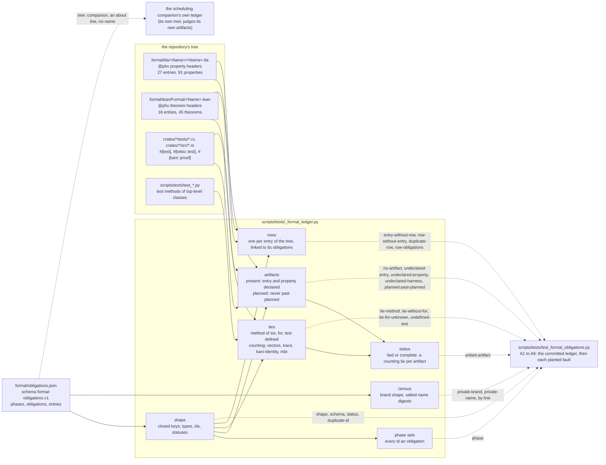

# The formal obligations ledger and its checker

- **Kind:** component.
- **Read at:** `5c44700b`; every count below is at that commit.
- **Decided by:** ADR-514 (SPEC-496).

## The components

The ledger names each engine property once, with the artifacts that carry it, the ties that bind each artifact to
the shipped code, and the gaps no tool closes. The checker reads the ledger and the tree, never a formal tool's
output, and lists every refusal by its arm; the test plants one fault at a time and reads the arm that refuses it.
The census reads the ledger's text alone. Solid edges are reads; dotted edges are refusals.

## What a tie is, and what is not

| binds an artifact | counts toward `tied` | why |
|---|---|---|
| `vectors`: a Rust test asserts every vector a Lean entry writes | yes | it fails when the code disagrees with the port |
| `trace`: a Rust test replays the code's runs as model steps | yes | it fails when the code takes a step the model does not |
| `kani-identity`: the harness calls the shipped function | yes | it checks the shipped item itself |
| `mbt`: model-based tests over the model's actions | yes, with its `mutant` named | only a planted mutant shows it can fail |
| `census`: an absence over the tree | no | it proves no property |
| `cross-target-hash`: equal hashes on every host | no | it tests an equality, it proves none |
| a `@phx covers` stamp | never a tie | it fails on an edit of the span, never on a divergence |

## The ledger at this commit

- 18 obligations, `O1a` and `O1` to `O17`, every one `planned`; phase set `"1"` holds 4 ids and `"2"` holds 10.
- Present artifacts: the three sync models' 11 properties in `O1a`, and the 52 properties and theorems of the 15
  engine-tied entries in `O11`; each is judged against its header on every run.
- Planned artifacts: 27 entries (6 TLA+, 21 Lean) and 29 Kani harnesses, each in its obligation; 6 companion
  artifacts in `O4`, `O5` and `O10`.
- One tie: the replay history's vectors test, `crates/fsrs7/tests/formal_vectors_replay_history.rs`.
- 43 rows, one per existing entry.
