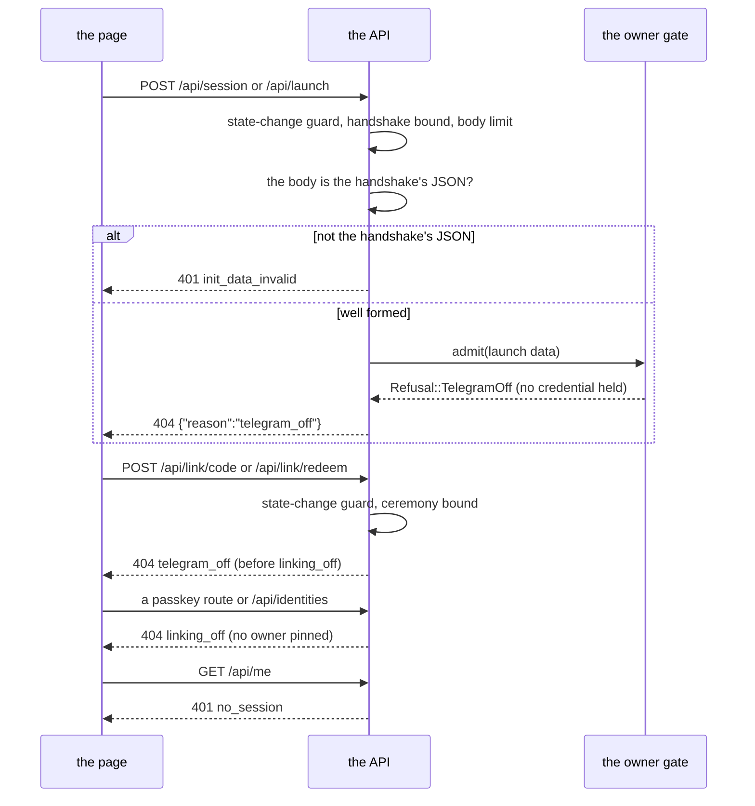
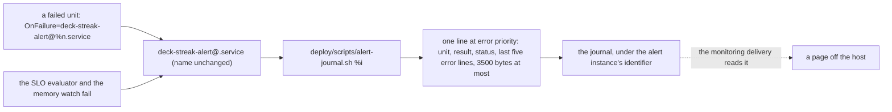
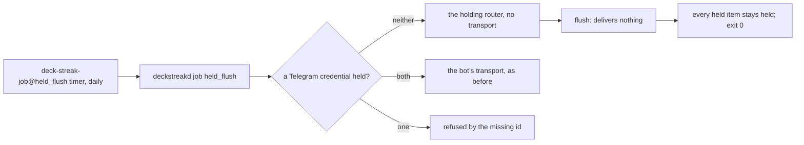

# The install carries no Telegram surface

SPEC-582 and ADR-601. What the install under `deploy/` runs once the Telegram surfaces leave it,
how the API answers with Telegram off, where a unit's failure goes, and what the held flush does
with no transport. Each step names the test that proves it and the row that is its red.

## 1. The install's units and timers, before and after

```mermaid
flowchart LR
  subgraph before["before"]
    B1["deck-streak-bot.service"]
    B2["deck-streak-job@sync (path unit)"]
    B3["tmpfiles: the request directory"]
    B4["held_flush drop-in: the bot's pair"]
    B5["deck-streak-second-route.service and .timer"]
    B6["api, alert template: the bot's pair"]
  end
  subgraph after["after"]
    A1["api: no credential"]
    A2["alert template: the journal sender, no credential"]
    A3["job template, its timers; the held_flush timer stays"]
    A4["sync server, MCP server, replicator, backups, SLO evaluator, memory watch"]
  end
  before -- "SPEC-582 R1, R3, R11, R12" --> after
```

| step | proved by | red |
|---|---|---|
| no bot unit, no doorbell, no request-directory line, no held-flush drop-in; 12 unit files page | A10 | seen red in CI on the first push; row S58214 |
| no unit loads the bot's pair | A11 | seen red in CI; row S58214 |
| no second route unit or timer; its script and model stay | A21 | seen red in CI |
| the rail contract holds 29 rows over 18 units | A20 | seen red in CI |
| the budget names 13 units, inside the share | A19 | seen red in CI |

## 2. The gate's request flow with Telegram off

| step | proved by | red |
|---|---|---|
| the role starts with neither credential, or with no credentials directory | A1, A2 | seen red on the base: the role refused start |
| one credential without the other refuses start by its id | A3 | not red (the base's behaviour); row S58202 |
| the held gate's three cases | A4 | not red (a new function); rows S58201, S58202 |
| `telegram_off` is a 404 with its reason alone | A5 | not red; row S58205 |
| the handshake and the launch answer `telegram_off`, a malformed body `init_data_invalid`; the link-code routes answer `telegram_off` before `linking_off` | A6 | not red; rows S58203, S58204 |

## 3. The alert path, from `OnFailure=` to the journal

| step | proved by | red |
|---|---|---|
| the template runs the journal sender, which names the unit and its result at error priority | A13 | seen red in CI; row S58207 |
| it reads no credential and makes no request | A14 | seen red in CI |
| it quotes the failed run's lines, bounded, in whole characters | A15 | seen red in CI; rows S58208, S58209 |
| every SLO alert and the channel route to `journal` | A16, A17 | seen red on the base, locally; row S58213 |
| no shipped source outside the bot names the Bot API | A9 | seen red on the base: the Telegram sender named it |
| the template's deny list still names the identity endpoint's range | A22 | not red; row S58210 |

## 4. The held flush with no transport

| step | proved by | red |
|---|---|---|
| neither credential: the job exits 0 and every held item stays | A8 | seen red on the base: the job refused its missing credentials directory; row S58206 |

## 5. The deploy and the edge

| step | proved by | red |
|---|---|---|
| the deploy restarts the API alone, a release with no bot unit deploys, the switch back restarts the API alone | A18 | seen red in CI; row S58211 |
| the edge's policy admits no framing origin | A12 | seen red in CI; row S58212 |
