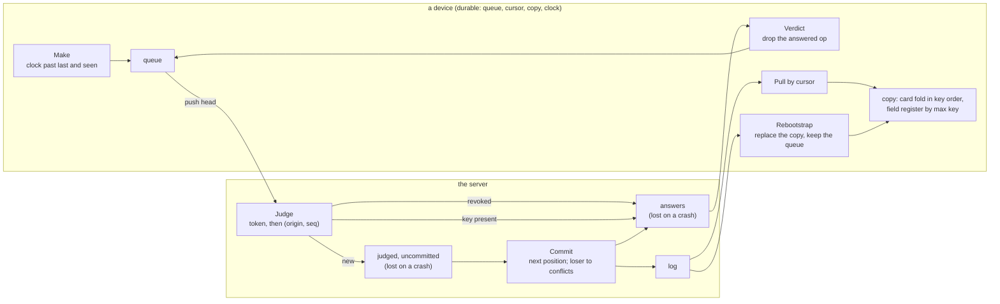

# The op log model and its four proofs

- **Kind:** data flow and component.
- **Read at:** `d3b09d5e`, before the sync core exists.
- **Decided by:** ADR-522 (SPEC-504).

## The flow the model checks

A device makes an operation, keeps it durably in its queue, and pushes the queue's head. The judge reads the
device's token, then the (origin, seq) key, and either refuses, answers Duplicate, or hands the operation to the
writer, which appends it at the next log position and records the loser of a concurrent edit. The device drops the
operation from its queue only when it reads its answer, and pulls the log by cursor into its copy, folding the card
and each field's register as the operations arrive.

## Where each property and proof sits

| place | TLA+ property | Lean entry |
|---|---|---|
| Make | CausalHlc, CausalHlcAtMake | SyncClock: `tick_gt_seen`, `tick_ge_pt`, `run_strict_mono`, `causal` |
| Judge | ExactlyOnce, RevokedDeviceRefused | PushJudge: `judge_idempotent`, `no_review_mutation` |
| Commit | NoSkip, MonotoneLog, NoSilentOverwrite, RetractOnlyOwn | - |
| Verdict, Rebootstrap | NoLostReview, RebootstrapKeepsPending | - |
| Pull and the copy | LocalIsPrefix, CanonicalCardFold, FieldConverges, UndoOwnOnly, Convergence | ReviewKey: `fold_sorted_perm_invariant`; FieldMerge: `merge_comm`, `merge_assoc`, `merge_idem`, `apply_perm_invariant` |

The Lean entries share `Formal/SyncOrder.lean`, the key and edit orders, and write their vectors through
`Formal/SyncVectors.lean`. The sync core, when it lands, covers its tick, sort, merge and judge from these entries and
reads each vectors file byte-equal in a Rust test.
