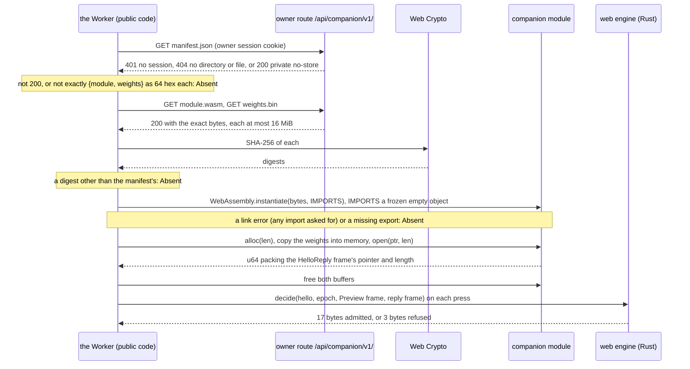
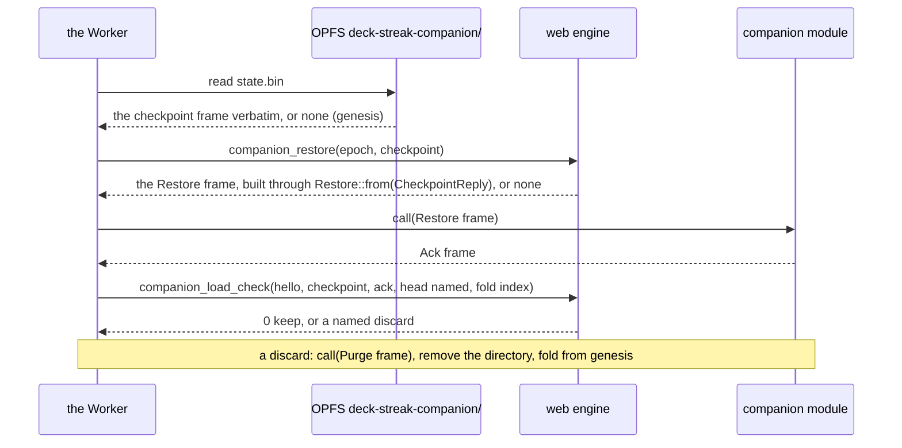
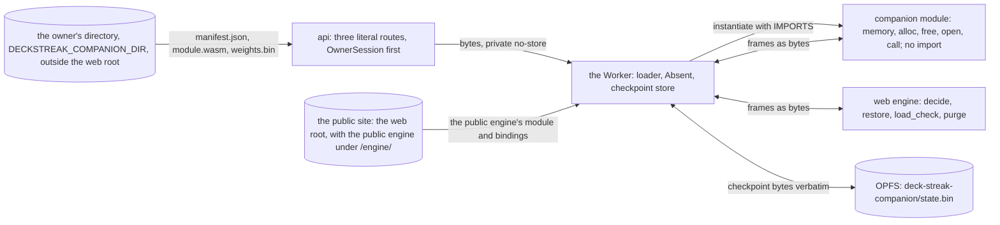

# The owner route and the companion loader

Read at `92755ef0`. SPEC-511 and ADR-529 decide what this draws: the order in which the web client's Worker loads the
owner's scheduling companion and fails closed (sequence), and where each file and each frame goes between the route,
its directory, the Worker and the web engine (data flow).

## 1. The loader (sequence)

Every step that fails reads `Absent`, and an `Absent` companion answers every request with the `Refused { Absent }`
frame, which the web engine's `decide` refuses. The Worker builds no frame: the web engine builds each one.

## 2. The stored checkpoint (sequence)

## 3. Route, directory, Worker and engine (data flow)

| crosses | from | to | content |
|---|---|---|---|
| the manifest, the module, the weights | the owner's directory, through the route | the owner's Worker only | no learner content; uncached |
| frames | the web engine and the module | each other, through the Worker | integers only (SPEC-501 R1) |
| the checkpoint frame | the module | OPFS, and back verbatim | derived, opaque; kept on the device only |
| nothing | the module | storage, network, clock | the import object gives it none |

The census of the built site (`scripts/companion-site-census.py`) holds that no file of the left-hand column ever sits
in the public site.
