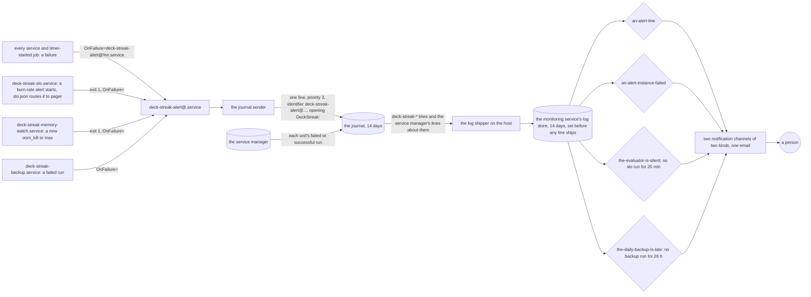
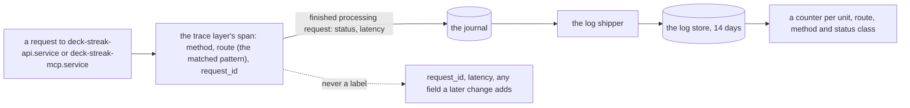
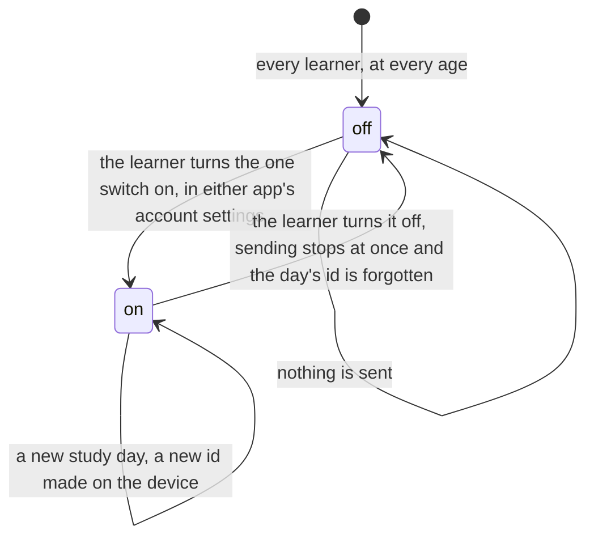

# Schematic: the pager, the request counters and the usage switch

Kind: data flow (the pages and the counters) and a state machine (the usage switch). Read at
the `dev` commit SPEC-585's pull request names as its design base, with the alert template and
`deploy/slo.json` as SPEC-582 leaves them. Decided by ADR-604; built by SPEC-585. Every
`path:line` below is at that commit.

## The pages, from a failing unit to a person

Every service and timer-started job names `OnFailure=deck-streak-alert@%n.service`; the SLO
evaluator and the memory watch page by failing (`deploy/scripts/slo-evaluate.py`, `main`). The
alert template's journal sender writes one line; the log shipper on the host sends DeckStreak's
lines to the monitoring service, which matches the pages that `docs/monitoring/pager.json`
declares and notifies a person.

| step | what holds it | its red | its rows |
|---|---|---|---|
| every alert routes to `pager`, the channel is `pager`, the template is shipped | A1 (`test_slo_declaration.py`) | red at the red commit: the base routes to `journal` | S58500, S58501, S58502 |
| the declaration's route is the SLO declaration's | A2 (`test_pager_declaration.py`) | the stub's route is `journal` | S58503 |
| the alert line is matched by the template's identifier, at priority 3, opening `DeckStreak: ` | A2 | the stub declares no page | S58504, S58505 |
| a failed alert instance pages on the service manager's record; the template names no `OnFailure=` | A2 | the stub declares no page | S58506 |
| the evaluator's silence pages within two to four of its five-minute periods | A3 | the stub declares no page | S58507 |
| a daily backup more than a day and at most two hours late pages | A3 | the stub declares no page | S58508 |
| only `deck-streak-*` lines ship, kept no longer than `privacy.json`'s `P14D` | A4 | the stub ships `*` and keeps no window | S58509, S58510 |
| a page reaches two channels of two kinds, one email | A4 | the stub declares no channel | S58511 |
| the log store's window, the shipper, the policies and the channels exist and fire | SPEC-585 section 8, the hand-run verify | none in the tree | none |

What the second route told the owner now arrives this way:

| failure | before (SPEC-396) | now |
|---|---|---|
| a monitored unit fails | the alert sender | `an-alert-line` |
| the alert sender cannot write its line, runs past its timeout or is killed | the second route's report | `an-alert-instance-failed`, from the service manager's record |
| the host, its service manager, a timer or the shipper goes quiet | the receiver's missing check-ins | `the-evaluator-is-silent` |
| the daily backup does not run | its failure only, when it ran | `an-alert-line` when it fails, `the-daily-backup-is-late` when it never runs |
| the host or the edge stops answering | the receiver's missing check-ins | the uptime checks, made outside this repository with the same channels |

## The request counters, from the request log

The span is opened at `crates/api/src/router.rs:298-315` and `crates/mcp/src/server.rs:103-120`;
the evaluator's fixture holds the event at `scripts/tests/fixtures/journal/api-burn.jsonl:1`. A
request no route matched carries no `route`, and is counted as `unmatched`.

| step | what holds it | its red | its rows |
|---|---|---|---|
| the labels are exactly the unit, the route, the method and the status class | A5 (`test_pager_declaration.py`) | the stub declares no label | S58512 |
| every other field of the response event stays out, and a new one is refused | A5 | the stub declares no label | S58512 |
| the journal's copy at the monitoring service keeps the journal's window | A6 (`test_privacy_policy.py`) | the base's page says nothing of the copy | S58513 |

## The usage switch, from the learner's choice

While the switch does not exist, both apps send nothing, and the privacy page says so. When it is
built (SPEC-585 section 9), an `on` app sends only the fixed list of events and the coarse daily
learning measures, each under the day's id; the account, any sign-in or device identifier, cards,
notes, deck names, searches, free text, single reviews, times of day and locations are never sent,
and the learning measures never ride the sealed sync's daily facts.

| step | what holds it | its red | its rows |
|---|---|---|---|
| the privacy page states what the server counts, that the apps measure nothing, and that any later measurement is off until turned on by one switch | A6 (`test_privacy_policy.py`) | the base's page has no `## Measuring use` | S58514 |
| the page and the app's privacy manifest agree that nothing is collected for analytics and nothing tracks | A6 | the base's page says nothing of measurement | S58515 |
| the switch itself, the collector and their labels | their own deliveries (#1100, #1101, #1102) | none here | none here |
