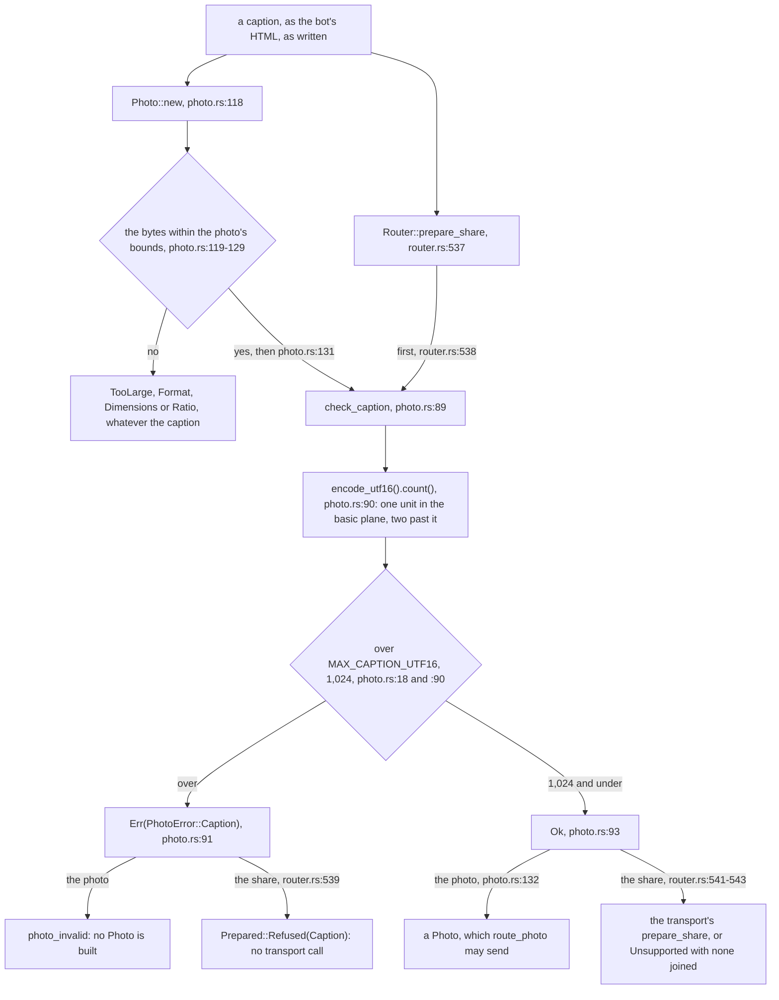
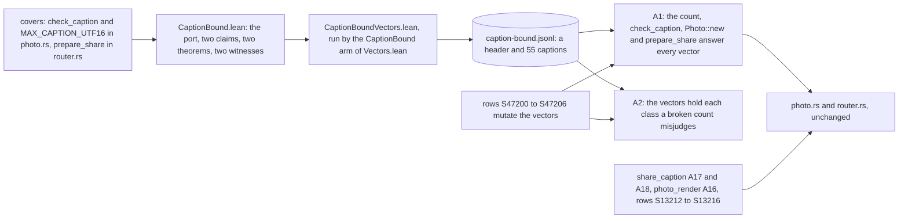

# Schematic: the photo caption bound, and its Lean proof

Kind: data flow and component. Read at DeckStreak `dev` `36c4783a`; every `path:line` is read
there. Added for SPEC-472 (ADR-489, #480). It rewrites neither
`docs/schematics/w7-image-pipeline-and-its-no-provider-path.md`, which draws the photo and the
share reaching their transport calls, nor `docs/schematics/notification-router.md`, which draws the
router's decision: it draws the one step both paths take before any transport call, the caption's
bound, and the Lean entry that proves it.

## A caption, from each path to its answer

Both paths ask one function with one bound, so they take one set of captions: the photo whenever its
image is within its other bounds, the share always. The bot's own `MAX_CAPTION_UTF16`
(`crates/bot/src/transport.rs:71`) is another rule, for a document's caption, and is not drawn here.

## The Lean port, step by step

`formal/lean/Formal/CaptionBound.lean` reads a caption as a list of characters.

| step | the code | the port | what the claims say of it |
|---|---|---|---|
| one character's units | the standard library's `char::encode_utf16`, reached through `photo.rs:90` | `encodeUtf16`: one unit when `code & 0xFFFF == code`, else two | `utf16Length` counts by the plane rule, one below U+10000 and two from it, written apart from the port |
| the caption's count | `caption.encode_utf16().count()`, `photo.rs:90` | `countUnits`, the length of every character's units | equal to `utf16Length` for every caption |
| the bound | `MAX_CAPTION_UTF16`, `photo.rs:18` (covered) | `maxCaptionUtf16`, 1024 | the platform's limit, 1,024, written as a literal in both claims |
| the check | `check_caption`, `photo.rs:89-94` (covered) | `checkCaption` | `TakesExactlyTheCaptionsWithinTheLimit`: `ok` exactly within the limit, `Caption` past it |
| building a photo | `Photo::new`, `photo.rs:118-133` (not covered: `new` is defined twice in the file) | `photoNew`: the image's own verdict as one input, then `checkCaption` | `OneSetOfCaptions`, the photo's side, and an image's refusal standing whatever the caption |
| preparing a share | `Router::prepare_share`, `router.rs:537-543` (covered) | `prepareShare`, answering a `Share`: `refused` with the check's error, or `transport` | `OneSetOfCaptions`, the share's side: refused before any transport call past the limit |

The witnesses, each the negation of one claim for a mutant of the S13200 band that its row proves
killed:

| witness | the mutant it ports | its input |
|---|---|---|
| `a_caption_is_counted_in_utf16_units_not_in_characters` | `checkByCharacters`, row `S13212`'s `caption.chars().count() > MAX_CAPTION_UTF16` | 1,023 letters and one character past the plane: 1,024 characters, 1,025 units |
| `the_share_asks_the_bound_of_its_own_caption` | `prepareShareAskingTheEmptyCaption`, row `S13213`'s `check_caption("")` | 1,025 letters |

## The tie between the port and the code

- **The vectors** are the empty caption and nine characters (U+0061, U+00E9, U+65E5, U+D7FF, U+E000,
  U+FFFF, U+10000, U+1F600, U+10FFFF) at 1,023, 1,024 and 1,025 units, each filled with the
  character and with the character last after letters: captions at the limit, one over it, and
  ones whose last character lies past the basic plane. Each line names its runs of code points, the
  port's unit count and its answer.
- **The tests.** A1 builds each caption from its runs and asks the crate's own code; A2 reads the
  vectors alone and counts the captions a count by characters, a count by bytes or a check that
  refuses at the limit would misjudge. Both are mutation coverage: the bound is already on dev.
- **The checks.** The formal checker proves both theorems, builds both witnesses, compares the
  vectors with the writer's output byte for byte, and stales the entry when a covered span moves.
  CI runs A1 and A2 and the rows; no CI job runs the Lean entry.
