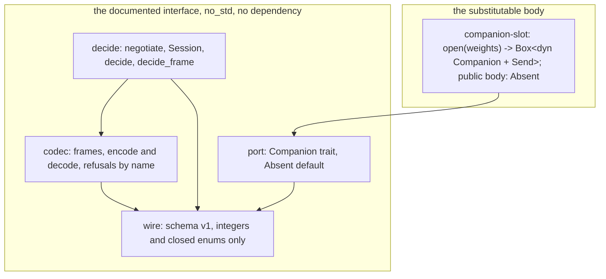

# The scheduling companion's documented interface

Read at `d3b09d5e`. SPEC-501 and ADR-519 decide what this draws: the interface's crates and who may link them
(component), and what crosses between the app and a companion, in which order, and what never crosses (data flow).

## 1. The crates (component)

The interface crate depends on nothing; the slot is the one body a build substitutes, and its public body is `Absent`.
The engine core, the umbrella FFI crate and the web engine reach them only in the changes that first use them (#997,
#998), so no arrow below leaves either crate for them yet.



## 2. One press, previewed and committed (data flow)

The app asks before it writes. `decide` is the one door to a written due date; a refusal writes nothing and asks no
other scheduler.

```mermaid
sequenceDiagram
  participant App as the app (public code)
  participant Codec as codec
  participant Companion as companion (slot body)
  App->>Companion: Hello{major 1, minor 0, release}
  Companion-->>App: HelloReply{status, major, minor, build_id, model_id, model, adapter}
  Note over App: negotiate: Ok only for status Ok, major 1, Trained; else the session keeps no model
  App->>Codec: encode Preview{event, target_ppm}, epoch e
  Codec->>Companion: frame (len, major, minor, kind 3, e, body)
  Companion-->>Codec: frame of Due{status, card, staged_t_ms, interval_days, due_day, model_id}
  Codec-->>App: decode, or Malformed
  Note over App: decide: Ok(NewDue) only when every condition holds; any Refusal writes nothing
  App->>App: write the due date from NewDue, then read the review back from the log
  App->>Companion: Commit{event read back}
  Companion-->>App: Ack{status, folded, head_t_ms}
```

## 3. What crosses, and what never does (data flow)

| crosses | from | to | content |
|---|---|---|---|
| schema versions and the app's release | the app | companion | no |
| review id, origin, sequence, card, note, home deck, preset | the app's log | companion | no: ids only |
| grade, kind, answer time, study day, target retention | the app | companion | no |
| status, model, adapter, build and model ids, state hash | companion | the app | no |
| interval and due day | companion | the app | no |
| checkpoint bytes | companion | the app, and back verbatim | derived, opaque; kept on the device only (`companion-state`) |

Never crossing: note fields, tags, deck names and paths, guids, media, notetype names, the per-review client record,
the Telegram id, sync credentials and the collection file. No type of `wire.rs` can hold them (SPEC-501 C1).
