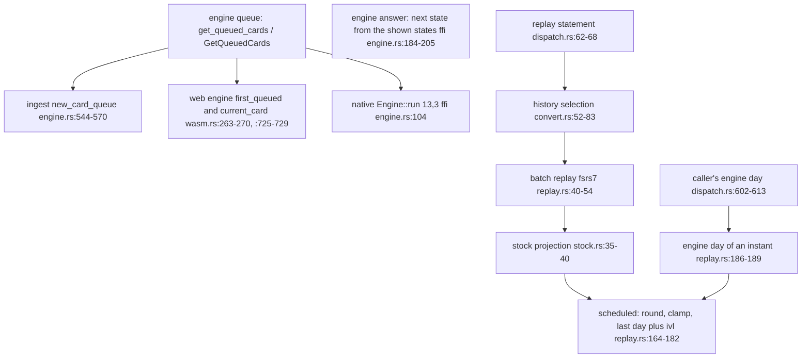
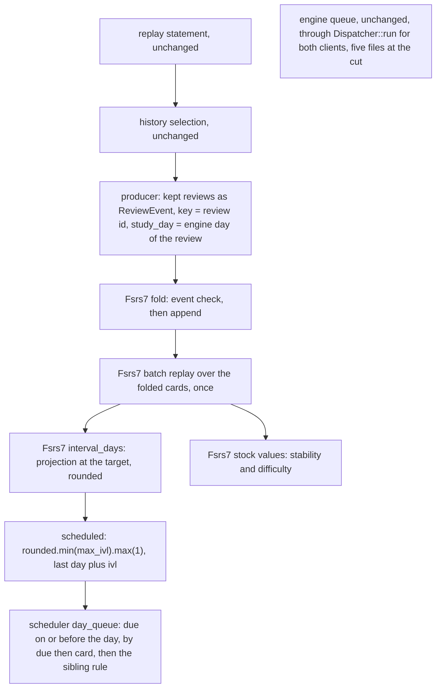
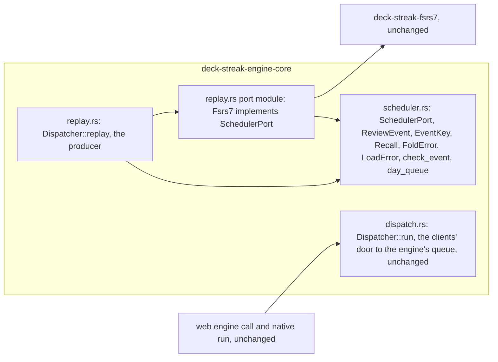
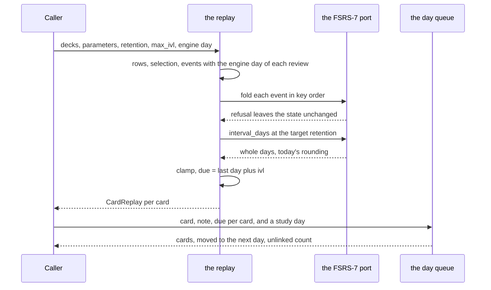

# The scheduling port and its FSRS-7 implementation

Read at dev `75d555c4`. Every `path:line` below is at that commit. SPEC-494 and ADR-512 decide what this draws.

## 1. Where the queue and the due days come from, before (data flow)

Every queue and every due day a learner sees comes from the engine. DeckStreak's one due day of its own is the FSRS-7
replay's, which nothing but a test calls.

## 2. After (data flow)

The replay's due day has one source, the port's `interval_days`. The port's module sits in the engine core beside
`Dispatcher::run`, the clients' one door to the engine's queue; no method of the trait gives a queue, so the engine's
queue passes that door unchanged and the route census names it as the engine's boundary.

## 3. The trait between them (component)

The crate graph is unchanged: the core depends on the engine, its protocol crates and `deck-streak-fsrs7`, and gains
no dependency; the two client adapters depend on the core; no workspace crate depends on anything new.

## 4. Where the study day enters, and where the sibling rule sits (sequence)

The producer is the only reader of a day: the port and the day queue read no clock and no timezone.

## 5. The tests, reds and rows of each step

| step | test (SPEC-494) | red at the stub commit | rows |
|---|---|---|---|
| the port's whole days on the fixtures, and the retention check | A1 `fsrs7_behind_the_port_gives_todays_due_days_on_the_replay_fixtures` | the stub answers 0 days | S49415, S49428 |
| the port's whole days over a grid | A2 `fsrs7_whole_days_equal_todays_rounding_over_a_fixed_grid` | the stub answers 0 days | S49415 |
| the day queue and the sibling rule | A3 `two_cards_of_one_note_never_share_a_study_day`, `the_sibling_rule_holds_over_every_small_queue` | the stub keeps both siblings | S49409 to S49412, S49424 |
| a card with no note id | A4 `a_card_with_no_note_id_turns_the_rule_off_and_is_counted` | the stub counts nothing | S49413, S49414 |
| only through the port | A5 `the_due_days_come_only_through_the_port_and_no_new_file_asks_for_the_engine_queue` | the stub replay keeps its direct path | S49420 |
| no clock in the port | A6 `no_clock_or_timezone_read_sits_inside_the_port` | the stub port reads the clock | S49421 |
| the fold's refusals | A7 `a_fold_refuses_a_key_not_after_the_last_and_leaves_the_state_unchanged` | the stub refuses nothing | S49403 to S49408 |
| checkpoint and restore | A8 `a_checkpoint_restores_to_equal_bytes_and_equal_intervals` | the stub checkpoint is empty | S49416 to S49418, S49423, S49425 to S49427 |
| the probe and the version | A9 `predict_is_a_pure_probe_and_the_version_names_the_model` | the stub answers one constant | S49400 to S49402, S49419, S49422 |

The replay suite and the graph suite run unchanged at every step and hold today's pins through the port.
