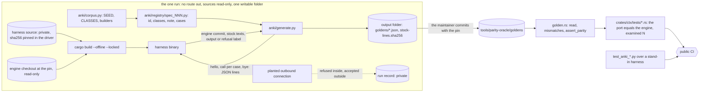

# Schematic: the second oracle, from a sandboxed engine run to a Rust assertion

Kind: data flow, with the clean and dirty roles. Read at `5c44700b` (ADR-012, ADR-029,
`tools/parity-oracle/README.md`, `tools/parity-oracle/golden.rs`, the root `Cargo.toml:4` and `:173-175`).
Decided by ADR-516.

| step | what crosses | guard |
|---|---|---|
| registry to driver | registrations with declared classes | every declared class has a case and every case's class is declared; the corpus pin is current; else exit 2 |
| sources to driver | the harness source and the engine checkout | a writable source is refused; the harness source's digest must equal the pin; else exit 2 |
| harness to driver | the engine commit, stock texts, outputs | another engine, a malformed or extra key, a refusal in words, or a non-zero exit fails the run (exit 3), and nothing is written |
| driver to output | strict goldens and the census digests | closed keys; no golden holding a stock line; writes only in the output folder |
| golden to Rust | typed cases | `mismatches` reports each case that differs; the fixture with one wrong output proves it can fail |
| tree to workflows | nothing | no workspace member, lock package or workflow reaches the harness |

**The two roles.**

| role | who | may read | writes |
|---|---|---|---|
| dirty | the harness's author and the run's operator | the engine's API and source at the pin | the harness and the run record, both private |
| clean | whoever writes a port that replaces an engine module | the documentation, this tree and the goldens | the port and its tests; its read list and the similarity score go to the private clean-room record |
