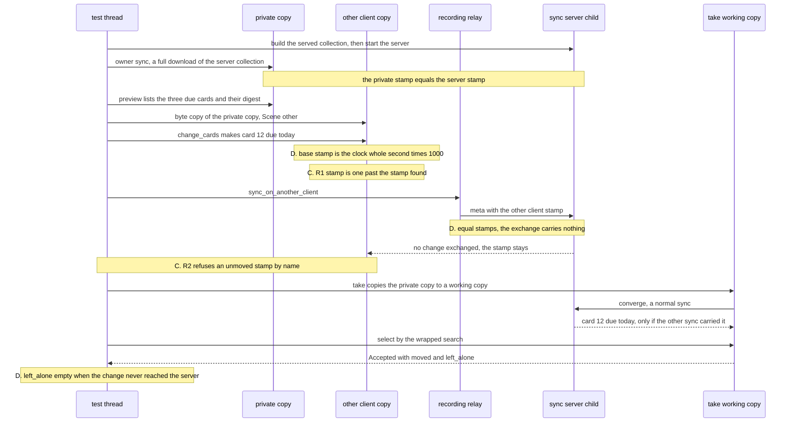
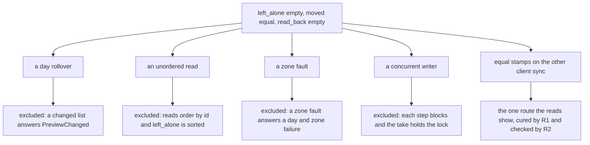

# The skip write test's other-client change always reaches the server

Kind: sequence. Owner: SPEC-459, ADR-476. Every `path:line` was read at dev
`83846ea3929ab3805c1e95db7291097fde559cd2`.

## The take's path, from the preview to the read the test makes

The test `a_take_pushes_exactly_the_previewed_cards_and_their_review_log_rows`
(`crates/ingest/tests/skip_write.rs:936-1037`) drives these steps in order on one thread; each runs
to completion before the next. D marks the dependence (ADR-476 D1), C the cure (ADR-476 D2).

The steps, by source:

| step | source |
|---|---|
| served collection and server child | `skip_write.rs:583-634`, `crates/ingest/tests/support/mod.rs:242-279` |
| owner sync, full download | `skip_write.rs:656-665`, `crates/ingest/src/sync.rs:332-347` |
| preview | `skip_write.rs:693-704`, `crates/ingest/src/skip_write.rs:103-142` |
| other client copy | `skip_write.rs:687-691` |
| the change (D, then C) | `crates/ingest/tests/support/synthetic.rs:1147-1172`, the stamp at `synthetic.rs:1169` |
| the other client's sync (C) | `support/mod.rs:780-785`, `support/mod.rs:756-771` |
| equal stamps exchange nothing | `synthetic.rs:1141-1142`, `synthetic.rs:354`, `crates/ingest/src/engine.rs:330-342` |
| the take's converge | `crates/ingest/src/skip_write.rs:297-305` |
| the selection and `left_alone` | `crates/ingest/src/skip_write.rs:312`, `skip_write.rs:458-487` |
| the test's read | `skip_write.rs:970-980` (the assertion at line 972) |

## Where the reads exclude other causes

## The recurrence census, by job

Each figure is the test's own duration, beside its job or artifact.

| where | result | duration |
|---|---|---|
| leg 138 baseline, job 116852801329 | FAIL | 37.885 s |
| leg 4 baseline, artifact 12034287584 | PASS | 98.243 s |
| leg 39 baseline, artifact 12036596584 | PASS | 98.000 s |
| leg 89 baseline, artifact 12040467680 | PASS | 96.073 s |
| leg 137 baseline, artifact 12049712679 | PASS | 97.445 s |
| leg 139 baseline, artifact 12049119648 | PASS | 95.583 s |
| leg 190 baseline, artifact 12048525712 | PASS | 95.697 s |
| leg 0 baseline, artifact 12035213593 | PASS | 70.475 s |
| leg 2 baseline, artifact 12037005357 | PASS | 75.074 s |
| `rust` test stage, artifact 12057161155 (job 117031548517, 2059 s stage) | PASS | 78.437 s |
| `rust` test stage, artifact 12057403758 (job 117043344169, 2406 s stage) | PASS | 95.348 s |

Counted by verdict, without the test's own line: 85 more baselines of the failing run that its
mutation verdict did not void, and 52 more `rust` jobs over the last 60 completed CI runs whose test
stage was green. Not read: 98 voided baselines of the failing run, 5 cancelled `rust` jobs and one
run with no jobs (SPEC-459 section 7).
