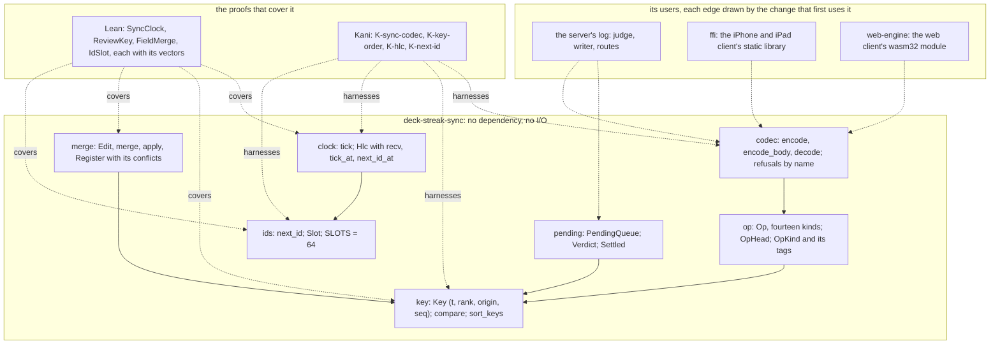
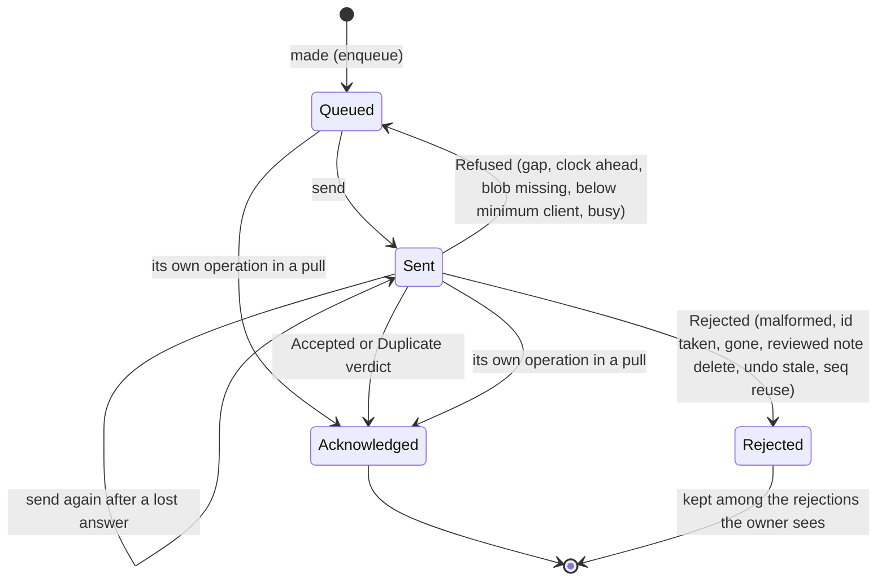

# The sync core and a pending operation's life

Read at `554a223e`. SPEC-509 and ADR-527 decide what this draws: the sync core's modules and who links the crate
(component), and the life of one operation in a device's pending queue (state machine).

## 1. The crate and its users (component)

`deck-streak-sync` depends on nothing and does no I/O. Its users are drawn dashed: the server's log, the umbrella FFI
crate and the web engine gain their edges in the changes that first use the crate (#15), so no manifest names it yet.
The Lean entries and the Kani harnesses check the modules they cover.

## 2. A pending operation's life (state machine)

An operation enters the queue when the device makes it and leaves only on its judgement. Sending changes its stage;
a retryable refusal sends it back. Acknowledged operations are part of the base; a rejected one is kept, bytes and
reason, for the owner.

