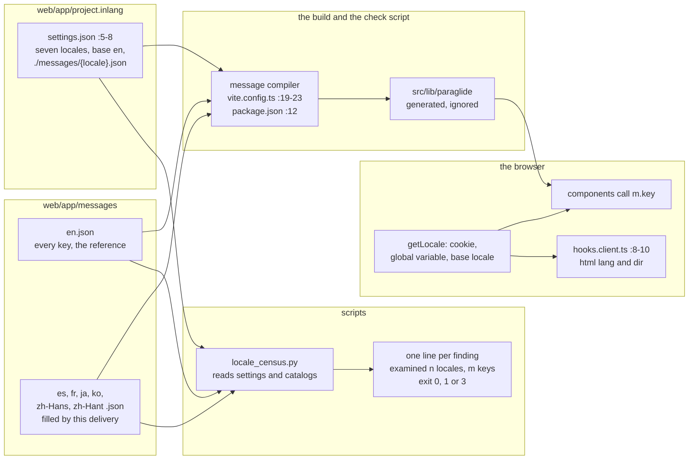
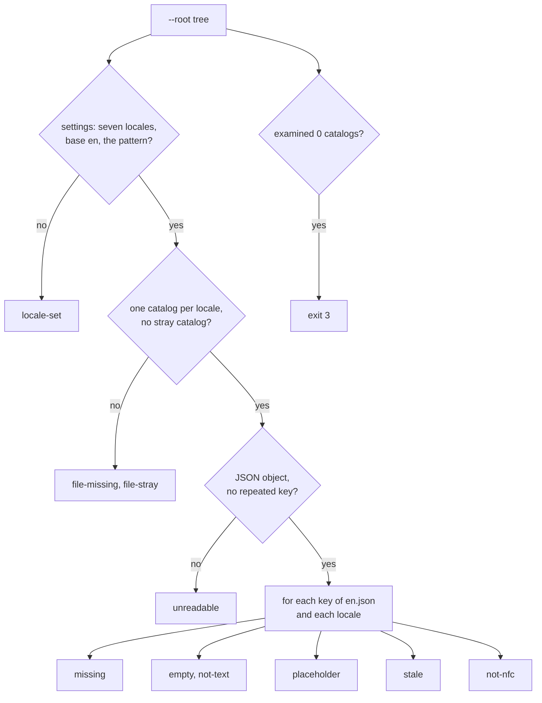

# The web app's seven message catalogs, and the census that holds them whole

The data flow of SPEC-571 (ADR-590): where each web message lives, how the web app chooses the locale
it shows, and what the census reads and refuses. Every `path:line` below was read at
`4e600dbb7565bd7cd6becb8f1c724b5e502c3d4a`.

## Data flow

## How a message reaches a screen

1. A component calls the compiled message function for its key.
2. The runtime picks the locale in its default order: the locale cookie when one is set, then a
   global variable, then `en`. No file in the tree sets either, so a visitor sees `en` unless a
   cookie names another locale. This delivery does not change that order.
3. The compiled function returns the locale's text. A key missing from that locale returns
   English's text; after this delivery the census refuses such a gap, so none ships.
4. `hooks.client.ts:8-10` sets `<html lang>` and `dir` to the active locale, so the CJK
   stylesheet's `:lang()` rules and assistive technology read the page's language.

## What the census reads and refuses

## Each step, its test, its red and its row

| step | test (`scripts/tests/test_locale_census.py`) | red | rows |
|---|---|---|---|
| the locale set, base and pattern | `TheWebCensus.test_a_locale_set_other_than_the_seven_is_refused` (A6) | the stub accepts every tree | S57101 to S57107 (each locale), S57108 (base), S57111 (pattern) |
| one catalog per locale, readable, no repeated key | `TheWebCensus.test_an_unreadable_or_repeating_catalog_is_refused` (A7) | the stub accepts every tree | the Python lane |
| a key English holds is in every locale | `TheWebCensus.test_a_key_removed_from_one_locale_is_refused` (A1) | the stub accepts every tree | the Python lane |
| no blank value, no value that is not text | A2 and `TheWebCensus.test_a_value_that_is_not_text_is_refused` (A8) | the stub accepts every tree | the Python lane |
| placeholders equal English's | `TheWebCensus.test_a_placeholder_that_differs_from_english_is_refused` (A3) | the stub accepts every tree | S57109 |
| no key English lacks | `TheWebCensus.test_a_key_english_lacks_is_refused_as_stale` (A4) | the stub accepts every tree | the Python lane |
| every value in NFC | `TheWebCensus.test_a_value_out_of_nfc_is_refused` (A5) | the stub accepts every tree | S57110 |
| nothing examined is not a pass | `TheWebCensus.test_a_tree_with_no_catalog_is_void` (A10) | the stub exits 0 | S57112 |
| a complete tree reads green | `TheWebCensus.test_a_planted_complete_tree_reads_green` (A9) | not red: the control | the killer of S57101 to S57108, S57110, S57111 |
| the web app's catalogs are whole | `TheWebTree.test_the_web_apps_catalogs_are_whole` (A11) | the tree before the fill | the census in CI over every later change |

## Where the census runs

- Locally: the builder runs `test_locale_census` by its module name over planted trees and over
  the repository.
- In CI: the Python stage of the hygiene job discovers every `scripts/tests/test_*.py`
  (`scripts/check.sh:185-186`), so a later change that adds an English key without its six
  translations reads red there, by the finding's name.
- In the mutation lane: `scripts/mutation-python.json` maps `scripts/locale_census.py` to
  `test_locale_census`.

## What is not changed

`en.json`, the settings file, every component, route and style, the five per-screen locale tests,
the runtime's locale order and the page-language hook keep their bytes.
