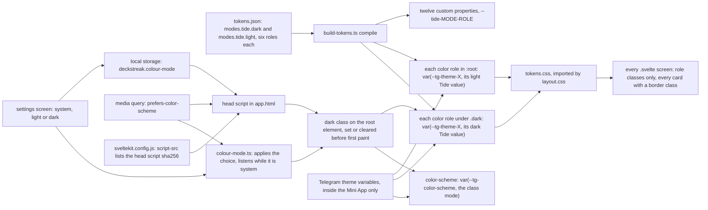
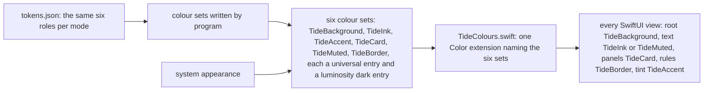

# Tide screens: from the token file to each client, its screens and its modes

Kind: data flow. For SPEC-593, decided by ADR-615 (every screen reads the Tide roles) and ADR-616
(one colour-mode rule per client). It extends `docs/schematics/tide-tokens.md`, the token flow both
apps copy. Paths are read at the dev commit SPEC-593 is cut on.

## The web app

Outside Telegram no `--tg-theme-*` variable is set, so every role takes its Tide fallback: the
light value from `:root`, or the dark value once the root element carries `dark`. Inside the Mini
App the Telegram variables win in both rules, so the chat theme keeps painting every role and
`--tg-color-scheme` keeps setting the scheme.

## The iPhone and iPad app

No view and no property list sets a colour scheme, so the system appearance picks each set entry.

## The tests that hold each edge

| edge | test |
|---|---|
| `tokens.json` to the twelve custom properties and the per-mode fallbacks | `web/app/src/lib/design/tokens.test.ts` |
| every declared pair at its contrast bar, both modes | `web/app/src/lib/design/tokens.test.ts` |
| `tokens.json` to the six colour sets | `scripts/tests/test_tide_tokens.py` |
| every screen class a declared role, every card with a border class | `scripts/tests/test_tide_screens.py` |
| the head script mode and its listed hash | `web/app/src/lib/settings/colour-mode.test.ts` |
| every view through the Tide extension, and no scheme override | `scripts/tests/test_tide_native.py` |
