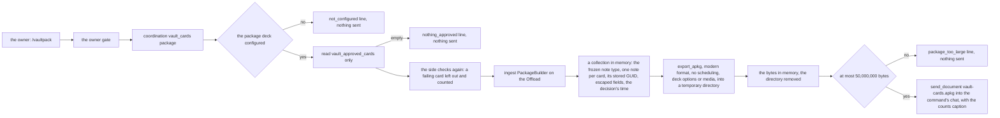
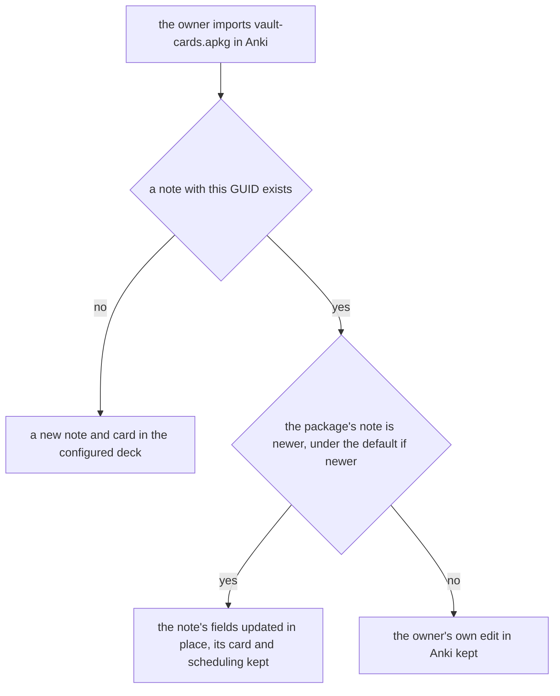
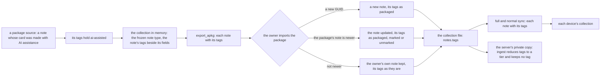
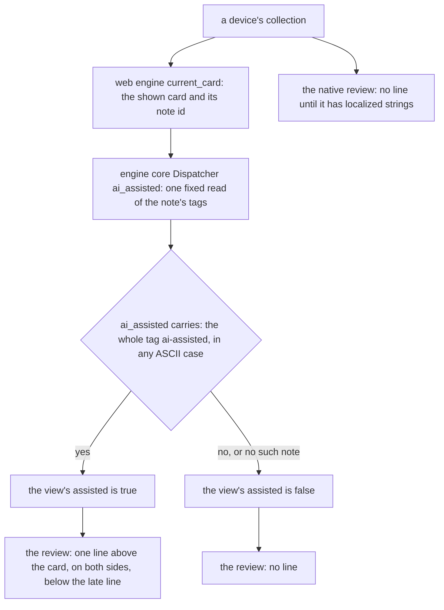
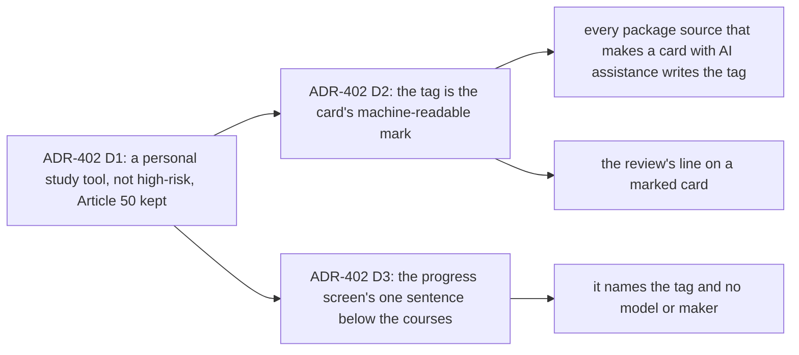

# Schematic: the vault-card package, from the approved cards to the owner's chat

Kind: data flow. Read at DeckStreak `dev` a4036b3 (ADR-006, ADR-009, ADR-058,
`docs/schematics/data-flow.md`, `docs/schematics/engine-pin-lifecycle.md`,
`docs/schematics/bot-update-loop.md`, `docs/schematics/notification-router.md`), and at the engine's
pinned fork `57382da` for the export and the importer it relies on. Added by SPEC-151 (ADR-151,
ADR-152), after SPEC-150's `vault-card-candidate-lifecycle.md`. It adds to `data-flow.md` one
outbound file, sent as a command reply; it adds no write to the owner's collection or its copy, and
it rewrites no accepted schematic.

## The build and the send

The package exists in memory and in that one document. No route of the API serves it, no job builds
it, and the log lines along this path carry counts and outcome words only.

## What the owner's import does

Each note's time is the owner's decision (ADR-151), so a package re-sent without a new decision never
overwrites an edit the owner made in Anki, and an approved edit does update the note. The import is
the owner's act; DeckStreak writes no Anki collection but the in-memory one it builds the file from
and the export's own temporary copy of it, which the engine removes.

## The ai-assisted marker, from the package source to each card view

Kind: data flow. Added by SPEC-388 (ADR-402), read at DeckStreak `dev` `3ca06142`. It adds no
outbound file, no write and no store. It draws how one tag, `ai-assisted`, rides in a field every
note already has, its tags, from the package source to each client's card view, and where ADR-402
and the course sentence bind it. The tag sits in the note, not in the note type, so the frozen note
type and the package's shape above are unchanged.

### From the source to every collection

The engine carries the tag on every edge of this figure: export, import, update, the collection
file and sync are the engine's own, and no DeckStreak code reads or writes the tag on them. SPEC-388
A7 to A9 drive those edges end to end. Ingest's card read already reads `notes.tags`
(`crates/ingest/src/reader.rs:41-44`) and keeps only the tier it reduces them to (`:126-128`,
`:308`), so the server stores no marker.

### From a collection to each card view

| layer | where | what it does with the tag |
|---|---|---|
| the rule | `crates/engine-core/src/ai_assisted.rs` (added) | `MARKER` and `carries`: a whole tag, without regard to ASCII case |
| the read | `crates/engine-core/src/dispatch.rs` (`Read`, `query`, `Dispatcher::ai_assisted`) | one fixed statement for one note's tags; a note the collection lacks reads unmarked |
| the view | `crates/web-engine/src/wasm.rs` (`current_card`) | the key `assisted`, from the core's read of the shown card's note |
| the page's type | `web/app/src/lib/engine/protocol.ts` (`CardView`) | `assisted: boolean` |
| the line | `web/app/src/lib/study/ReviewScreen.svelte` | `study_ai_assisted`, below the late line, above the card |
| the course sentence | `web/app/src/routes/progress/+page.svelte` | `progress_ai_assisted`, once, below the course list |
| the native review | the native app | nothing yet: it holds no localized strings (#738) |

### Where the decisions bind

ADR-402 D1 binds the whole figure: the purpose is one learner's own study, so the tag is a fact
shown to that learner, never a grade or a filter for anyone else. D2 binds the source: a source
that makes a card with AI assistance writes the tag on its note, and the package builder, when it
is built, writes it too (#65). D3 binds the one sentence, `Cards made with AI assistance carry the
tag ai-assisted.`, to the progress screen, the one screen that lists the learner's courses.
