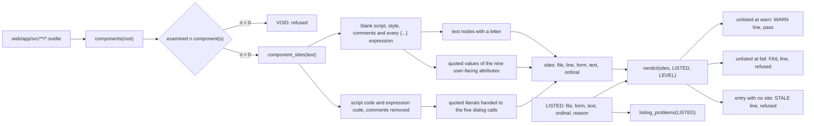
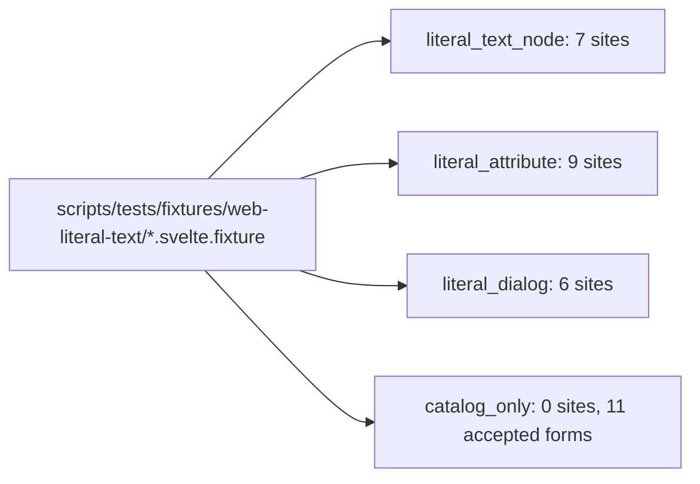

# The web literal-text census

SPEC-653 and ADR-675. One standard-library module, `scripts/tests/test_web_literal_text.py`,
reads every web component as text and reports each user-facing text written as a literal instead
of drawn from the message catalogs.

## Data flow

## Planted components

Each planted line carries a `planted:` comment and each control an `accepted:` one; a test checks
that the reported lines are exactly the planted lines.
