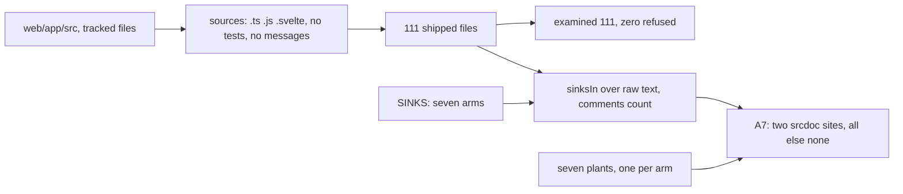
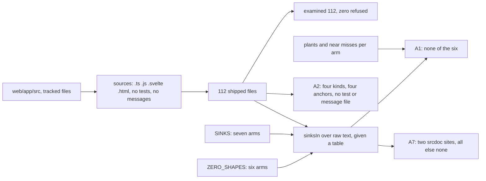
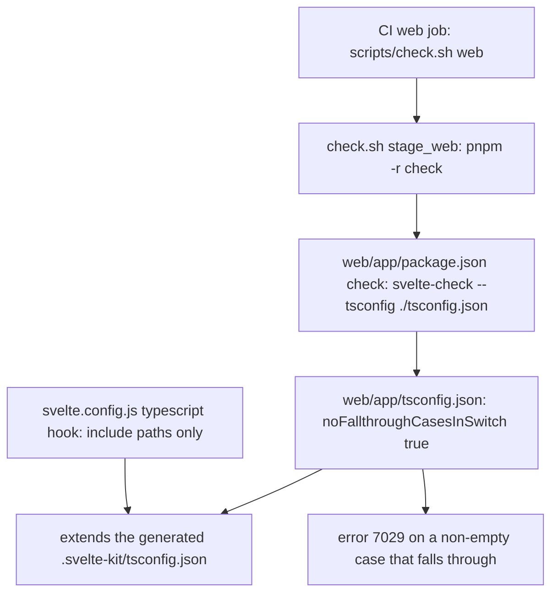

# Schematic: the web sink census and the type check's fall-through flag

SPEC-425 (ADR-439). A data-flow schematic of the card sink census before and after this delivery
(its walk, its arms and its examined count), and of the chain through which the Mini App's type
check reads the fall-through flag. Every `path:line` is read at dev `ac7ebd75`.

## 1. The census before

`web/app/src/lib/card/card-sinks.test.ts` holds one table of seven arms (`:16-27`) and one test,
SPEC-341's A7 (`:59-95`). Its walk, `sources` (`:46-56`), reads every `.ts`, `.js` and `.svelte`
file under `web/app/src` except a `.test.` or `.spec.` file and the generated messages directory:
111 tracked files. `examined` (`:39-43`) prints the count and refuses zero. The expected census
holds two `srcdoc` sites, `CardFrame.svelte` and `frame-host.ts` (`:68-71`), and none of the other
six arms.

The page shell `src/app.html` is shipped and unread. No arm reads code run from text, a blank
target, a wildcard post or a script URL.

## 2. The census after

The walk gains `.html`, so it reads 112 tracked files, `src/app.html` included. A second table,
`ZERO_SHAPES`, holds six arms, read by the same matcher, which now takes the table it applies.
Two new tests sit in their own `describe` block beside A7: A1 holds the six arms at none and
proves each against its plants and near misses, and A2 holds the walk by its kinds and anchors.
A7 keeps its table, its plants and its expected census, and reads the widened walk.

| arm | table | held at | proved by |
|---|---|---|---|
| `{@html`, `innerHTML=`, `outerHTML=`, `insertAdjacentHTML(`, `document.write(`, `message listener` | `SINKS` | none | SPEC-341 A7's plants |
| `srcdoc` | `SINKS` | two sites | SPEC-341 A7's plants |
| `eval(`, `new Function(`, `string timer`, `blank target without rel`, `postMessage to '*'`, `javascript: URL` | `ZERO_SHAPES` | none | SPEC-425 A1's plants and near misses |

The four anchors of A2, one per kind: `src/app.html`, `src/lib/card/CardFrame.svelte`,
`src/lib/card/frame-host.ts`, `src/lib/card/policy.js`.

What the walk leaves out on purpose: the planted card harness under `web/app/tests-card`, which
holds a blank target, two wildcard posts and a script URL as its proofs; the tests under
`web/app/src`, one of which names the `javascript:` scheme to prove its refusal; and the build
configs, which never reach the page.

## 3. Where the type check reads the flag

The flag sits in the app's own config. Each node below is a link A3's test reads from the tree; the
CI job's stage list is held by `scripts/tests/test_ci_workflows.py`.

| link | read at | held by |
|---|---|---|
| the web stage runs the type check | `scripts/check.sh:160` | A3; row S42504 |
| the type check reads the app's own config | `web/app/package.json:12` | A3; row S42503 |
| the app's config sets the flag | `web/app/tsconfig.json`, after `:12` | A3; rows S42501, S42502 |
| the CI job runs the web stage | `.github/workflows/ci.yml:253` | `test_ci_workflows.py`'s stage layout |

The app's config overrides the generated parent, whose in-tree source, the `typescript.config`
hook in `web/app/svelte.config.js:38-50`, pushes include paths and sets no option. Before this
delivery the type-checked tree holds five `switch` statements and 0 fall-throughs, so the flag
refuses nothing today and refuses the first fall-through a change adds.
