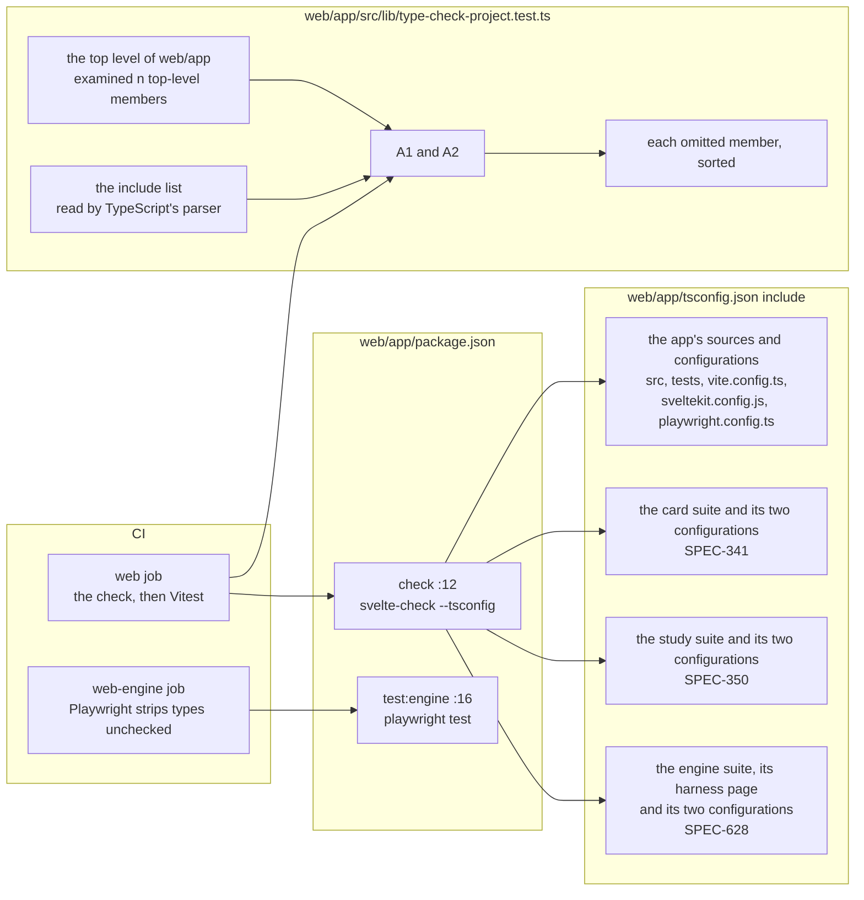

# The web type-check project, and the census that holds it

Kind: component and data flow. Read at `877b3dfbebd32768f61b817a36e70d519c81d432`. The project of
SPEC-628 (ADR-650): what the web app's type check reads, which jobs run the check and the browser
suites, and what the census reads and names.

## Component and data flow

## What each part holds

- The check reads only the files the `include` list names, so a browser suite the list leaves out
  is never type-checked: Playwright runs it with its types stripped.
- The census selects each top-level directory named `src`, `tests`, `tests-<name>` or
  `<name>-harness`, and each top-level `.ts` or `.js` file that is no declaration file (SPEC-628
  R3), and names, sorted, each one the list does not name. A1 reads it over the real listing, A2
  over planted ones.
- `web/app/scripts` stays outside both: its scripts run in Node beside the app.
