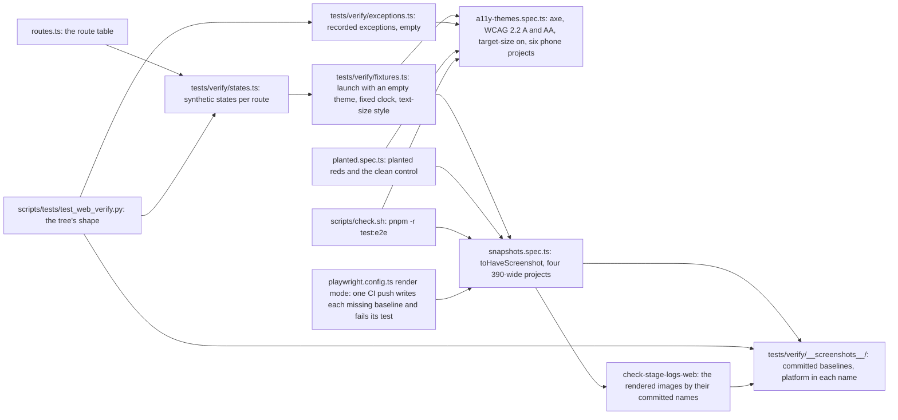

# Web verification: where each baseline and fixture lives, what each gate reads and compares, and on which runner

Decided by ADR-662 for SPEC-639. Measured at dev `36efa139`.

## 1. The flow

## 2. Where each thing lives and who reads it

| step | file | read by | compared against | runner |
|---|---|---|---|---|
| route table | `web/app/src/lib/routes.ts` | both specs, `test_web_verify.py` | the screens under `src/routes` (kept `a11y-coverage.test.ts`) | CI web job; a local machine for the Python check |
| states | `web/app/tests/verify/states.ts` | both specs | every route has `first`, `empty`, `error`; review adds `question`, `answer` | CI web job |
| theme | `fixtures.ts` (empty launch theme) | `a11y-themes.spec.ts` | the root background equals the Tide background of the scheme | CI web job |
| axe | `a11y-themes.spec.ts` | axe in Chromium | no violation under the five WCAG tags; `target-size` among the rules run | CI web job |
| exceptions | `web/app/tests/verify/exceptions.ts` | `a11y-themes.spec.ts`, `test_web_verify.py` | each entry names rule, route, reason, issue | both |
| snapshots | `snapshots.spec.ts` | the runner's screenshot assertion, no margin (`threshold: 0`, `maxDiffPixels: 0`) | `__screenshots__/{projectName}/{testFilePath}/{arg}-linux.png` | CI web job only |
| render | `playwright.config.ts`, its render mode | the runner's screenshot assertion with `updateSnapshots: 'default'` | none: each missing baseline is written under `CHECK_LOG_DIR/baselines/` by its committed name, and its test fails | CI web job, one push |
| kept audit | `web/app/tests/a11y.spec.ts` | axe in Chromium, desktop | Telegram's palettes, unchanged | CI web job |

## 3. Tests per step, with reds and rows

| step | criterion | test | red (how it runs) | row |
|---|---|---|---|---|
| projects | A1 | `test_web_verify.py` matrix tests | locally, over a fixture config with one project dropped | S63901 |
| states | A2 | `test_every_route_has_its_learner_states` | locally, over a fixture state table missing a route | S63902 |
| synthetic | A3 | `test_a_planted_real_looking_fixture_value_is_refused` | locally, over a planted email-shaped value | S63903 |
| axe ran | A5 | `test_a_planted_audit_without_target_size_is_refused` | locally, over a planted spec without the option | S63904 |
| axe tags | A5 | `test_a_planted_audit_missing_a_wcag_tag_is_refused` | locally, over five planted specs, each missing one tag | S63910-S63914 |
| axe refuses | A6 | `planted.spec.ts`, the pair and the target | CI by name: push 1's planted pair is at full contrast and its planted target at full size, so each refusal test fails as unrefused; the plant commit turns them green on the last push | none (test-only) |
| theme refuses | A7 | `planted.spec.ts`, the host palette | CI by name: push 1's planted launch carries the empty theme, so the refusal test fails as unrefused; the plant commit turns it green on the last push | none (test-only) |
| axe on Tide | A4 | `a11y-themes.spec.ts` | CI by name, green; its red is A6's: the planted tests run this audit's tags and `target-size` at a phone size | none (test-only) |
| snapshots | A8, A9 | `snapshots.spec.ts`, `planted.spec.ts` | CI by name: push 1 has no baseline, so each snapshot test fails as missing; the render push writes each one under the stage logs and fails its test; the last push compares with the committed baselines | none (test-only) |
| baselines present | A10 | `test_a_planted_missing_baseline_is_refused` | locally, over a fixture tree with one baseline removed | S63905 |
| exceptions | A11 | `test_a_planted_bare_disable_is_refused` | locally, over a planted `disableRules` outside the table | S63906 |
| no margin | A13 | `test_the_screenshot_expectation_allows_no_margin`, `test_a_planted_screenshot_margin_is_refused` | locally, over three planted configs, each with one margin | S63907-S63909 |
| kept check | A12 | `a11y-coverage.test.ts` | unchanged and green | none |

## 4. Not measured

How the CI runner rasterises the bundled face against another machine, how a phone's text setting reaches the Mini App's web view, and how a device reads a screen.
