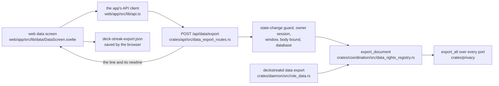
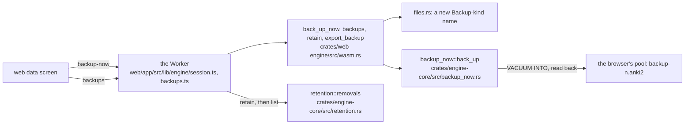
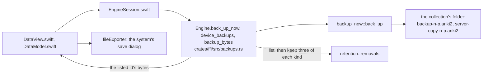

# Your data and this device's backups: the data flow (SPEC-516, ADR-534)

Three flows leave the data screens. Each arrow is a call; each box names the file that makes it.

## The JSON copy (R2, R3)

The route and the host's role call one function, so the bytes the browser saves are the bytes the
host writes (D2). The native screen has no owner session yet, so it names the web screen and
`/export` instead (D7).

## Back up now and the list, on the web (R4)

## Back up now, the list and the export, on iPhone and iPad (R5)

## The server's backup age (R6)

The web screen reads `GET /api/sync/snapshot` (SPEC-377 R12): an age when found, "no backup yet"
when not found, and "unknown" for `{"found": null}`, a refusal or a failed read. The native screen
shows "unknown" while it holds no owner session.
